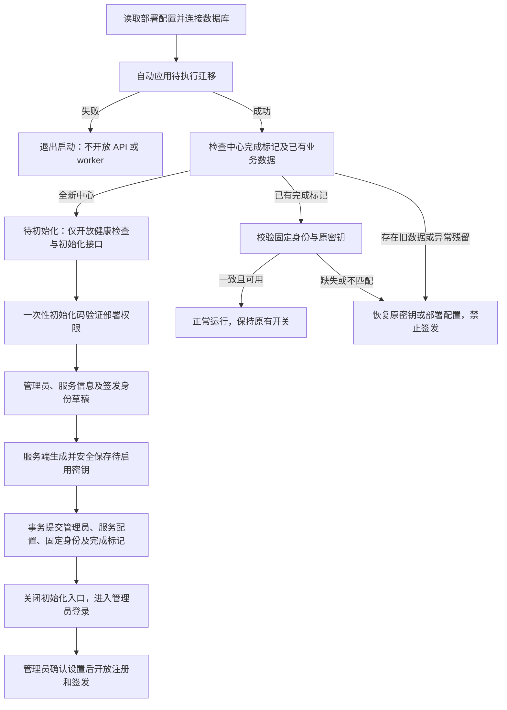

# 身份中心首次启动与 WebUI 初始化设计

文档状态：待实现的业务与交互设计，2026-11-01。配套静态设计为 [a20–a35](gui-design/index.html)，沿用现有浅色、细边框、紧凑表单及 Bootstrap Icons。本文不表示后端接口或 Solid 向导已经实现。

## 1. 目标与边界

后端连接一个已创建但没有业务表和数据的 PostgreSQL 数据库时，自动执行表结构迁移，然后进入“待初始化”。部署维护者在 WebUI 设置首位管理员账号、密码、公开服务信息及新的签发身份，无须先通过脚本生成管理员密码或 issuer 私钥。

数据库实例和连接、监听地址、允许的管理 Origin、HTTPS、会话及 CSRF 密钥、受保护密钥存储及其解密材料仍属于部署配置。网页不接收数据库密码、不更改迁移、不设置服务器文件路径。后端继续只提供 API；管理前端由独立静态服务提供。

本期支持新建签发密钥；已有中心的密钥恢复继续通过受保护的运维流程完成。私钥不粘贴、不上传到网页，也不返回浏览器。密钥轮换、管理员密码找回、多管理员和旧凭证迁移不在本设计内。

## 2. 启动与服务门禁

| 服务状态 | WebUI 行为 | API 与任务行为 |
| --- | --- | --- |
| 后端未就绪、迁移中或迁移失败 | a28 显示连接不可用、迁移结果未知；提供重新检查 | 迁移提交前不监听业务端口，失败则退出；前端不能声称已知具体迁移错误 |
| `SETUP_REQUIRED` | `/admin`、登录页及管理深链转入 `/admin/setup` | 只开放健康检查、最小初始化状态和受控初始化接口；普通管理登录不可用，业务 API 返回 `503 CENTER_NOT_INITIALIZED`，不启动签发任务 |
| `SETUP_IN_PROGRESS` | 已验证会话恢复同一份草稿，未验证者仍先输入初始化码 | 普通业务继续关闭；页面刷新、后端重启不创建新草稿或新密钥 |
| `INITIALIZED` | `/admin` 进入登录或已登录概览；向导重访显示 a32 | 初始化写入口永久拒绝，按正常会话与业务开关处理；完成页仅允许读取有限时间内本次提交回执 |
| `RECOVERY_REQUIRED` | 通用不可用提示，部署维护者从日志排查 | 有完成标记但密钥丢失、身份不匹配或已有业务残留时，拒绝进入首次初始化；不自动替换密钥 |

`SETUP_REQUIRED` 必须同时满足：没有中心完成标记、没有固定签发身份，也没有既有成员、申请、签发或正式管理员等业务数据。迁移历史和本设计定义的初始化控制/草稿记录不算已运营数据。不能使用“管理员表为空”或“私钥文件不存在”作为重新开放初始化的依据。状态、草稿和最终提交由数据库中的中心单例记录协调，不由进程内布尔值决定。

已有版本升级时，迁移先将可识别的旧中心标记为已有中心；正式管理员可从已验证的原部署账号和密码哈希迁入，原 issuer 保持不变。无法确定旧数据与原配置一致时进入恢复流程，绝不按新中心开放。升级适配需在实现时明确迁移规则并验证，不将旧中心暴露给首次领取者。

## 3. 部署权限验证

空数据库不代表任意访问者可以创建管理员。后端首次进入待初始化时，以安全随机源生成至少 32 字节的一次性初始化码，写入部署主机上仅服务账号和维护者可读的受保护文件。普通日志仅提示领取位置；不记录码值。容器部署使用受限持久卷；多实例共用同一初始化控制状态及受保护存储。

- 运维在部署主机读取码后，手工输入 a20 的密码型输入框。码不放在 URL、二维码、浏览器持久存储、访问日志或前端资源中。
- 码有效期 30 分钟。后端仅保存校验摘要，验证成功时原子消费；错误与过期使用相同的失败提示，并提供重新获取说明。校验按来源与全局限流，使用常量时间比较。
- 成功后轮换会话标识，建立独立的 HttpOnly 初始化 Cookie，生产配置 Secure 与 SameSite。写请求同时校验允许的 Origin 和初始化 CSRF Token；首次验证也校验 Origin 和预验证 CSRF Token。
- 初始化会话空闲 30 分钟失效，绝对有效期 2 小时；它不能调用正常管理员接口。正常管理员 Cookie 也不能代替部署权限验证。
- 会话失效显示 a29。维护者通过受限运维命令重新签发初始化码，旧码立即作废；重新验证恢复原草稿。签发新码不会新建中心、清空草稿或改变签发密钥。
- 初始化完成后，所有剩余码和初始化会话失效；清理码文件。任何新签发码的运维操作也必须拒绝已初始化中心。

未验证的状态查询仅返回是否需要初始化及可公开的就绪状态，不暴露管理员账号、草稿、组织、指纹、密钥路径或故障细节。初始化相关响应设置 `Cache-Control: no-store`，页面不接入会收集表单值的遥测。

## 4. 向导步骤与字段

向导使用与管理员登录一致的品牌栏和页脚，不显示正常后台侧栏或虚构管理员头像。主区域宽 960 px，左侧表单、右侧启动与业务状态，顶部五步进度。每一步只有明确的主要操作；新中心的注册和签发状态始终可见。

| 步骤 / 路由 | 字段、动作与反馈 | 继续条件 |
| --- | --- | --- |
| 部署验证 `/admin/setup` | 自动确认数据库已就绪，输入一次性初始化码，点击“验证并开始”；a20 | 服务状态允许且验证成功 |
| 管理员 `/admin/setup/admin` | 管理员账号、密码、确认密码；a21，校验错误 a34 | 服务端校验并保存密码哈希成功 |
| 服务信息 `/admin/setup/service` | 展示名、公开服务地址、可选说明及联系地址；a22 | 地址及长度符合现有服务设置规则，草稿修订保存成功 |
| 签发身份 `/admin/setup/issuer` | 输入组织身份字符串，点击“生成签发密钥”；a23 → a35 → a24 | 服务端确认密钥已安全持久化，可恢复同一公开身份 |
| 确认完成 `/admin/setup/review` | 汇总账号、服务信息、组织、公钥指纹及关闭的业务开关；勾选确认，点击“完成初始化”；a25 | 草稿完整、密钥可读取且身份一致、修订未变化 |
| 完成 `/admin/setup/complete` | 显示本次回执，提示登录、配置建议、开放服务及备份；a27 | 已确认最终事务成功；不自动登录管理员 |

管理员账号去除首尾空白后须为 3–128 个字符，不限定为邮箱；密码按原文处理，不裁剪或静默截断，长度 12–128 个 Unicode 字符，允许空格、粘贴和密码管理器，不要求特定字符组合。密码框默认遮盖并支持可访问的显示切换，分别使用 `username` 和 `new-password` 自动填充语义。确认密码仅在前端比较，不提交或保存。账号和密码仍由后端权威校验；字段错误紧邻输入，焦点移到首个错误。

服务端收到密码后立即使用独立盐计算 Argon2id 哈希，草稿只保存哈希；返回值只包含 `password_configured=true`。切换步骤后清空前端密码信号，返回管理员页不回填密码。已保存密码可显示“密码已设置”；只有选择更改密码时才要求重新填写两次。修改账号可保留已保存密码哈希。

公开服务地址使用根路径 HTTPS，loopback 允许 HTTP，不含凭据、查询或片段，与现有 `public_base_url` 约束一致。它不修改部署层的监听、代理或允许的管理 Origin。组织身份字符串遵循 SDK 校验；它参与 `IssuerPublic` 和指纹，初始化后只读。服务展示名之后可以修改。

初始配置固定为：注册关闭、签发关闭、待审有效期 7 天、建议轮询间隔 5 秒、Claims 默认建议为空。两项业务开关在向导里只读，实际前端使用 disabled 控件或状态文本。管理员登录后在现有服务设置和 Claims 建议页面调整，不插入绕过人工核验的示例 Claim。

向导跨步跳转时由后端完整性决定可达步骤；直接访问确认页不会跳过密码或密钥准备。草稿保存成功后才前进，保存中禁用重复操作。支持键盘、关联 label、错误说明及状态播报；窄屏将说明列放到表单下方，保证字段与操作可滚动访问。PNG 按现有 1440 × 1000 设计画布导出。

## 5. 密钥生成、保管与固定身份

生成动作由后端调用现有 issuer SDK，以安全随机源创建新 issuer，得到私钥备份和 `IssuerPublic`。返回浏览器的仅有公开身份、组织、完整 issuer 指纹、算法/协议和准备状态；密钥文件路径及原文永远不在响应中。“下载公开身份”只输出 SDK 的公开 `IssuerPublic` wire JSON，不提供私钥下载按钮。

密钥存储位置由部署配置给定。服务端采用已配置的秘密存储，或将 SDK 明文备份以认证加密写入受限持久目录；解密材料来自部署秘密且与密文分离。写入必须完成安全落盘、重新读取和公私钥匹配校验后，才能把候选密钥标为 `READY`。原始备份只在服务端必要的内存范围中存在并及时清理；不以数据库 JSON、临时 Web 文件或日志保存明文。

候选密钥关联中心草稿、组织身份、生成操作号和存储引用，使用不可覆盖的唯一位置。生成请求携带幂等键，刷新和超时后按同一操作查询：已经安全保存的候选密钥复用；状态不确定时先探测原存储，不能盲目重新生成。未持久化的失败结果可丢弃后在原操作内重试，不曾展示为“已生成”。a35 表示服务端处理中，a30 表示尚未形成可用密钥，不允许继续。

候选密钥生成后，组织字段只读；返回服务信息编辑不会改变密钥。若维护者确实要更改组织身份，需在受控运维流程中显式废弃未启用草稿；本期向导不提供“重新生成”或“替换当前中心身份”操作。最终提交及之后的正常启动必须将真实公开身份与数据库固定的完整身份/指纹匹配，不能只比较展示名。

完成页要求维护者备份密钥存储及其解密材料，使用既有受保护运维流程操作。浏览器未获得私钥，不能勾选“已下载私钥”或宣称完成备份。更换设备、恢复数据库或密钥丢失都不得自动新建 issuer 冒充原中心。

## 6. 草稿、最终提交与恢复

初始化草稿属于中心级单例，包含非秘密服务信息、账号、密码哈希、候选密钥引用、公开身份、修订号及生成/提交操作状态。草稿通过 PostgreSQL 持久化，默认有效期为最后一次有效保存后 24 小时；每次请求校验服务端时间。原始密码、初始化码及密钥原文不进入浏览器 localStorage/sessionStorage、URL 或客户端缓存。

多个已验证页面操作同一份草稿，每次写入携带期望修订号和幂等键。修订冲突返回 a33，保留当前页面非秘密输入，用户记录后加载最新草稿再合并；密码原文不持久保存以帮助合并。草稿过期后先核对是否存在已提交结果，若确实未完成，由维护者显式确认废弃并新建草稿；不可静默生成另一个签发身份。

最终提交采用以下顺序：

1. 确认候选密钥已安全落盘，重新读取并校验完整公开身份。密钥的持久准备在数据库最终事务之前完成，使用稳定引用，不依赖提交之后再重命名文件。
2. 在 Serializable 事务中条件更新中心单例，检查未初始化、草稿修订及完整性，创建唯一正式管理员、服务设置及 Claims 建议初始修订，固定候选密钥引用与公开身份，写入完成标记、初始化审计及幂等结果。
3. 事务失败全部回滚，候选密钥保持未启用，可复用重试；没有“管理员已生效但中心尚未初始化”的中间状态。两个实例/会话并发提交只允许一个成功。
4. 事务成功后正常业务读取到完整配置。签发 worker 只有初始化已完成、身份校验通过且签发开关开启时才执行。其他实例观察同一数据库状态并加载固定密钥，不沿用启动时的待初始化缓存。
5. 撤销所有初始化权限，完成页凭仅可读本次结果的短期回执显示结果；回执 Cookie 与管理员及初始化会话隔离，不能修改草稿或调用管理 API，有效期 10 分钟。之后进入正常登录；账号密码验证后才创建管理员会话。

文件存储与 PostgreSQL 不具备联合事务。本设计采用“先持久准备候选密钥，再以数据库原子引用启用”的边界。崩溃后的无引用候选密钥由受限清理任务回收，清理前再次检查固定引用和操作租约；正式引用的密钥永不按草稿过期删除。提交后密钥不可读进入恢复故障，不撤销完成标记或重新开放向导。

提交中展示 a26；超时或断网展示 a31，先查询原提交操作，不能直接提示失败或引导重新生成。若提交已成功，返回完成回执或登录入口；未成功则恢复草稿，以原幂等键重试。提交响应丢失但初始化会话已撤销时，短期操作回执仍可查询结果；回执也丢失则只显示已初始化并进入登录，不公开账号或草稿。

## 7. 拟新增 HTTP 契约

以下为设计契约，不改动当前已生成的 HTTP 类型。实现时将共享 DTO 加入 `crates/identity-api` 并重新导出 TypeScript，继续使用 Salvo 会话/CSRF 中间件和 Toasty 类型化模型。

| 方法与路径 | 权限 | 语义 |
| --- | --- | --- |
| `GET /api/v1/setup/status` | 公开 | 仅返回 `setup_required`、`setup_in_progress` 或 `initialized`；不提供草稿细节 |
| `GET /api/v1/setup/csrf` | 来源校验 | 建立预验证 CSRF 上下文；后续绑定初始化会话 |
| `POST /api/v1/setup/session` | 一次性码 + CSRF + Origin | 原子消费码，轮换会话，返回可恢复步骤；失败不泄露账号或草稿 |
| `DELETE /api/v1/setup/session` | 初始化会话 + CSRF + Origin | 退出初始化会话，不废弃草稿 |
| `GET /api/v1/setup/draft` | 初始化会话 | 返回服务、账号、密码是否已设置、修订及公开密钥状态；不返回哈希、码或私钥 |
| `PUT /api/v1/setup/draft/admin` | 初始化会话 + 写保护 | `expected_revision`、账号、可选新密码、幂等键；首次保存必须包含密码 |
| `PUT /api/v1/setup/draft/service` | 同上 | 带修订保存公开服务信息；不可设置注册/签发为开启 |
| `POST /api/v1/setup/key-generation` | 同上 | 组织身份 + 修订 + 幂等键；返回生成操作号，异步处理返回 `202` |
| `GET /api/v1/setup/key-generation/{operation_id}` | 初始化会话 | 查询 `PENDING / READY / FAILED` 与可公开错误、就绪后公开身份；仅限本中心草稿 |
| `POST /api/v1/setup/complete` | 初始化会话 + 写保护 | 草稿 ID/修订、候选密钥 ID、身份确认、幂等键；不重复传密码或私钥；仅事务提交成功才返回完成 |
| `GET /api/v1/setup/operations/{operation_id}` | 初始化会话或本次只读回执 | 查询同一次最终提交状态，完成后只读，不具有任何初始化写权限 |

最终提交发出前建立不可猜测的本次操作回执，使用独立的 HttpOnly Cookie 绑定。回执仅授权一个操作、有效期 10 分钟；响应只包含该操作状态与有限完成摘要。路径里的操作 ID 本身不是访问凭证。

所有写请求使用相同幂等键重试相同内容，异内容同键冲突。密码请求的幂等比较使用独立部署秘密计算 HMAC 摘要，不能持久化密码原文或可离线猜测的裸摘要。最终状态与幂等结果在同一事务中提交。正常管理员登录和初始化业务的错误语义保持区分：

| 条件 | 状态码 / 错误码 | 页面反馈 |
| --- | --- | --- |
| 尚未初始化而调用普通业务 | `503 CENTER_NOT_INITIALIZED` | 钱包提示中心尚未开放；后台转入向导 |
| 初始化码错误、已用或过期 | `401 SETUP_VERIFICATION_FAILED` | 重新输入或向维护者领取新码；不泄露哪部分匹配 |
| 初始化会话失效 | `401 SETUP_SESSION_EXPIRED` | a29，重新验证后恢复草稿 |
| Origin / CSRF 不符 | `403` | 操作未执行，重新加载验证上下文 |
| 字段错误 | `422 VALIDATION_FAILED` | a34 等字段级反馈，保留其他输入 |
| 草稿修订变化 / 幂等键异内容 | `409 SETUP_REVISION_CONFLICT / IDEMPOTENCY_CONFLICT` | a33 或明确操作冲突，禁止静默覆盖 |
| 另一提交完成或向导重访 | `409 ALREADY_INITIALIZED`（写请求） | a32，转正常登录 |
| 草稿过期 | `410 SETUP_DRAFT_EXPIRED` | 验证后说明过期，维护者显式处理，不自动替换密钥 |
| 密钥存储不可用 | `503 KEY_STORE_UNAVAILABLE` | a30，保留草稿和原生成操作 |
| 请求过频 | `429` + `Retry-After` | 禁止立即重试，展示等待时间 |
| 网络中断 / 最终提交超时 | 客户端结果未知 | a31，查询原操作 |

错误只返回用户说明、字段名和追踪 ID；详细存储故障仅在受限日志中记录。审计记录初始化完成时间、操作者类型、正式管理员标识、配置修订及公开身份，不记录密码、哈希、初始化码或私钥。

## 8. 设计稿与验收

| 图号 | 状态 |
| --- | --- |
| a20–a25 | 部署验证、管理员、服务信息、生成前/后签发身份、最终确认 |
| a26–a27 | 提交中、已完成并准备登录 |
| a28–a29 | 后端未就绪、初始化码或会话需重新验证 |
| a30–a31 | 密钥存储失败、最终提交结果未知 |
| a32–a35 | 已初始化重访、草稿修订冲突、密码不一致、密钥生成中 |

配套 [页面结构说明](identity-center-wallet-project-structure.md#75-计划新增首次初始化向导) 明确区分当前页面和拟新增路由。现有登录稿 a01/a18 改为“使用初始化时创建的管理员账号登录”，正常服务设置和只读签发身份页继续沿用。

| 编号 | 场景 | 通过标准 |
| --- | --- | --- |
| BOOT-01 | 完全空库首次启动 | 自动迁移一次后进入待初始化，不要求预置管理员或 issuer 密钥 |
| BOOT-02 | 迁移失败 / 后端离线 | 不开放业务或 worker；前端显示状态未知，无虚假成功或浏览器迁移按钮 |
| BOOT-03 | 未持有初始化码、错误码、过期码、跨站请求 | 不能创建管理员、读取草稿或生成密钥；限流和 CSRF/Origin 生效 |
| BOOT-04 | 密码长度、确认不一致、空值及安全显示 | 字段反馈清晰；后端只保存哈希，返回/日志/浏览器存储不含原文 |
| BOOT-05 | 保存各步骤后刷新或重启 | 会话有效时恢复同一草稿和候选密钥；过期后重新验证可恢复 |
| BOOT-06 | 密钥生成超时、文件写入故障、重复生成请求 | 已就绪身份不改变；故障可查可重试，未安全落盘不能继续 |
| BOOT-07 | 两页面改草稿、两实例同时完成 | 修订冲突不覆盖；唯一正式管理员、唯一固定身份和唯一完成结果 |
| BOOT-08 | 最终事务失败或提交响应丢失 | 无半初始化；先查原操作，复用原幂等键与密钥，不重复创建 |
| BOOT-09 | 初始化完成 | 注册/签发保持关闭，所有初始化写权限失效，需正常管理员登录 |
| BOOT-10 | 已初始化后重启或访问深链 | 保持管理员、固定身份和原开关，向导不可重置 |
| BOOT-11 | 旧数据库、已有业务残留、原密钥丢失或不匹配 | 进入旧中心/恢复分支，不自动生成密钥或开放领取管理员 |
| BOOT-12 | 草稿过期与清理 | 先核对最终结果和正式引用，不删除已启用密钥、不静默换身份 |
| BOOT-13 | 公共接口及导出内容检查 | 无账号、草稿、密码哈希、初始化码、私钥或内部路径泄漏；仅公开身份可下载 |
| BOOT-14 | 初始化后完成原业务闭环 | 管理员开放服务后，钱包添加中心、审批领证与应用证明登录保持原有语义 |

本次交付为文档与静态界面；后续实现需为上述权限、数据库事务、密钥落盘与中断恢复增加真实 API/数据库验收，不能将设计稿的视觉检查当成业务实现测试。
