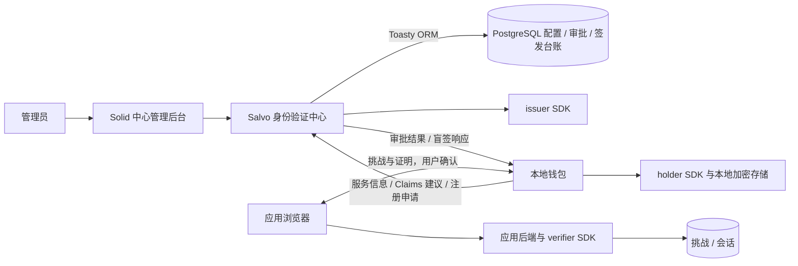
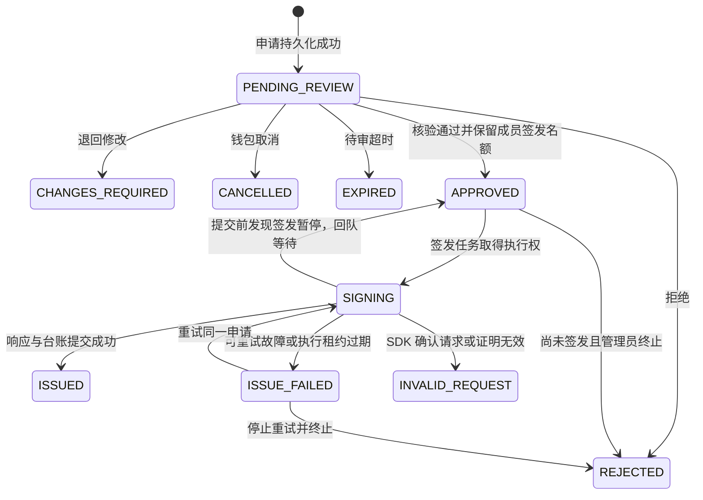
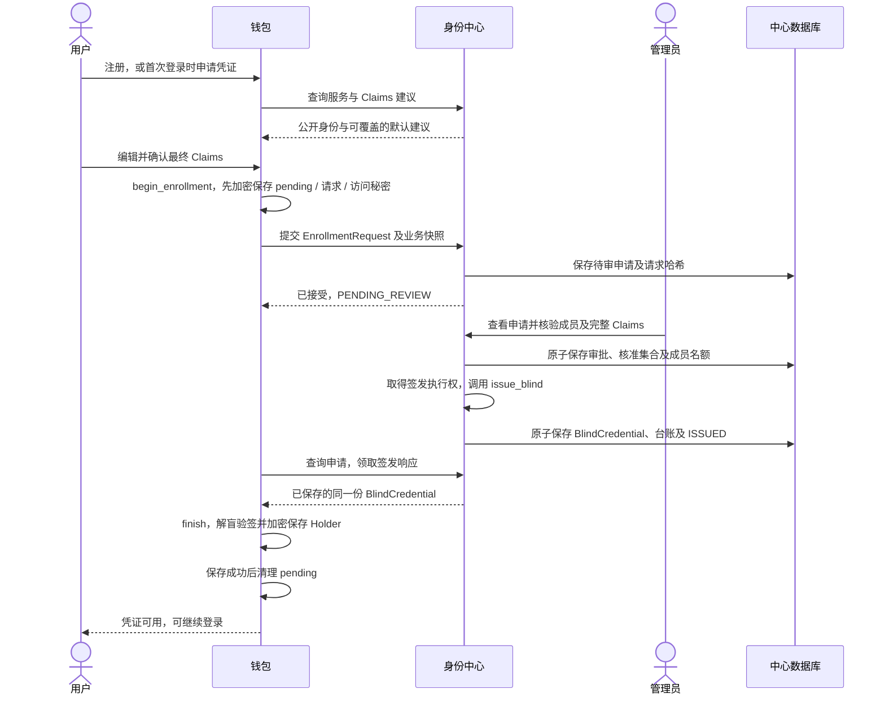
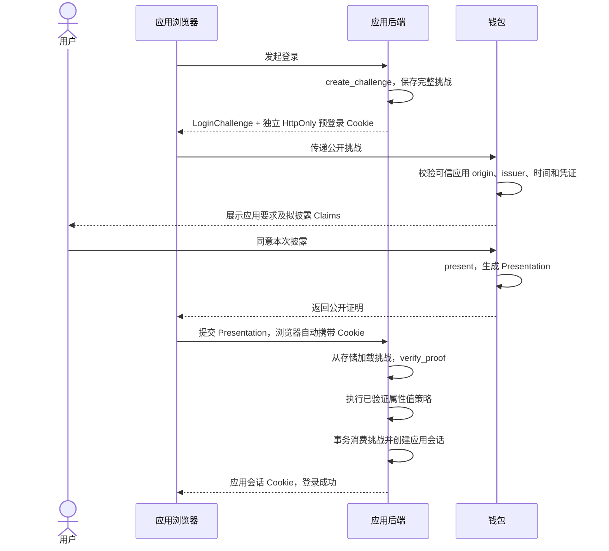

# 身份验证中心与钱包业务流程设计

文档状态：待实现的业务设计。本文不表示下述页面、HTTP 接口或持久化能力已经存在。

编写日期：2026-10-30。基线：当前 SDK v0.1 / 密码学协议 v1。

## 1. 目标、范围与现状

在现有 SDK 上建设可实际操作的身份验证中心和本地钱包，完成“配置服务 → 钱包申请注册 → 管理员审批 → 中心盲签发 → 钱包保存凭证 → 使用凭证登录应用”的闭环。

本次需求中的“登录流程中完成审批并签发凭证”按以下业务含义设计：用户首次登录、尚无凭证时，可以在当前登录任务中进入注册领证；管理员审批后，中心签发凭证给钱包；钱包领证成功后继续应用登录。已有凭证的后续登录直接使用证明，无须重复注册、重复审批或联系中心。管理员登录管理后台是另一种独立会话。

首期交付主体为 `issuer-service`、`issuer-service-webui` 和 `wallet`。应用侧依照现有 verifier SDK 接入，提供最小登录演示作为闭环验收入口；本文定义其对接行为，不建设完整的应用账号管理平台。

| 组件 | 当前仓库状态 | 本设计增加的业务能力 |
|---|---|---|
| `sdk/core` | 已实现协议消息、Claims、编码及资源限制 | 沿用；业务配置放在协议消息之外 |
| `sdk/issuer` | 已实现核准属性匹配和盲签发 | 由中心封装身份核验、审批、幂等和签发台账 |
| `sdk/holder` | 已实现申领、解盲验签、凭证备份和出示 | 由钱包封装表单、加密存储、恢复和用户同意 |
| `sdk/verifier` | 已实现挑战、客户端绑定和证明验真 | 由应用封装挑战存储、权限判断和会话事务 |
| `issuer-service` | 入口仍为模板；已依赖 issuer SDK | 服务配置、管理员会话、申请 API、审批及签发 |
| `issuer-service-webui` | Solid/Vite 模板 | 设置页面、审批列表、申请详情和签发记录 |
| `wallet` | Tauri/Solid 模板；已依赖 holder SDK | 中心连接、Claims 编辑、申请、领证及登录授权 |

业务流程以本文为准；密码学类型和编码以 [SDK API](sdk-api.md)、[协议补充](../sdk/PROTOCOL.md) 为准。业务 HTTP API 的 `/api/v1` 与密码学协议 v1 分别版本化。

当前后端模块、Solid 前端、钱包 IPC、页面路由及实际目录详见 [项目结构与模块说明](identity-center-wallet-project-structure.md)。

### 1.1 首期明确采用的规则

1. 一个中心部署绑定一个签发身份 `IssuerPublic`；钱包数据结构按 issuer 隔离，允许连接不同中心。
2. 注册采用人工审批。管理员依据可信资料核验申请人及其完整 Claims，然后批准或拒绝。
3. 中心提供可查询的 Claims 建议配置。钱包默认加入启用的建议项，用户可以修改、删除和增加字段，甚至提交空集合。
4. 建议配置不构成字段白名单、强制必填规则或可信属性来源。申请合法不等于应获签发。
5. 一次申请固定一份完整 Claims；管理员不能直接改完原申请再签。需要改动时退回，由钱包生成新申请。
6. 中心签发的是 `BlindCredential`；钱包解盲并验签、持久化 `Holder` 后，才展示“凭证可用”。
7. 同一中心内，一个经核验的成员首期只允许一份已签发注册凭证；自动补发、属性续签、钱包迁移另行设计。
8. 领证后，应用验证不依赖中心在线。中心暂停注册或停止签发不自动使已有凭证失效。

### 1.2 本期边界

不在本期引入 OIDC/OAuth 兼容、短信或邮件验证码、外部成员目录同步、多租户、自动审批、链上账户、资产管理、凭证撤销、凭证有效期、密钥轮换迁移或保留原应用身份的重新签发。

中心的“注册账号”、钱包持有的凭证、应用内身份和管理员账号是不同对象。钱包不是加密货币钱包；注册成功也不自动创建某个应用的登录会话。

### 1.3 技术栈约定

| 层次 | 技术选型 | 应用范围 |
|---|---|---|
| 服务端数据库 | PostgreSQL | 保存服务配置、Claims 建议、管理员会话、申请、审批、签发台账、任务及审计等服务端业务数据 |
| 后端 Web 框架 | Salvo（Rust） | 身份中心 HTTP API、管理会话、鉴权、请求校验及业务服务接入 |
| ORM | [Toasty](https://github.com/tokio-rs/toasty) | 服务端数据模型及 PostgreSQL 数据访问；落实本文要求的事务、唯一性和条件更新语义 |
| 前端框架 | Solid | 身份中心管理页面与钱包界面，沿用现有 Vite 工程 |
| 钱包桌面运行时 | Tauri / Rust | 本地加密存储、操作系统安全存储和 holder SDK 调用 |

PostgreSQL 保存服务端业务数据，钱包的用户秘密、pending 和 holder 按第 12.2 节在本地加密保存。Solid 页面通过后端 API 或 Tauri IPC 操作业务，不直接连接数据库。具体依赖版本、Toasty 模型映射及数据库迁移方案在后续实现设计中确定。

## 2. 参与者、责任与信任关系

| 参与者 | 主要操作 | 持有的数据与权限 |
|---|---|---|
| 申请人 | 选择中心、编辑 Claims、提交申请、确认披露 | 本地钱包的使用权限 |
| 钱包 | 生成申领请求、保存 pending、领证、生成登录证明 | 用户秘密、盲因子、完整凭证；不上传这些秘密 |
| 中心签发服务 | 保存申请、执行审批状态、调用 SDK、返回签发结果 | issuer 私钥、审批记录、明文申请 Claims、盲签响应 |
| 中心管理员 | 登录后台、配置服务、核验身份、审批和重试签发 | 管理权限；不能获得用户秘密 |
| 应用后端 | 创建挑战、验证证明、执行业务策略并创建会话 | 可信 issuer 公钥、完整挑战、应用内 subject 和会话 |
| 应用浏览器页面 | 发起登录、与钱包交换公开消息、提交证明 | 预登录 Cookie 和应用会话 Cookie；钱包不读取 Cookie |

中心可以看到本次申请的全部 Claims。选择披露保护发生在后续钱包向应用出示时，不能向用户承诺“中心看不到申请属性”。

中心的审批记录可以关联申请人与签发事件；应用正常登录不上传注册申请 ID、成员编号或完整凭证。用户主动披露唯一姓名、成员编号等属性仍可能造成关联。

## 3. 业务对象与状态

### 3.1 对象及关联标识

| 对象 | 关键内容 | 约束 |
|---|---|---|
| 服务配置 | 展示名、公开地址、联系信息、注册及签发开关、配置修订号 | 服务端保存；公开信息与管理信息分开返回 |
| Claims 建议配置 | 建议键、说明、展示顺序、建议值及是否默认加入 | 独立修订号，不进入 SDK 签名消息 |
| 注册申请 | 原始 SDK 请求、规范请求哈希、提交时间、状态、建议配置快照 | 申请提交后不可改写其密码学请求 |
| 成员核验记录 | 内部 `member_ref`、可信资料来源、核验说明 | 由管理员确认；不能直接信任申请人填写的成员号 |
| 审批决定 | 审批人、时间、结论、核准的完整 Claims、理由 | 批准时绑定申请版本与请求哈希 |
| 签发记录 | issuer、成员、请求 ID/哈希、核准 Claims、原始盲签响应 | 与签发成功状态一同持久化 |
| 钱包申领记录 | 加密 pending、完整请求及业务元数据、申请访问秘密、中心指纹 | 必须先保存，再发送请求 |
| 钱包凭证记录 | 加密 holder、issuer 公开信息、本地展示信息 | 验签并保存成功后才可用于登录 |
| 应用登录任务 | 可信应用 origin、issuer、当前挑战和用户选择 | 与注册申请分离；更换挑战不影响注册申请 |

标识约定：

- `issuer_id`：SDK 从可信 `IssuerPublic` 派生的指纹；不能用服务展示名代替。
- `request_id`：SDK 生成的随机申领 ID；中心以 `(issuer_id, request_id)` 唯一识别申请，不再创建容易混淆的第二个公开申请 ID。
- `request_hash`：由 SDK 对完整规范申领请求计算，包含 Claims；不直接哈希原始 HTTP body。
- `member_ref`：中心内部可信成员标识。通过人工核验选定或建立；不要求作为 Claim 签入凭证，也不向应用发送。
- `revision`：服务配置、Claims 建议和申请状态各自使用的业务版本号；不代替 `request_hash`。

`member_ref` 用于防止对同一经核验成员重复签发，不宣称实现了密码学上的自然人唯一性。初次注册不要求先持有中心凭证，也不要求先登录一个尚未建立的用户账号。

### 3.2 中心申请状态机

| 状态 | 钱包展示 | 允许的下一步 |
|---|---|---|
| `PENDING_REVIEW` | 等待管理员审批 | 查询、取消；管理员审批、退回或拒绝 |
| `CHANGES_REQUIRED` | 需要修改，显示具体理由 | 保留旧记录作为历史，从新草稿创建新请求 |
| `REJECTED` | 申请被拒绝，显示可公开理由 | 根据理由重新申请；旧请求不复用 |
| `CANCELLED` | 已取消 | 可以重新申请 |
| `EXPIRED` | 审批等待超时 | 可以重新申请 |
| `APPROVED` | 审批通过，等待签发 | 服务端调度签发；不能再编辑 Claims |
| `SIGNING` | 正在签发 | 查询；禁止并发取消或修改审批决定 |
| `ISSUE_FAILED` | 审批通过，签发暂未完成 | 中心重试同一请求；管理员可终止未签发申请 |
| `INVALID_REQUEST` | 请求验证失败，需要重新申请 | 终态；不生成可交付凭证 |
| `ISSUED` | 凭证已签发，等待钱包领取或完成保存 | 重取同一盲签响应；不能回到待审状态 |

`CHANGES_REQUIRED`、`REJECTED`、`CANCELLED`、`EXPIRED`、`INVALID_REQUEST` 为本次请求的终态。`ISSUED` 为签发终态，但不表示钱包已经成功解盲或已经登录应用。

待审有效期首期默认 7 天，可由设置页面调整；只影响新申请的待审截止时间。批准后不因待审截止时间到达而中断签发。SDK 的登录挑战时效与这个期限没有关联。

### 3.3 钱包状态

钱包将中心状态与本地状态分别记录，避免网络错误覆盖真实签发结果。

| 本地状态 | 含义 | 恢复方式 |
|---|---|---|
| 草稿 | 尚未调用 SDK 创建申领 | 可自由编辑 |
| 已保存待提交 | pending、请求及访问秘密已加密保存 | 重发原请求 |
| 提交结果未知 | 网络中断，不能判断中心是否接收 | 用原请求及原访问秘密重试提交 |
| 等待审批或签发 | 中心已接受申请 | 查询状态 |
| 已收到盲签响应 | 响应已持久化，本地尚未完成领证 | 使用对应 pending 调用 `finish` |
| 凭证保存失败 | 解盲验签成功，但 holder 尚未可靠写入 | 保留 pending 与响应，重试保存 |
| 凭证可用 | holder 已验签且成功加密保存 | 清理 pending，允许出示 |
| 需处理 | 被退回、拒绝、过期或响应校验失败 | 展示原因；不破坏仍可恢复的 pending |

钱包本地“删除记录”不能伪装成中心撤销。中心申请已经 `ISSUED` 时，删除本地凭证也不会解除成员唯一签发约束。

## 4. 中心初始化与管理员登录

### 4.1 初始化

1. 运维人员通过部署配置建立首位管理员，避免把未初始化的管理员创建接口暴露在公网。首期采用单管理员角色，设置与审批均要求管理员会话。
2. 在服务运行环境配置 issuer 私密备份位置。可使用仓库现有 [密钥生成工具](../utils/README.md) 创建备份；私钥不粘贴到管理网页，也不经前端传输。
3. 服务启动时导入备份并校验公私钥及预期公开身份。密钥不可用时禁止签发，不悄悄生成新密钥替代原中心。
4. 管理员登录设置页面，确认 issuer 指纹，填写展示信息、公开服务地址及 Claims 建议，保存后开放注册和签发。
5. 钱包和接入应用通过可信渠道获取中心地址及 issuer 指纹；指纹不能仅由不可信注册链接决定。

同一密钥下的组织身份字符串属于 `IssuerPublic`，参与 issuer 指纹，初始化后只读。可编辑的“服务展示名”仅用于 UI；修改它不能调用 SDK 重新生成组织身份或改变已有凭证的信任源。

### 4.2 管理员会话

管理员输入独立管理员账号和密码登录，密码使用适当的密码哈希保存。登录成功由服务端设置 HttpOnly 会话 Cookie；生产使用 Secure 和适当的 SameSite。管理写操作校验会话、请求来源及 CSRF 防护。退出后服务端使会话失效。

管理员凭据、钱包申请访问秘密和应用预登录 Cookie 三者互不通用。钱包领证成功不能取得后台管理权限；管理员审批也不向钱包返回管理员会话。

## 5. 身份中心设置页面

管理后台提供独立“服务设置”页面，并将“待审申请”“签发记录”作为并列入口。

### 5.1 服务信息

| 设置项 | 是否可编辑 | 行为 |
|---|---|---|
| 服务展示名 | 是 | 钱包连接与后台标题展示，可热更新 |
| 服务说明、联系地址 | 是 | 公开查询返回；只用于说明，不参与签名 |
| 公开服务地址 `public_base_url` | 是 | 使用 HTTPS；本地开发可用 loopback HTTP。不得包含账号密码、查询或片段；首期固定部署在根路径 |
| 接受新注册 `registration_enabled` | 是 | 关闭后拒绝新申请，已有申请的查询和原请求重试仍可用 |
| 允许签发 `issuance_enabled` | 是 | 关闭后禁止新批准和开始新的签发任务；已批准申请等待恢复；已签发响应可继续领取 |
| 待审有效期 | 是 | 默认 7 天，必须为正时长；保存时计算未来新申请的截止时间 |
| 钱包建议轮询间隔 | 是 | 默认 5 秒，可配置在 3–60 秒范围内，响应同时返回当前建议值 |
| 组织身份、协议版本、issuer 指纹、公钥 | 否 | 展示实际导入密钥的公开信息；允许复制公开信息 |
| 密钥状态 | 否 | 可用、不可用；不展示私钥原文或秘密存储路径 |
| 服务配置修订号 | 否 | 每次有效保存增加；供并发编辑检查 |

关闭签发开关后，已经取得执行权的任务须在写入签发成功记录前再次检查开关。关闭操作与签发提交按数据库事务顺序生效：关闭事务已提交时，尚未提交的任务暂停并丢弃未提交结果；已经提交为 `ISSUED` 的结果可领取。

更换公开服务地址不改变 issuer 指纹，但钱包不自动信任重定向后的新地址。管理员需另外分发新地址；钱包确认目标地址和原固定指纹后才迁移连接。

### 5.2 Claims 默认建议编辑器

管理员可以增删建议行、调整顺序、修改说明、启停默认加入，并预览钱包将显示的表单。

| 每行字段 | 含义 | 首期规则 |
|---|---|---|
| `key` | SDK Claims 键名 | 唯一，满足 SDK 键语法与字节限制 |
| `label` | 人类可读名称 | 展示信息，不作为签名字段 |
| `description` | 用途、核验方式或填写说明 | 纯文本展示 |
| `default_value` | 建议填充值 | 字符串；未配置时，默认加入的行使用空字符串 |
| `example_value` | 输入示例 | 仅占位提示，不自动提交 |
| `include_by_default` | 是否默认加入新草稿 | 启用时生成一行可编辑、可删除的 Claim |
| `display_order` | 展示顺序 | 不影响 SDK 内部按键排序 |

保存时校验默认加入的项数及其键名、默认值满足中心实际生效的 Claims 限制，避免默认表单本身无法提交。标签、说明、示例和其他业务文本另有长度限制，不计入签名 Claims。

配置中不提供 `required`、`allow_custom_claims=false` 或“隐藏且不可删除”的选项。API 明确返回 `mode=advisory` 与 `allow_custom_claims=true`，让钱包知道这是一份可覆盖的建议。

示例配置可包含 `display_name`、`department`、`role`，其中 `role` 的建议值为 `member`。用户可以将其改为其他值；中心随后依据可信资料审批，不能因为值来自默认配置就免审，也不能因为用户提交了 `role=admin` 就自动授予权限。

### 5.3 保存、生效与冲突

1. 页面加载服务配置及 Claims 建议的当前修订号。
2. 管理员修改后，页面先展示公开信息和钱包表单预览；服务端再次校验所有字段。
3. 保存提交携带期望修订号。其他管理员会话已更新时返回冲突，页面要求重载或人工合并，不静默覆盖。
4. 一次保存中的服务信息、建议配置及审计记录原子提交，任一字段错误均不部分生效。
5. 保存成功后公开查询返回新修订。已提交申请保持其原请求、Claims 和建议快照，不能被新配置反向改写。
6. SDK `ClaimsLimits` 是进程启动配置，页面只显示实际生效值。不能在运行时调用 `set_claims_limits` 实现热更新；调整资源限制需按启动契约另行部署。

## 6. 钱包查询与应用 Claims 建议

### 6.1 公开查询接口

提供 `GET /api/v1/claim-hints`，不要求管理员或钱包账号登录。钱包在创建新的注册草稿时调用；中心关闭新注册后仍可查询。

| 返回字段 | 类型与用途 |
|---|---|
| `api_version` | 业务 API 版本 |
| `issuer_id` | 这份建议对应的 issuer 指纹，必须匹配钱包已信任的中心 |
| `revision` | 建议配置修订号 |
| `updated_at` | 服务端更新时间 |
| `mode` | 固定 `advisory` |
| `allow_custom_claims` | 固定为真 |
| `claims` | 按展示顺序排列的建议行，字段见 5.2 |
| `effective_claims_limits` | 本进程实际生效的键数、键长和值长限制；长度单位为 UTF-8 字节 |

接口可用 ETag 和条件请求缓存；`304` 仅表示继续使用同一可信 issuer 的已有缓存，不能脱离缓存使用。默认值和说明是公开资料，不应配置真实用户信息或管理秘密。

另提供 `GET /api/v1/service-info` 返回服务展示信息、实际 `IssuerPublic`、派生 `issuer_id`、注册/签发开关、服务配置修订号、当前建议修订号及轮询建议。两次查询遇到更新时，以实际取得的建议修订建立草稿，并将其写入申请业务快照；修订不一致不会改变 SDK 请求。

### 6.2 钱包表单生成与编辑

1. 钱包连接中心，读取公开信息并核对固定指纹，向用户展示中心名称、地址和指纹。
2. 查询 Claims 建议。首次打开新草稿时，为每个 `include_by_default=true` 的建议创建表单行。
3. `default_value` 预填为实际值；没有默认值时显示空输入。`example_value` 只显示为提示；不得把占位文字当作用户输入。
4. 用户可以编辑键和值、移除任意建议行、增加任意合法键；非默认加入的建议可手动选入。
5. 提交前展示最终完整集合，并明确告知这些值将全部发送给中心审批，后续向应用出示时才可选择披露。
6. 一个保留但为空的输入行提交空字符串；删除行表示该键缺失。两者不能混淆。
7. 用户显式确认后，钱包按最终集合创建 SDK `Claims`；UI 展示顺序不影响规范请求哈希。

钱包必须校验本地与中心的实际资源限制，采用双方都能接受的范围；受信中心的配置也不能动态改变已运行 SDK 的静态限制。若双方配置无法兼容，提交前给出具体错误。

### 6.3 建议变化及不可用

- 草稿打开期间配置变化：提示“中心建议已更新”，由用户选择对比并应用；保留用户已编辑或明确删除的字段，不自动覆盖。
- 已创建 pending：建议变化不修改现有请求。需要采用新集合时，先处理旧申请，再从新草稿创建新请求。
- 接口临时不可用：有同一 issuer 缓存时显示缓存版本；无缓存时允许从空表单手工编辑，展示“暂未取得中心建议”。仍需正常提交审批。
- 配置损坏、重复建议键或返回错误 issuer：不自动应用；错误 issuer 时阻止继续对该连接发送申请，要求检查信任配置。
- 请求携带较旧建议修订或未携带建议修订：不能仅因此拒绝；自定义字段、移除建议项和空 Claims 都属于允许的申请形式。

这里的“默认携带”只作用于申请签署的表单，不自动成为应用登录时的披露选择。

## 7. 注册申请、审批、签发与领证

### 7.1 完整时序

### 7.2 钱包创建与提交申请

1. 确认中心开放注册。签发暂停时可以提交待审申请，但界面提示签发暂停。
2. 用户确认完整 Claims 和可选申请说明。申请说明是审批沟通材料，不属于已签名 Claim，不随凭证披露。
3. 钱包调用 `Holder::begin_enrollment`，得到 `PendingEnrollment` 与 `EnrollmentRequest`，并记录 SDK `request_hash`。
4. 钱包使用安全随机源生成本申请独立的 256 位访问秘密；它用于未登录阶段查询、领取与取消申请。
5. 将 pending、请求、固定的业务元数据（建议修订及申请说明）、访问秘密、中心地址及固定指纹作为一个可恢复的本地加密记录提交。写入失败时不发送请求。
6. 向中心提交原始 SDK 请求及业务元数据。HTTP 包装层不得给 SDK 消息增加字段；解析内层消息时仍使用 SDK 严格 wire 入口，保留重复字段检查，不能先经普通字典解析而吞掉重复字段。
7. 中心限制 HTTP 输入大小和频率，检查协议结构、issuer、Claims 语法/限制及请求哈希，事务保存为 `PENDING_REVIEW`。原始访问秘密只在传输中出现，服务端保存其安全校验摘要。
8. 返回申请状态、状态修订、截止时间和轮询间隔。接收成功只表示已入队，不表示身份核验或申领知识证明已经通过。

当前 issuer SDK 在 `issue_blind` 中验证申领知识证明，未提供独立公开验真入口。首期不通过提前试签来判断申请有效，也不依赖 SDK 私有数学接口；如申领证明无效，在正式签发步骤转入 `INVALID_REQUEST`。

### 7.3 管理员审批

待审列表展示申请时间、请求 ID、Claim 数量、当前状态和剩余审批时间。详情页展示中心实际收到的完整键值、原始建议修订、用户删改和自定义字段、申请说明，以及核验资料记录。

审批步骤：

1. 管理员以实际收到的申请内容为准阅读 Claims；按提交时的建议快照比较，不能用最新建议冒充用户提交时的版本。
2. 根据组织既有可信名册或独立线下核验资料确认申请人，并选定或建立中心内部 `member_ref`。首期手工录入来源、核验说明；钱包自填姓名、邮箱、成员号和申请访问秘密本身不能充当身份核验结果。
3. 对完整 Claims 核准，包括自定义项。权限类字段需对应可信授权资料；无法确认的字段应退回或拒绝。自述类字段也须按组织允许的语义明确核准，不能因为字段“只是备注”就无条件签入。
4. 通过时，管理员确认最终核准集合。该集合必须与申请中的完整 Claims 完全相等；审批记录保存核验来源与确认结果，而不是直接将未审查请求复制为已核准属性。
5. 在事务中检查申请仍为 `PENDING_REVIEW`、版本未变化、未超时、签发开关开启；检查该成员无已签发或正在获准签发的其他申请；保存批准决定并保留成员名额。
6. 返回“审批通过，等待签发”。即使签发失败，界面也保留已批准记录，不能显示为已领证。

其他决定：

- 退回修改：填写希望变更的键值和理由；原请求转为 `CHANGES_REQUIRED`。钱包展示差异并由用户确认新集合，重新生成 request/pending；原请求不修改。
- 拒绝：填写可向申请人公开的理由；内部核验备注与公开理由分开保存。
- 停止未完成签发：仅允许在 `APPROVED` 或 `ISSUE_FAILED` 且无执行中的签发租约时终止；通过状态修订及执行代次阻止旧任务再提交。`ISSUED` 不允许用拒绝操作撤销。

已签发后修改属性需要另行设计续签。当前 SDK 新建申领会生成新的用户秘密，不能承诺新申领仍保留原应用 subject；本期不会自动这样处理。

### 7.4 服务端签发及持久化

1. 从已批准记录读取原始请求、固定 issuer 和管理员核准的完整 Claims；再次比较请求哈希与批准时的哈希。
2. 通过条件更新取得签发执行权。每次执行带唯一代次及有限租约；恢复任务接管时，旧代次不能再提交结果。
3. 在受限工作线程执行 `Issuer::issue_blind`，使用安全随机源；CPU 密集操作不占用异步请求线程。
4. SDK 确认请求知识证明有效、issuer 匹配、核准集合与请求完全一致后，生成盲签响应。
5. 开启提交事务，再核对执行代次、申请状态、批准记录、成员名额和签发开关。将完整响应、签发台账、签发时间及 `ISSUED` 状态原子提交。
6. 只有提交成功后才允许 API 返回盲签响应；数据库提交失败时丢弃内存结果，通过同一申请重试。
7. 网络响应丢失时读取已保存的结果，不再次签发。签发任务也必须先检查是否已经存在已提交响应。

提交前发现签发暂停时，任务丢弃未提交结果并回到 `APPROVED` 等待恢复；成员名额继续保留。`SIGNING` 的执行租约到期后，恢复流程先使旧代次失效、转为 `ISSUE_FAILED`，再决定是否重试，不能让申请永久卡在执行中。

一份申请最多存在一份可对外领取的持久化盲签响应。进程崩溃可能导致未提交的内存签名被重新计算；这不等于允许同一申请交付多份不同响应。

签发错误分为：可恢复的密钥临时不可用、工作线程或存储故障，进入 `ISSUE_FAILED`；不可恢复的请求结构/证明无效，进入 `INVALID_REQUEST`；审批集合与请求不一致属于中心流程错误，停止签发并供管理员排查，不能静默修复 Claims。错误详情不向钱包输出私钥、原始秘密或内部堆栈。

### 7.5 钱包查询、领取与完成

1. 钱包按建议间隔查询当前申请，后台或离线时降低频率；收到 `429` 遵循 `Retry-After`，网络失败采用有上限的退避。
2. 状态达到 `ISSUED` 后，携带本申请访问秘密领取 `BlindCredential`。接口始终返回已保存的同一响应。
3. 钱包严格解析响应，核对固定 issuer、原 request ID、请求哈希及完整 Claims，保存响应后调用对应 pending 的 `finish`。
4. `finish` 完成解盲与完整签名验证。失败时保留 pending 和响应，展示可诊断的错误；不能删除旧数据再自动生成一个新请求。
5. holder 加密写入成功、索引和本地状态提交后，才显示“凭证可用”。如有必要，可通过重新读取并导入验证确认写入可恢复。
6. 最后清理 pending 及其秘密备份；崩溃恢复根据已保存 holder 判断是否仅需完成清理，避免重复创建本地凭证条目。
7. 钱包不必回传完整凭证或解盲结果。中心保持 `ISSUED` 即可；客户端领取次数不证明实际持有成功。

首期不在首次领取后删除盲签响应，也不自动清理成员唯一签发台账。数据保留策略须同时保障重试和防止重复签发，不能简单按待审过期时间删除已签发记录。

## 8. 已有凭证登录与首次登录续接

### 8.1 应用登录时序

执行要求：

1. 应用预先固定可信 issuer 及自己的规范 origin，不能根据钱包请求动态切换信任源。
2. 应用创建挑战时显式声明 `required_claims`，保存完整挑战和状态。现 SDK 固定生成 120 秒有效挑战，允许的未来时钟偏差上限为 30 秒。
3. 客户端绑定秘密仅通过应用自己的 HttpOnly 预登录 Cookie 下发；生产配置 Secure，默认 SameSite=Strict，不放进挑战、二维码或钱包回调。
4. 钱包的可信 origin 来自独立配置及用户对实际访问应用的确认，不能把挑战中的 `audience` 原样当作可信来源，也不能信任任意深链给出的 origin。
5. 钱包显示应用要求披露的键、对应凭证值及用户额外选择的披露项，取得明确同意后调用 `present`。未选属性保持隐藏。
6. 用户拒绝披露某个必需键时，本次登录中止；不能生成缺字段证明再宣称成功。凭证本身缺少必需键时，显示“当前凭证不满足该应用要求”，本期不自动续签。
7. 应用从自己的存储加载挑战，从当前浏览器请求的 Cookie 读取独立绑定秘密，调用 `verify_proof`。钱包直接返回证明不代表浏览器已登录。
8. 应用只从 `VerifiedProof` 读取 subject 与属性，再判断值和权限。例如要求 `role` 键出现不等于只允许 `role=member`；值策略由应用执行。
9. 验真后在事务内重新读取时间，检查完整挑战匹配、仍未消费且 `expires_at > commit_now`；原子消费挑战并创建会话，并发请求只有一个成功。
10. 事务成功后设置应用会话 Cookie。钱包不接收应用会话秘密，也不向中心报告本次登录。

应用本地账号映射至少使用 `(issuer_id, canonical_origin, subject)`。同一 issuer、同一用户秘密及同一规范 origin 下 subject 稳定；钱包软件相同本身不能保证身份相同。

### 8.2 首次登录没有凭证

1. 钱包接到可信应用的登录任务，发现没有匹配 issuer 的可用凭证，显示“先向该中心申请凭证”。用户也可以从钱包直接注册，无须先访问应用。
2. 钱包保留应用 origin、目标 issuer 和任务说明作为本地续接上下文，进入第 6–7 节的注册流程；不把应用 Cookie 或应用会话秘密传给中心。
3. 待审期间，用户可关闭钱包或应用页面；中心申请独立保存，重开钱包可恢复。原登录挑战可以自然过期，不延长其 120 秒有效期。
4. 审批并领证成功后，钱包提示“凭证已就绪，继续登录”。用户回到原应用获取新挑战，再在同一登录任务中确认披露；不能使用旧挑战或把中心批准结果当作应用登录结果。
5. 原页面已关闭时，用户重新打开同一可信应用发起登录，直接使用已保存凭证，无须再次申请。
6. 拒绝、退回或超时时，保留可操作的原因；本次应用登录保持未完成，不产生应用会话。

审批和签发发生在首次登录的领证分支中。应用本身不查询中心审批进度，已有凭证登录不依赖中心服务。

### 8.3 首期钱包与浏览器交换方式

首期最小演示采用显式交换：应用页面输出挑战，用户在钱包已配置的可信应用项下导入；钱包展示独立固定的 origin，并要求用户核对实际浏览器地址。生成证明后，用户将证明交回同一浏览器的原应用页面，由该页面同源提交并携带 Cookie。

这个方式用于验证业务闭环。挑战文件、剪贴板内容和 QR 本身不构成浏览器来源认证；不得因成功解码就自动认定来源可信。正式自动唤起和自动回传需另行设计浏览器集成、通道配对与可信 origin 获取。首期不接收任意回调 URL，也不把凭证、pending 或 Cookie 放入链接。

## 9. HTTP API 业务契约

以下为待实现的接口清单与业务语义，不包含实现代码。除公开查询外，申请接口使用本申请专属访问秘密，管理接口使用管理员会话。公开消息始终使用现有 SDK wire 格式。

### 9.1 公开信息与钱包申请

| 方法与路径 | 授权 | 输入或返回 | 主要行为 |
|---|---|---|---|
| `GET /api/v1/service-info` | 公开 | 服务公开信息及 `IssuerPublic` | 提供实际身份、开关及版本；不泄漏部署秘密 |
| `GET /api/v1/claim-hints` | 公开 | 见 6.1 | 可覆盖的默认 Claims 建议 |
| `POST /api/v1/enrollments` | 钱包为本次请求生成的 Bearer 秘密 | SDK `enrollment_request`、可选建议修订及申请说明 | 新建待审申请；访问秘密在该次创建时绑定申请 |
| `GET /api/v1/enrollments/{request_id}` | 本申请 Bearer 秘密 | 状态、状态修订、时间、公开处理理由、轮询间隔 | 不返回内部核验资料或其他申请 |
| `GET /api/v1/enrollments/{request_id}/credential` | 本申请 Bearer 秘密 | 业务外层中的 SDK `blind_credential` | 仅 `ISSUED` 返回已保存结果 |
| `POST /api/v1/enrollments/{request_id}/cancel` | 本申请 Bearer 秘密 | 期望状态修订 | 仅取消待审申请；与批准竞争时只允许一个状态变更 |

所有申请路由绑定当前中心的固定 issuer。`POST` 的 Bearer 秘密只用于为新申请建立访问能力，不是“已通过身份验证”的证明。服务端需要独立执行准入限流和人工审批。

申请提交字段：

| 字段 | 规则 |
|---|---|
| `enrollment_request` | 完整 SDK 消息，禁止业务层替用户补删 Claims 或改写密码学字段 |
| `claim_hints_revision` | 可选；用于追溯表单来源；不存在、过旧或已淘汰均不独立造成拒绝 |
| `application_note` | 可选纯文本，有独立长度限制；不是签名属性，不作为自动身份授权依据 |

服务器保存提交时能确定的建议快照。未知修订记录为“来源快照不可用”，不能借此忽略申请，也不能用当前建议假装恢复旧版本。申请元数据提交后同样固定；变更申请说明需新申请，首期不提供原地修改入口。

SDK `request_hash` 不覆盖业务元数据。中心另行保存规范化业务提交摘要，以区分完全相同的重试与同一 SDK 请求携带了不同说明或建议修订的冲突。

### 9.2 管理员登录与设置

| 方法与路径 | 用途 |
|---|---|
| `POST /api/v1/admin/sessions` | 账号密码登录，建立服务端管理会话 |
| `GET /api/v1/admin/session` | 查询当前管理员身份与会话有效状态 |
| `DELETE /api/v1/admin/session` | 退出并使会话失效 |
| `GET /api/v1/admin/overview` | 查询服务开关、密钥状态、待审/签发失败数量及近期处理摘要 |
| `GET /api/v1/admin/settings` | 返回可编辑服务设置、Claims 建议、当前修订及只读状态 |
| `PUT /api/v1/admin/settings` | 带期望修订保存一份完整设置；事务成功后生效 |
| `GET /api/v1/admin/enrollments` | 按状态、时间、请求 ID 查询，游标分页 |
| `GET /api/v1/admin/enrollments/{request_id}` | 完整申请、核验记录、批准记录和签发状态 |
| `POST /api/v1/admin/enrollments/{request_id}/approve` | 提交成员核验结果、完整核准 Claims、资料来源和期望状态修订 |
| `POST /api/v1/admin/enrollments/{request_id}/request-changes` | 退回修改，保存公开理由与修改建议 |
| `POST /api/v1/admin/enrollments/{request_id}/reject` | 拒绝待审，或依 7.3 终止尚未签发的申请 |
| `POST /api/v1/admin/enrollments/{request_id}/retry-issuance` | 仅对 `ISSUE_FAILED` 重试同一已批准请求 |
| `GET /api/v1/admin/members` | 查询已核验成员，供只读成员页面及审批成员选择器使用 |
| `GET /api/v1/admin/members/{member_ref}` | 查询成员核验摘要、签发名额及关联申请；首期只读 |
| `GET /api/v1/admin/issuances` | 查询获准签发任务及已签发台账，覆盖等待、失败和成功，不导出用户钱包秘密 |
| `GET /api/v1/admin/audit-events` | 分页查询设置变更、审批及签发操作记录 |

审批和设置写操作除期望修订外携带业务幂等键。同一键与同一内容重试返回原操作结果；同一键对应不同内容返回冲突。网络重试不能追加第二条批准记录或启动第二个签发任务。

### 9.3 应用侧最小对接

应用提供“创建挑战”和“提交证明”两个业务入口：创建挑战同时保存服务端记录、设置独立预登录 Cookie；提交证明携带浏览器自己的 Cookie，完成验真、值策略与会话事务。路径由接入应用定义，不能将中心的申请访问秘密当作应用认证令牌。

最小演示可采用 `POST /api/v1/login/challenges` 和 `POST /api/v1/login/proofs`。前者返回 SDK `LoginChallenge`，后者接收 SDK `Presentation`；两者属于应用 origin，不能混入中心申请 API。

### 9.4 状态码与错误

| 场景 | HTTP 语义 | 钱包或页面处理 |
|---|---|---|
| 新申请已接受，仍待审 | `202` | 保存中心状态并开始查询 |
| 已存在的相同申请重试 | `200`，返回当前状态 | 不创建新申请；若已签发则进入领取 |
| 查询状态或取得已签发响应 | `200` | 更新状态或进入解盲 |
| 建议缓存未变化 | `304` | 使用同 issuer 对应缓存 |
| SDK 消息结构、编码或字段值不合法 | `400`，稳定业务错误码 | 指出字段问题，不原样回显敏感输入 |
| 管理员未登录或会话失效 | `401` | 返回管理员登录入口 |
| 申请不存在或访问秘密不匹配 | 对申请资源统一 `404` | 不暴露他人申请是否存在；提示检查本地记录 |
| 重复请求内容冲突、非法状态迁移、配置版本冲突 | `409` | 刷新状态、保留本地数据；不自动换请求重试 |
| 领取时尚未签发 | `409`，`CREDENTIAL_NOT_READY` | 依据返回状态继续等待或处理终态 |
| 新注册已关闭 | `403`，`REGISTRATION_CLOSED` | 保留草稿；原请求的幂等重试先查询既有记录 |
| 签发暂停时尝试批准或重试 | `409`，`ISSUANCE_PAUSED` | 管理后台说明暂停原因 |
| HTTP 请求体超限 | `413` | 缩减输入；不混同于 SDK 的单字段限制 |
| 限流 | `429` 与 `Retry-After` | 按指示退避 |
| 服务依赖临时不可用 | `503` | 使用同一请求重试；不把未知结果当作拒绝 |

除 `304` 等无响应体场景，错误返回业务错误码、用户可读说明和追踪 ID；字段校验可返回字段名。数据库错误、内部核验备注、访问秘密、私钥及未加密备份不得进入错误响应。

## 10. 幂等、唯一性与并发

| 场景 | 必须执行的规则 |
|---|---|
| 同 issuer、同 request ID、同哈希、同元数据、同访问秘密重试 | 返回原申请当前结果；不重置待审截止时间 |
| 同 request ID 的承诺、证明或 Claims 发生变化 | 完整请求哈希变化，拒绝冲突；不得覆盖原申请 |
| 同 SDK 请求但申请说明或建议修订变化 | 业务摘要不同，拒绝冲突；不得悄悄改审批上下文 |
| 同 request ID 携带错误访问秘密 | 不返回既有申请和盲签响应；遵循统一不可访问语义 |
| 同一成员的多个申请同时获准 | 原子保留成员名额，最多一个进入获准签发链路 |
| 同一申请被映射到不同成员 | 获准后禁止重绑；改绑必须先终止未签发旧流程，再通过新申请重新核验 |
| 批准与取消、超时处理竞争 | 检查状态、版本及时间，只有一个状态变更成功 |
| 多个签发工作线程或重启恢复竞争 | 状态条件更新、执行租约与代次保证只有一个结果可提交 |
| 签名完成但事务未提交就崩溃 | 不向外返回；恢复后允许重算未提交结果 |
| 台账已提交但网络返回丢失 | 返回存储中的原响应；禁止再次调用签发产生新交付结果 |
| 两次钱包领取或两次本地恢复 | 相同请求恢复同一凭证条目；本地按 issuer 和 request ID 防重复写入 |
| 同一登录证明并发提交 | 无状态验真可能都成功，但挑战消费与会话事务只允许一个成功 |

成员名额在 `APPROVED`、`SIGNING`、`ISSUE_FAILED` 和 `ISSUED` 阶段保持占用。未交付签发结果的申请终止或确认无效时，在同一事务中释放名额并使旧执行代次失效；已经 `ISSUED` 的名额不通过删除、拒绝或领取失败释放。

未审批申请可能尚无可信成员映射，因此不能只根据钱包自填字段做“唯一成员”判断。允许多个待审申请存在，管理员批准时核验并执行成员唯一性检查。

## 11. 钱包与后台页面行为

### 11.1 钱包

| 页面或区域 | 内容与操作 |
|---|---|
| 钱包首页 | 已连接中心、可用凭证、待处理申请；进入连接、申请或登录任务 |
| 添加中心 | 输入中心地址，读取公开信息，通过独立可信指纹确认身份 |
| 受信应用 | 用户主动配置并确认应用的规范 origin 和可信 issuer；从选定应用项导入挑战，禁止由挑战自动建立信任 |
| 注册表单 | 默认建议、字符串键值编辑、自定义行、删除、恢复建议及完整提交预览 |
| 申请详情 | 请求 ID、提交与截止时间、审批/签发状态、公开理由、重试或取消入口 |
| 凭证详情 | 中心身份、完整本地 Claims、领证时间；不直接展示主秘密或原始秘密备份 |
| 登录授权 | 独立可信应用 origin、要求披露的键值、额外选择、拒绝和确认 |
| 首次登录待领证 | 当前申请进度、返回应用获取新挑战的续接入口 |
| 本地锁定与恢复 | 解锁后使用秘密；应用重启恢复申请、响应和已存凭证 |

“恢复建议”是显式用户操作，应预览差异，不能自动清除自定义字段。申请提交后显示固定内容；要编辑则进入新草稿流程。

### 11.2 中心管理后台

| 页面 | 内容与操作 |
|---|---|
| 管理员登录 | 独立账号密码登录 |
| 概览 | 注册/签发开关、密钥可用性、待审和失败任务数量 |
| 服务设置 | 第 5 节全部设置及钱包表单预览 |
| 待审列表 | 分页、状态过滤、打开详情；首期逐项审批，不提供绕过核验的批量通过 |
| 申请详情 | 完整 Claims、建议差异、申请说明、成员核验资料、审批操作及处理历史 |
| 成员查询与详情 | 只读检索已核验成员、签发名额及关联申请；新成员在批准事务中建立 |
| 签发记录 | 成员、请求、审批人、签发状态与时间、失败原因及合法重试入口 |
| 审计记录 | 谁在何时修改了设置、作出了审批或重试了签发；敏感值受权限控制 |

所有页面区分“审批通过”“中心已签发”“钱包凭证可用”“应用登录成功”，禁止用一个“成功”状态混合表示四个不同阶段。

## 12. 存储、保密与运行约束

### 12.1 中心持久化

中心使用 PostgreSQL 持久化，通过 Toasty ORM 建立数据模型并访问数据。逻辑数据至少包括服务设置、建议修订/快照、管理员及会话、成员核验、注册申请、审批记录、签发台账、签发任务及审计事件。具体库表、索引与迁移在实现设计中确定。

成员名额保留、状态条件更新、签发结果提交和审计写入使用 PostgreSQL 事务与数据库约束保证一致性；Toasty 数据访问层须保留这些原子性要求。服务重启后恢复待签发任务及失效租约，不能丢失批准记录或重复交付签名。

Salvo 负责 HTTP 路由及鉴权等请求处理，业务服务通过 Toasty 访问 PostgreSQL。数据库连接信息由服务部署配置提供，连接凭据不通过公开 API、设置页面或前端资源下发。

issuer 私钥与数据库、前端资源分离，按部署环境保护；导入 SDK 的原始备份为未加密材料，不等于已做好存储加密。数据库中保存的 Claims 和核验资料也需限制访问，并纳入受保护备份。普通运行日志仅记录必要标识和错误码，不记录完整请求体、完整属性值或认证秘密。

### 12.2 钱包本地保护

pending、holder、申请访问秘密和含敏感值的恢复文件在落盘前加密。Windows 首期使用操作系统当前用户的安全存储能力保护本地数据密钥，例如 DPAPI 或系统凭据库，再对钱包记录使用认证加密；不将解密密钥硬编码或与明文备份一起保存。

秘密和 SDK 操作留在 Tauri Rust 层。前端仅取得当前操作需要的展示数据，不能通过通用 IPC 获取用户秘密、盲因子或 issuer 私钥。展示完整本地 Claims 属于用户操作，解锁后才提供；错误报告、剪贴板交换和前端日志不得附带秘密备份。

中心停机不影响本地凭证解锁、生成证明或应用使用已固定公钥验真。pending 丢失后，即便中心已经签发，钱包也不能凭 request ID 或访问秘密恢复用户秘密和盲因子；界面需说明这一事实，本期不能自动补发。

### 12.3 SDK 兼容约束

- Claim 键满足 `[a-z][a-z0-9_.-]*`；值全部为 UTF-8 字符串，不隐式转换数字或布尔值，不自动 trim 或进行 Unicode 归一化。
- 当前默认资源限制为每集合 128 键、键名 64 字节、值 1024 字节；实际部署以启动时生效值为准。这些不是密码学协议硬上限。
- 建议元数据、管理员说明、成员内部 ID、配置修订、访问秘密等放在业务对象中，不能扩展五种严格 SDK 消息。
- 所有密码学公开消息通过 SDK wire 解析和输出，不能绕过未知字段、重复字段、顺序或规范编码检查。
- 不以建议配置变更修改组织指纹，也不以设置热更新改变 SDK 的全局静态限制。
- SDK 没有撤销或凭证到期机制。停用中心成员、关闭注册或修改建议，不会使已经签发的签名失效；应用的会话过期也不等于凭证撤销。

## 13. 关键异常与用户可见结果

| 异常 | 系统处理 | 用户结果 |
|---|---|---|
| 建议接口不可达 | 使用同 issuer 缓存或手工表单 | 可以自定义填写；明确建议未更新 |
| 中心公钥或指纹与已信任信息不符 | 停止发送申请与领取 | 要求核对中心连接，不自动替换信任源 |
| 用户删除所有建议字段 | 提交合法空 Claims | 仍按成员资格和人工审批判断，不以缺默认项拒绝 |
| 用户增加未知字段或更改建议值 | 接收并展示给管理员 | 可以申请，不保证会被核准 |
| 自定义 Claim 重复、非法键或值超限 | 提交前及服务端拒绝 | 显示对应字段问题 |
| 提交请求超时 | 保留 pending，按原 ID/哈希/秘密重试 | 不创建第二个未知申请 |
| 审批时资料不符 | 退回或拒绝，保存理由 | 修改后生成新请求 |
| 同一成员已有已签发凭证 | 批准阶段拒绝重复签发 | 提示使用已有凭证；不会自动重置成员身份 |
| 审批通过后签发失败 | 保存批准及失败状态，重试原请求 | 显示“等待签发恢复” |
| 无效申领知识证明 | SDK 拒绝，记录 `INVALID_REQUEST` | 没有可领取凭证，需要重新申请 |
| 钱包关闭或系统重启 | 从加密记录恢复申请/holder | 继续查询、领证或使用凭证 |
| 已签发响应被篡改或属于另一 pending | `finish` 拒绝，保留恢复数据 | 不显示凭证可用 |
| holder 保存失败 | 保留 pending 与响应 | 重试本地保存，不重新请求签发 |
| 申请访问秘密丢失 | 拒绝未授权查询，不凭公开 ID 重置 | 有本地受保护备份则恢复；无备份不自动补发 |
| 首次审批超过登录挑战时效 | 注册继续，原挑战作废 | 领证后回应用获取新挑战 |
| 用户拒绝披露必需 Claim | 停止本次出示 | 不建立应用会话 |
| 应用时钟、origin 或 Cookie 绑定错误 | 验真失败 | 重新发起正确应用的登录 |
| 同一证明重复提交 | 应用原子消费挑战 | 最多一次创建会话 |
| 中心停机或暂停注册 | 已有凭证使用流程继续 | 可继续登录受信应用 |

## 14. 验收场景

以下作为后续实现和集成测试的验收清单，本文阶段不增加测试代码。SDK 既有测试继续使用；重点补足 HTTP、数据库、UI 和存储之间的行为。

HTTP 场景通过 Salvo 服务入口验收；数据库事务、唯一约束和并发恢复场景通过 Toasty 数据访问层在真实 PostgreSQL 上验收。管理后台与钱包界面均使用 Solid 完成对应交互。

| 编号 | 场景 | 通过标准 |
|---|---|---|
| SET-01 | 管理员登录并配置服务 | 保存后刷新可恢复；未登录请求不能读写管理配置 |
| SET-02 | 两个后台会话修改同一修订 | 后提交者收到冲突，不覆盖先前更新 |
| SET-03 | 修改展示名、地址或 Claims 建议 | 不改变实际 issuer 指纹和已有凭证 |
| SET-04 | 关闭新注册、关闭签发后恢复 | 新申请受开关影响；既有查询/领取可用；获准任务按规则暂停及恢复 |
| HINT-01 | 默认配置三项建议 | 查询 API 返回建议元数据，钱包新草稿默认加入启用项 |
| HINT-02 | 删除建议、改值、增加自定义 Claim | 中心接收实际完整集合，管理员能核准；不按建议白名单拒绝 |
| HINT-03 | 空 Claims、空字符串与未选字段 | 三种语义可区分，空集合能在成员核验通过后签发 |
| HINT-04 | 配置在草稿/待审期间更新 | 草稿仅经用户确认合并；已提交请求、哈希与快照保持原值 |
| HINT-05 | 缓存、建议不可用或修订未知 | 受信缓存/手工流程可用；不静默换 issuer 或覆盖用户数据 |
| ENR-01 | 钱包注册、人工审批、签发和领证 | 生成可导入、可出示且验签通过的 holder；中心看不到用户秘密 |
| ENR-02 | 权限类和自定义 Claims 的人工核验 | 核准集合有可信来源及批准记录，越权值不自动获签 |
| ENR-03 | 退回变更属性后重新提交 | 新请求有新 pending/ID/哈希，原请求保持终态；不原地改签 |
| ENR-04 | 同一 ID 修改承诺、证明、Claims 或业务元数据 | 服务端拒绝冲突，原审批上下文保持不变 |
| ENR-05 | 多次提交、断网重试和多次领取 | 原申请不重复创建，响应丢失后取得同一已保存盲签响应 |
| ENR-06 | 两份申请竞争同一成员、批准竞争取消/超时 | 事务只允许一条合法迁移和一份成员签发名额 |
| ENR-07 | 并发工作线程、租约过期及重启 | 旧任务无法提交；最多一个可交付签发结果 |
| ENR-08 | 签发后数据库故障、提交后返回丢失 | 未提交结果不外发；已提交结果不重新签发 |
| ENR-09 | 无效知识证明或错误核准集合 | SDK 拒绝；无可领取凭证，批准/失败记录可追溯 |
| ENR-10 | 错误访问秘密或仅知道请求 ID | 无法查询、取消或领取他人申请，无管理权限 |
| WAL-01 | 创建 pending 时本地写入失败 | 不向中心提交不能恢复的申请 |
| WAL-02 | 提交、待审、收到响应或保存凭证时重启 | 恢复到可继续状态，成功保存 holder 后才清理 pending |
| WAL-03 | 篡改响应或加密本地数据 | 响应/导入验证失败，不形成可用凭证；无明文秘密落盘 |
| LOG-01 | 首次登录等待审批超过 120 秒 | 申请继续，领证后获取新挑战并完成首次应用登录 |
| LOG-02 | 已有凭证时中心停机 | 钱包出示和应用验真均成功，中心没有登录回调依赖 |
| LOG-03 | 仅同意必需项、选择额外项或拒绝 | 实际披露严格匹配用户同意；拒绝必需项时没有会话 |
| LOG-04 | 错误 origin、issuer、Cookie、过期挑战或篡改属性 | 验真失败，不创建会话 |
| LOG-05 | 并发重复提交相同证明、验真后才过期 | 事务消费最多一次；提交时已过期则不创建会话 |
| LOG-06 | 同一凭证在同一/不同应用出示 | 同 origin 的 subject 稳定，不同 origin 分离；未选属性不输出 |

正常流程使用 0、1、3 对 Claims 覆盖业务分支即可。资源边界使用较小配置验证，不以本次业务实现为由增加大规模 Claims 压力测试。

## 15. 后续实现顺序

1. **持久化与初始化**：建立 Salvo 后端、PostgreSQL 连接与 Toasty 数据模型及迁移，完成管理员初始化、固定 issuer 导入、配置/申请/审批/签发数据和事务约束。
2. **设置与公开查询**：Salvo 管理会话与公开 API、Solid 服务设置页面及 Claims 编辑器、`service-info` 与 `claim-hints`；先验证建议可覆盖和配置版本语义。
3. **钱包注册**：在现有 Tauri/Solid 钱包中完成中心信任确认、建议表单、自定义 Claims、pending 加密保存、申请 API 及查询恢复。
4. **审批与签发**：成员核验、逐申请审批、后台签发任务、成员唯一性、幂等响应与失败重试。
5. **钱包领证**：领取、解盲验签、holder 安全保存、崩溃恢复及明确的凭证状态。
6. **最小应用登录闭环**：使用独立应用 origin 及 verifier SDK 验证凭证；覆盖首次登录领证续接与已有凭证离线于中心的登录。
7. **集成验收**：按第 14 节检查配置、默认建议、自定义、审批、持久化、重试与登录事务；结果记录在后续实现提交中。

本轮产物仅为本文档及仓库文档入口。页面、接口、数据库、SDK 和钱包业务代码均留待后续实现。
