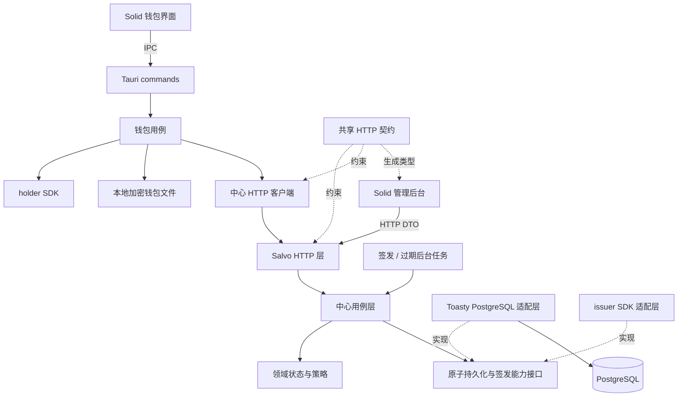

# 身份中心与钱包项目结构、模块及页面设计

文档状态：待实现的结构设计，仅规划目录、职责、依赖、页面及接口边界，不包含业务实现代码。

日期：2026-10-30。业务基线：[身份验证中心与钱包业务流程](identity-center-wallet-business-flow.md)。技术栈固定为 PostgreSQL、Salvo、Toasty、Solid 和 Tauri；密码学部分沿用现有 SDK v0.1 / 协议 v1。

## 1. 总体组织方式

保留仓库现有的 `issuer-service`、`issuer-service-webui`、`wallet` 和四个 SDK crate。身份中心采用一个后端服务，在 crate 内划分领域规则、用例、HTTP、数据库及后台任务模块。钱包采用 Solid 界面和 Tauri Rust 后端，由 Rust 统一处理网络、秘密、存储与 SDK 调用。

增加一个小型共享业务契约 crate 和一个生成的 TypeScript 类型包。两个前端共享接口类型，各自维护页面、业务状态及组件；首期不建设独立的通用 UI 组件库。

| 单元 | 运行形式 | 主要依赖 | 对外边界 |
|---|---|---|---|
| `issuer-service` | Salvo HTTP 服务，进程内运行签发等后台任务 | issuer SDK、业务契约、Toasty、PostgreSQL | 公开申请 API、管理员 API、管理页面静态资源 |
| `issuer-service-webui` | Solid SPA | 生成的业务契约、Solid Router、Solid Query | 通过同源 HTTP 管理中心 |
| `wallet/src-tauri` | 本地 Tauri Rust 进程 | holder SDK、业务契约、HTTP 客户端、系统密钥保护 | 受限 Tauri commands 与状态事件 |
| `wallet/src` | Solid SPA，运行于 Tauri WebView | 生成的 IPC 类型、部分业务契约、Solid Router | 通过 IPC 使用钱包，展示用户可读信息 |
| `crates/identity-api` | 被中心和钱包引用的 Rust 库 | Serde 及原始 JSON 包装 | 定义 HTTP 业务 DTO、错误码和分页结构 |
| `packages/identity-api-types` | 本地 TypeScript 类型包 | 从业务契约生成 | 提供 HTTP DTO 类型，不持有运行时状态 |
| `examples/relying-party` | 独立的最小应用后端与 Solid 登录页 | verifier SDK、Salvo、Toasty、PostgreSQL | 验收挑战、证明与应用会话闭环 |



依赖约束：SDK 保持现有角色边界；业务 DTO 不加入 SDK core。后端领域规则不引用 Salvo、Toasty 或前端 DTO；HTTP handler 和 Tauri command 只做入参、授权及结果映射，业务过程进入用例层。

## 2. 仓库总体目录

以下均为目标结构；只在实现对应能力时创建文件。`dist`、运行数据和生成缓存不提交版本库。

```text
crypto-sso/
├── Cargo.toml                         # 继续使用根 Rust workspace
├── Cargo.lock
├── sdk/                               # 现有 core / issuer / holder / verifier
├── crates/
│   └── identity-api/                   # HTTP 业务契约，不包含 SDK 数学实现
├── packages/
│   └── identity-api-types/             # 从 Rust 契约生成的 TS 类型
├── issuer-service/                    # 中心 Salvo 服务
├── issuer-service-webui/              # 中心 Solid 管理后台
├── wallet/
│   ├── src/                           # 钱包 Solid 界面
│   └── src-tauri/                     # 钱包本地 Rust 后端
├── examples/
│   └── relying-party/
│       ├── Cargo.toml                 # 独立 verifier 示例后端
│       ├── src/
│       ├── toasty/                    # 示例自己的数据库迁移
│       └── web/                       # Solid 最小应用登录页
├── utils/                             # 运维 CLI；沿用密钥生成工具
├── dev-utils/                         # 沿用现有开发工具
├── deploy/
│   ├── compose.dev.yaml               # 开发 PostgreSQL 及数据库初始化
│   ├── issuer.env.example             # 配置名称与非秘密示例
│   └── README.md                      # 启动、迁移、备份与部署说明
├── scripts/
│   ├── check-contracts.ps1            # 契约生成结果检查
│   └── check-integration.ps1          # 集成验收入口
└── docs/
    ├── identity-center-wallet-business-flow.md
    ├── identity-center-wallet-project-structure.md
    ├── sdk-api.md
    └── sdk-test.md
```

新增加的业务契约和示例 Rust 包纳入根 Cargo workspace；SDK 的正常依赖图保持原状。前端沿用现有 Bun 包管理及锁文件；类型包使用本地依赖，不要求首期搬迁为新的 JavaScript monorepo。

## 3. 共享契约与类型归属

### 3.1 HTTP 业务契约

```text
crates/identity-api/
├── Cargo.toml                         # 建议包名 crypto-sso-identity-api
├── src/
│   ├── lib.rs
│   ├── common.rs                      # 分页、修订号、时间及追踪信息
│   ├── public.rs                      # ServiceInfo、ClaimHints
│   ├── enrollments.rs                 # 申请提交、状态、领取响应
│   ├── admin.rs                       # 登录、设置、审批、成员及台账 DTO
│   ├── errors.rs                      # 稳定业务错误码及 API 错误结构
│   └── sdk_json.rs                    # 内嵌 SDK 原始 JSON 的透明包装
├── examples/
│   └── export_types.rs                # 导出普通业务 DTO 的 TS 类型
└── tests/
    └── json_contracts.rs              # 严格解析、字段及错误码契约

packages/identity-api-types/
├── package.json
├── README.md                          # 生成入口与使用约定
└── src/
    ├── index.ts
    └── generated.ts                   # 生成并提交，禁止手工修改
```

普通业务 DTO 以 Rust 定义为源，建议使用 `ts-rs` 导出 TS。SDK 原始消息字段在 TS 中作为不可信 JSON 值处理，最终由 Rust 的 SDK wire 解析；不能为方便生成类型，把 SDK 消息改成宽松的普通 Serde 对象。

SDK JSON 包装保留内层原始对象，避免 HTTP 外层先反序列化为字典、吞掉重复字段。中心接收 `EnrollmentRequest`、钱包接收 `BlindCredential` 及挑战、示例接收 `Presentation` 时，都要进入各自角色重导出的严格 wire 入口。

| 数据类型 | 定义位置 | 约束 |
|---|---|---|
| SDK 公共交换消息 | 现有 SDK core | 编码和密码学含义沿用现有协议 |
| HTTP 请求、响应及公开错误码 | `identity-api` | 中心、钱包和管理后台共同遵循 |
| ORM 模型 | 中心 `infrastructure/postgres/models` | 不直接返回给 HTTP 或前端 |
| 中心领域对象 | 中心 `domain` | 表达状态、审批及签发规则，不包含 HTTP Cookie |
| 页面表单模型 | 各前端 `features/*/model.ts` | 包括脏状态、校验和展示，不复制服务端权威状态 |
| IPC DTO 和事件载荷 | 钱包 Rust `commands/dto` | 单独生成到钱包 `bridge`；不加入公开 HTTP 契约 |
| 钱包秘密与本地记录 | 钱包 Rust `domain`、`storage` | 不导出通用前端读取接口 |

契约生成检查只校验业务字段、命令与事件的一致性，不把密码、Bearer 值、holder 或 pending 内容写成测试快照或生成产物。

### 3.2 首期补充的后台只读查询

现有业务 API 足以完成注册和审批。为了支持实际页面，补充下列聚合查询，并保持详情数据复用：

| API | 使用页面 | 内容 |
|---|---|---|
| `GET /api/v1/admin/overview` | 概览 | 开关、密钥状态、待审/签发失败数量、近期处理摘要 |
| `GET /api/v1/admin/members` | 成员查询、审批中的成员选择器 | 已核验成员的分页检索，不按钱包自报信息自动创建关联 |
| `GET /api/v1/admin/members/{member_ref}` | 成员详情 | 内部成员标识、核验摘要、签发名额及关联申请 |

首期成员页面以查询为主。建立新成员及绑定可信资料发生在批准用例的事务中；无需增加一套独立的成员账号、密码、角色和用户自助登录系统。

## 4. 身份中心后端目录

```text
issuer-service/
├── Cargo.toml
├── src/
│   ├── main.rs                        # 读取启动参数，启动 runtime
│   ├── lib.rs                         # 供集成测试复用组装入口
│   ├── bootstrap.rs                   # 初始化 SDK 限制、DB、签发器和任务
│   ├── config.rs                      # 部署配置；与管理页面业务设置分开
│   ├── state.rs                       # 共享服务依赖和停止信号
│   ├── domain/
│   │   ├── mod.rs
│   │   ├── enrollment.rs              # 状态、版本、可执行迁移
│   │   ├── approval.rs                # 核验结果、完整核准集合、处理理由
│   │   ├── member.rs                  # 可信成员及签发名额规则
│   │   ├── issuance.rs                # 签发任务、代次、租约及提交条件
│   │   ├── settings.rs                # 服务设置、建议修订及校验
│   │   ├── audit.rs                   # 业务审计事件
│   │   └── error.rs                   # 内部业务错误
│   ├── application/
│   │   ├── mod.rs
│   │   ├── ports.rs                   # 业务原子存储、时钟、签发能力边界
│   │   ├── auth.rs                    # 管理员登录、会话和退出
│   │   ├── settings.rs                # 设置读取、完整保存与修订冲突
│   │   ├── enrollment.rs              # 受理、状态查询、取消和领取
│   │   ├── review.rs                  # 核验、批准、退回与拒绝
│   │   ├── issuance.rs                # 取任务、调用签发器和提交结果
│   │   └── queries.rs                 # 概览、成员、台账及审计读模型
│   ├── http/
│   │   ├── mod.rs
│   │   ├── router.rs                  # Salvo 路由注册
│   │   ├── errors.rs                  # 业务错误到 HTTP 错误的映射
│   │   ├── static_files.rs            # /admin 静态资源及 SPA fallback
│   │   ├── middleware/
│   │   │   ├── mod.rs
│   │   │   ├── admin_session.rs       # 会话鉴权
│   │   │   ├── csrf.rs                # 管理写请求来源及 CSRF 校验
│   │   │   ├── enrollment_access.rs   # 申请 Bearer 校验
│   │   │   └── request_policy.rs      # 追踪 ID、body 限制及限流
│   │   └── handlers/
│   │       ├── mod.rs
│   │       ├── public.rs              # service-info、claim-hints
│   │       ├── enrollments.rs         # 钱包申请接口
│   │       └── admin/
│   │           ├── mod.rs
│   │           ├── auth.rs
│   │           ├── overview.rs
│   │           ├── settings.rs
│   │           ├── enrollments.rs
│   │           ├── members.rs
│   │           ├── issuances.rs
│   │           └── audit.rs
│   ├── infrastructure/
│   │   ├── mod.rs
│   │   ├── postgres/
│   │   │   ├── mod.rs
│   │   │   ├── db.rs                  # Toasty 模型注册、连接与事务入口
│   │   │   ├── models/                # 按业务对象分文件的 Toasty Model
│   │   │   ├── mapping.rs             # ORM、领域与读模型之间的转换
│   │   │   ├── store.rs               # 持久化能力接口实现
│   │   │   ├── queries.rs             # 分页、聚合及详情查询
│   │   │   └── transactions/
│   │   │       ├── mod.rs
│   │   │       ├── accept_enrollment.rs
│   │   │       ├── decide_review.rs
│   │   │       ├── lease_issuance.rs
│   │   │       ├── finish_issuance.rs
│   │   │       └── save_settings.rs
│   │   ├── sdk/
│   │   │   ├── mod.rs
│   │   │   └── issuer.rs              # 导入固定密钥及 issuer SDK 调用
│   │   └── security/
│   │       ├── mod.rs
│   │       ├── password.rs            # 管理员密码哈希
│   │       └── tokens.rs              # 会话与申请访问秘密校验
│   ├── workers/
│   │   ├── mod.rs
│   │   ├── issuance.rs                # 签发队列轮询、并发限制及恢复
│   │   ├── expiration.rs              # 待审过期条件更新
│   │   └── session_cleanup.rs         # 过期管理会话清理
│   └── bin/
│       └── bootstrap_admin.rs         # 受控部署环境建立首位管理员
├── toasty/
│   ├── migrations/                    # 经审阅的 PostgreSQL 迁移
│   ├── snapshots/                     # 模型映射快照
│   └── history.toml                    # Toasty 迁移历史元数据
└── tests/
    ├── common/
    ├── settings_http.rs
    ├── enrollment_http.rs
    ├── review_transactions.rs
    ├── issuance_recovery.rs
    └── admin_access.rs
```

这些是一个 crate 内的 Rust 模块。初期不为每个目录创建独立 crate；具体文件可以从少量用例开始，随真实职责增长拆分。

### 4.1 模块边界

| 模块 | 负责 | 调用方式 |
|---|---|---|
| `http` | 路由、权限上下文、严格外层解析、状态码与 Cookie | 调用 `application`；不直接写数据库 |
| `application` | 编排完整用例、核对哈希、选择事务操作、构造结果 | 使用领域规则及有限的能力接口 |
| `domain` | 状态迁移、审批条件、建议规则及签发约束 | 保持普通 Rust 类型，可独立测试 |
| `postgres` | Toasty 模型、读模型、唯一约束与事务实现 | 将领域动作原子写入 PostgreSQL |
| `sdk/issuer` | 保持固定 issuer、严格 SDK 解析及盲签发 | 使用 issuer crate；不依赖 holder/verifier |
| `workers` | 调度、退避、租约恢复、服务停止 | 调用与 HTTP 共用的用例，不重复写一套签发逻辑 |
| `bootstrap` | 配置并组装上述依赖 | 在 SDK 使用和工作线程启动前设置 ClaimsLimits |

`ports.rs` 表达“批准并保留成员名额”“提交签发结果”等完整原子能力，不为每张表创建一个通用 CRUD trait。数据库事务由一个持久化操作完整拥有，所有关联写入使用同一事务连接，避免事务中误用全局连接提交部分数据。

## 5. PostgreSQL 模型与事务归属

### 5.1 逻辑模型

| 模型 / 建议表名 | 主要内容 | 关键约束 |
|---|---|---|
| `IssuerMetadata / issuer_metadata` | 固定组织公开信息与指纹 | 当前部署唯一 issuer；与导入密钥匹配 |
| `ServiceSettings / service_settings` | 展示信息、开关、轮询、待审期限、修订 | 单一设置记录，版本条件更新 |
| `ClaimHintRevision / claim_hint_revisions` | 不可变建议文档和发布时间 | 修订唯一；旧申请可追溯 |
| `AdminUser / admin_users` | 管理员标识、密码哈希、状态 | 账号唯一；首期统一管理员角色 |
| `AdminSession / admin_sessions` | 会话摘要、用户、有效期 | 会话摘要唯一，按有效期清理 |
| `Member / members` | 内部成员标识、核验摘要及资料引用 | 中心内可信 member_ref 唯一 |
| `Enrollment / enrollments` | SDK 请求、哈希、访问秘密摘要、状态、版本、业务快照 | `(issuer_id, request_id)` 唯一；按状态/创建时间索引 |
| `ReviewDecision / review_decisions` | 操作者、核验来源、核准集合、公开及内部理由 | 追加历史；申请引用当前有效批准决定 |
| `MemberIssuanceSlot / member_issuance_slots` | 成员当前获准或已签发的请求 | `(issuer_id, member_ref)` 主键；申请绑定唯一 |
| `IssuanceJob / issuance_jobs` | 任务、下次尝试时间、执行代次、租约、失败码 | 每申请唯一任务；按可运行时间索引 |
| `Issuance / issuances` | 已提交的完整盲签响应、批准引用及签发时间 | 每申请唯一响应，issuer/member 唯一 |
| `OperationDedup / operation_dedup` | 管理写操作幂等键、内容摘要、原结果 | 操作者/动作/幂等键唯一 |
| `AuditEvent / audit_events` | 设置、审批、签发等业务事件 | 与对应业务写入同事务；按时间和对象索引 |

申请中的 `member_ref` 在核验前可以为空。成员名额在批准时保留，直到未签发申请被合法终止才可释放；`ISSUED` 的名额长期保留。

原始 SDK 消息、规范 Claims 快照及已签发响应优先以经过严格校验的 JSON 文本保存，以便原样领取和重验；用于检索的 issuer、ID、状态、时间、修订等单独成列。不要从分散的属性行或最新建议配置重建已经获批的请求。

签发列表是业务读模型，以获准签发任务为基准关联成功记录，使等待、失败及已签发都能在同一台账页面展示；不能只读取 `issuances` 成功表而遗漏待处理任务。成员详情、概览和审计同样返回有限读模型，不直接序列化 ORM 关联对象。

### 5.2 原子操作划分

| 持久化操作 | 同一事务的内容 |
|---|---|
| 接受申请 | 检查原请求幂等、固定业务元数据、保存建议快照引用、创建待审记录 |
| 批准申请 | 核对状态/版本/时间/开关、确认或建立成员记录、保留成员名额、批准记录、签发任务、审计、管理幂等结果 |
| 退回 / 拒绝 / 取消 / 过期 | 状态条件迁移、对应理由；适用时释放未签发名额并废弃旧执行代次 |
| 取得签发执行权 | 核对获准状态及签发开关、分配新代次、写入租约、更新执行状态 |
| 提交签发结果 | 重查代次及开关、保存唯一盲签响应、更新申请及任务状态、占用永久签发名额、写审计 |
| 保存设置 | 核对设置修订、更新完整设置、必要时追加建议修订、写审计及幂等结果 |

昂贵的 `issue_blind` 在事务锁外执行。签发结果提交时重新核对执行代次和状态；旧任务即使算出签名也不能写回。关闭签发和签发提交使用一致的设置记录检查及加锁顺序，保证开关的生效顺序可确定。

### 5.3 Toasty 与迁移

按 [Toasty 官方仓库](https://github.com/tokio-rs/toasty) 当前文档，模型以 Rust `toasty::Model` 定义，放入 `models/`；迁移、映射快照与历史集中在服务自己的 `toasty/` 下。实现时锁定 Toasty 与 PostgreSQL driver 的匹配版本，并以所选版本的工具产物为准。

数据库扩展约束和事务操作都封装在同一个 PostgreSQL 适配层。对 ORM 之外确需使用的 PostgreSQL DDL，放入受版本管理的迁移；用例及 handler 不散落 SQL，也不再并行引入另一套 ORM。

第一个数据库里程碑要在真实 PostgreSQL 上验证复合唯一性、条件更新、完整回滚及任务竞争，再展开审批页面。生产启动检查迁移版本，正式迁移由部署步骤执行；不在每次启动时重建表。

## 6. 中心 Solid 前端目录

```text
issuer-service-webui/
├── package.json
├── vite.config.ts
└── src/
    ├── index.tsx
    ├── app/
    │   ├── App.tsx
    │   ├── router.tsx
    │   ├── providers.tsx              # QueryClient、会话及全局通知
    │   ├── AdminLayout.tsx            # 导航、会话信息和页面容器
    │   ├── RequireAdmin.tsx           # 页面访问门禁
    │   └── SettingsLayout.tsx         # 设置子页与共享草稿边界
    ├── pages/
    │   ├── LoginPage.tsx
    │   ├── OverviewPage.tsx
    │   ├── EnrollmentListPage.tsx
    │   ├── EnrollmentDetailPage.tsx
    │   ├── MemberListPage.tsx
    │   ├── MemberDetailPage.tsx
    │   ├── IssuanceListPage.tsx
    │   ├── AuditPage.tsx
    │   ├── NotFoundPage.tsx
    │   └── settings/
    │       ├── ServiceSettingsPage.tsx
    │       ├── ClaimHintsPage.tsx
    │       └── IssuerInfoPage.tsx
    ├── features/
    │   ├── auth/                      # api、会话资源、登录表单
    │   ├── overview/                  # 概览读模型与统计卡片
    │   ├── settings/                  # 完整设置草稿、冲突及保存
    │   ├── claim-hints/               # 建议编辑器、预览、顺序与校验
    │   ├── enrollments/               # 申请列表、详情及公开/内部理由
    │   ├── review/                    # 成员核验、批准确认、退回/拒绝
    │   ├── members/                   # 成员检索与只读详情
    │   ├── issuances/                 # 台账、失败展示及重试动作
    │   └── audit/                     # 事件分页、对象链接
    ├── shared/
    │   ├── api/
    │   │   ├── client.ts              # 同源请求、CSRF、401 与取消
    │   │   ├── errors.ts              # API 错误到可操作提示的映射
    │   │   └── query-keys.ts
    │   ├── ui/                        # 表格、对话框、字段、空态、状态条
    │   └── format/                    # 时间、指纹、标识展示
    └── styles/
        ├── tokens.css
        └── global.css
```

每个 feature 先按需要包含 `api.ts`、`queries.ts`、`model.ts`、`components/`；页面只组合 feature、布局和路由参数。建议新增 `@solidjs/router` 与 `@tanstack/solid-query`，由 Solid signals/store 保存未提交表单，由 Query 保存服务端读模型。

## 7. 中心页面、路由与交互

### 7.1 页面划分

管理后台统一部署于 `/admin/`。下表的 API 均带 `/api/v1` 前缀。

| 路由 | 页面及 feature | 页面内容、动作 | 主要 API |
|---|---|---|---|
| `/admin/login` | 登录 / auth | 账号密码、登录错误、成功后返回站内目标页；无公开注册 | `POST /admin/sessions` |
| `/admin/overview` | 概览 / overview | 注册与签发状态、密钥可用性、待审及失败数量、处理入口 | `GET /admin/overview` |
| `/admin/enrollments` | 申请列表 / enrollments | 状态、时间、请求 ID 筛选，游标分页；待审为默认视图 | `GET /admin/enrollments` |
| `/admin/enrollments/:requestId` | 审批工作区 / enrollments + review | 固定申请、核验、处理、签发状态和历史 | 申请详情、批准/退回/拒绝/重试 |
| `/admin/members` | 成员列表 / members | 可信成员检索、名额状态及关联申请入口 | `GET /admin/members` |
| `/admin/members/:memberRef` | 成员详情 / members | 内部标识、核验摘要、已获准或已签发申请；首期只读 | `GET /admin/members/{member_ref}` |
| `/admin/issuances` | 签发台账 / issuances | 签发时间、状态、失败原因、重试入口；进入原申请查看详情 | `GET /admin/issuances` |
| `/admin/settings/service` | 服务设置 / settings | 展示信息、公开地址、开关、期限、轮询间隔 | `GET/PUT /admin/settings` |
| `/admin/settings/claims` | 默认建议 / settings + claim-hints | 字段编辑、顺序、默认值、预览及修订冲突 | 同一完整设置 API |
| `/admin/settings/issuer` | 签发身份 / settings | 只读公钥、指纹、协议版本、实际 ClaimsLimits 及密钥状态 | `GET /admin/settings` |
| `/admin/audit` | 审计 / audit | 操作者、时间、动作、对象过滤及分页 | `GET /admin/audit-events` |

`/admin` 跳转到概览。签发详情复用申请详情中的“签发”区域，不为同一对象维护第二套详情接口。未知页面使用站内 404；API 路径始终返回 API 404，不进入 SPA fallback。

### 7.2 审批工作区

申请详情采用一个工作区，分为三个主要区域：

1. **申请事实**：请求 ID、哈希、提交时版本、原始 Claims、建议差异、申请说明及到期时间。原始 Claims 只读。
2. **身份核验与决定**：选择已有成员或在批准时建立新成员，录入可信资料来源；确认完整核准集合；提供通过、退回或拒绝入口。内部备注与公开理由分别输入。
3. **处理历史**：状态变化、审批人、签发任务、失败码、已签发时间。仅合法状态显示重试或终止操作。

“通过”确认框再次列出完整 Claims、成员和期望状态修订。前端不允许在这里直接改 Claim 值；有改动需求则退回。提交按钮禁用只能改善交互，服务端仍执行版本、幂等、成员名额及权限检查。

### 7.3 设置页面共享一份草稿

服务信息和 Claims 建议虽然拆成两个编辑页面，仍对应一份 `SettingsDraft`，由 `SettingsLayout` 持有加载时的完整配置及修订。页间切换保留未保存修改；离开设置区域时提示保存或放弃。

保存提交完整配置与同一个期望修订，不因切换标签页遗漏未显示字段。只读 issuer 页面不提供私钥编辑。`409` 时显示服务端与当前草稿差异，由管理员重载或合并后再保存；不自动覆盖新版本。

建议编辑器使用专门的 `ClaimHintEditor`，包含名称、说明、默认值、示例和默认加入开关；它与钱包的“申请 Claim 键值编辑器”分别实现，避免把默认建议误当必填约束。

### 7.4 服务端状态与界面状态

列表筛选、分页游标、详情标签进入 URL；表单草稿、展开状态留在组件。API mutation 成功后使相关详情、列表、概览、成员和台账缓存失效。

后台会话只依赖 HttpOnly Cookie，前端不保存管理令牌。会话失效时清空受保护查询并转到登录页，返回地址只允许本站管理路由。审批中状态改变时提示刷新，不在后台自动再次提交原操作。

管理页面所有 Claims、备注和理由作为文本显示；输入的 HTML 不进入 `innerHTML`。审计及通知仅展示需要的信息，不将完整表单写入浏览器日志。

## 8. 钱包 Rust 后端目录

```text
wallet/src-tauri/
├── Cargo.toml
├── tauri.conf.json
├── capabilities/
│   └── default.json                   # 仅主窗口需要的能力
├── src/
│   ├── main.rs
│   ├── lib.rs                         # Tauri 初始化及 command 注册
│   ├── bootstrap.rs                   # SDK 限制、系统密钥和本地数据初始化
│   ├── runtime.rs                     # 解锁状态、后台任务与锁定代次
│   ├── domain/
│   │   ├── mod.rs
│   │   ├── center.rs                  # 中心地址、固定指纹、建议缓存
│   │   ├── trusted_app.rs             # 独立可信应用 origin 与 issuer
│   │   ├── enrollment.rs              # 草稿、固定提交及申领状态
│   │   ├── credential.rs              # 本地凭证索引及展示元信息
│   │   ├── login.rs                   # 登录任务、挑战和同意计划
│   │   ├── vault.rs                   # 钱包版本、锁定与记录状态
│   │   └── error.rs
│   ├── application/
│   │   ├── mod.rs
│   │   ├── ports.rs                   # 本地原子存储、中心客户端与密钥保护
│   │   ├── vault.rs                   # 初始化、解锁、锁定及恢复
│   │   ├── centers.rs                 # 中心连接确认、建议读取与地址迁移
│   │   ├── trusted_apps.rs            # 独立创建及更新可信应用配置
│   │   ├── enrollments.rs             # 草稿、提交、同步、取消与领证
│   │   ├── credentials.rs             # 可用凭证查询、详情及本地删除
│   │   ├── login.rs                   # 挑战检查、领证续接、披露同意与证明
│   │   └── preferences.rs             # 自动锁定等本地偏好
│   ├── commands/
│   │   ├── mod.rs
│   │   ├── vault.rs
│   │   ├── centers.rs
│   │   ├── trusted_apps.rs
│   │   ├── enrollments.rs
│   │   ├── credentials.rs
│   │   ├── login.rs
│   │   ├── preferences.rs
│   │   ├── events.rs                  # 只包含有限业务状态的事件
│   │   └── dto/                       # 可向前端暴露的视图与命令输入
│   ├── infrastructure/
│   │   ├── mod.rs
│   │   ├── storage/
│   │   │   ├── mod.rs
│   │   │   ├── vault_file.rs          # 认证加密文件、格式与原子替换
│   │   │   ├── records.rs             # 持久化记录到领域视图的映射
│   │   │   ├── migration.rs           # 本地数据格式版本迁移
│   │   │   └── recovery.rs            # 中断恢复、临时文件及已完成申领清理
│   │   ├── security/
│   │   │   ├── mod.rs
│   │   │   ├── key_protector.rs       # 操作系统密钥保护能力接口
│   │   │   ├── windows.rs             # Windows DPAPI / 系统凭据适配
│   │   │   └── encryption.rs          # 本地记录认证加密
│   │   ├── http/
│   │   │   ├── mod.rs
│   │   │   ├── issuer_client.rs       # 固定中心端点、超时、限流和 DTO
│   │   │   └── errors.rs              # 网络错误映射及重试分类
│   │   └── sdk/
│   │       ├── mod.rs
│   │       ├── enrollment.rs          # begin_enrollment、finish、备份恢复
│   │       └── presentation.rs        # wire、origin 校验和 present
│   └── jobs/
│       ├── mod.rs
│       └── enrollment_sync.rs         # 每申请单一轮询、退避和后台降频
├── examples/
│   └── export_ipc_types.rs            # 导出前端可用的普通 IPC DTO
└── tests/
    ├── local_recovery.rs
    ├── enrollment_flow.rs
    ├── login_consent.rs
    └── vault_locking.rs
```

钱包 Rust crate 只正常依赖 holder SDK。所有中心请求由 `issuer_client` 发起，前端不安装一份可直接访问中心的 HTTP 客户端；这样申请访问秘密始终留在 Rust 层。

### 8.1 关键职责

| 用例模块 | 输入与输出 | 必须保持的边界 |
|---|---|---|
| `centers` | 用户输入地址、可信指纹；返回连接预览及本地中心 ID | 首次探测不等于已信任；确认后才保存固定身份 |
| `enrollments` | 草稿键值、建议修订、说明；返回本地申请视图 | 创建 pending、访问秘密和固定元数据并持久化后，才提交 |
| `credentials` | 本地凭证 ID；返回需要显示的 Claims 及状态 | 不返回 holder 备份、用户秘密或原始私密对象 |
| `trusted_apps` | 用户确认的规范 origin 和可信 issuer | 独立于导入挑战建立；拒绝从挑战自动增加信任 |
| `login` | 可信应用 ID、原始挑战、选中凭证和披露键 | 只为 Rust 内已保存的有效任务生成证明 |
| `vault` | 本地初始化、系统密钥访问、锁定操作 | 统一控制所有秘密访问和后台任务生命周期 |

网络操作不持有本地文件写锁。将变更写入本地存储前重新核对记录版本和钱包解锁代次，防止晚到响应覆盖新状态或在锁定后重新输出敏感数据。

### 8.2 本地数据布局与提交

首期钱包数据量较小，采用一个带版本的加密钱包文档，包含中心、可信应用、草稿、申领、凭证、登录任务续接上下文及偏好。放在操作系统应用数据目录，由 Rust 层负责读写；不在前端 localStorage 或 PostgreSQL 保存钱包秘密。

```text
操作系统应用数据目录/CryptoSSO/wallet/
├── profile.json                       # 最小格式标识，不包含 Claims 或秘密
├── vault.enc                          # 已提交的认证加密钱包文档
└── vault.<随机值>.tmp                  # 提交中的加密临时文件，恢复后清理
```

本地提交通过同目录加密临时文件、可靠写入和操作系统支持的原子替换完成；限制一个写入者，并防止重复启动的两个进程同时修改同一个钱包。数据密钥由当前操作系统用户的安全能力保护，具体系统封装位置由 `key_protector` 管理。

每个凭证关联原 issuer 和 request ID，避免多次恢复产生重复本地条目。领证先提交包含新 holder 且仍保留 pending/响应的完整文档，提交成功后再以第二次本地提交清理 pending；恢复流程可以识别“已保存凭证，待清理”的状态。

首期不保留包含已清理 pending 的长期旧快照，也不提供明文秘密导出。文件格式迁移先验证旧文件、写新加密文档，再切换已提交版本；未知或损坏版本停止写入并报告可恢复信息。

### 8.3 锁定与长任务

钱包锁定时停止新的同步和秘密操作，清除前端敏感查询及已加载 Claims。正在执行的网络或阻塞密码学任务带解锁代次；即使无法立即停止计算，也需在返回时核对代次，丢弃不再授权的结果，并释放相关秘密对象。

`jobs/enrollment_sync` 是申请状态同步的唯一调度者。页面显示申请不会再独立启动轮询；Rust 事件通知前端刷新读模型。解锁恢复后按持久化记录继续同步和领证。

## 9. 钱包 IPC 契约与事件

### 9.1 Command 分组

下列名称用于规划命令边界，最终注册名集中在 `commands/mod.rs` 和前端 `bridge`，不在页面中散写 `invoke` 字符串。

| 命令组 | 主要操作 | 返回给前端的数据 |
|---|---|---|
| 钱包 | `get_wallet_status`、`initialize_wallet`、`unlock_wallet`、`lock_wallet` | 是否初始化/解锁、格式版本和可执行操作 |
| 中心 | `probe_center`、`confirm_center`、`list_centers`、`get_center`、`refresh_claim_hints` | 公开信息、指纹、缓存修订和连接状态 |
| 可信应用 | `list_trusted_apps`、`save_trusted_app`、`remove_trusted_app` | 规范 origin、issuer 和本地显示名 |
| 注册草稿 | `create_enrollment_draft`、`save_enrollment_draft`、`get_enrollment_draft` | 可编辑 Claim 行、来源修订、用户删改记录 |
| 申请 | `submit_enrollment`、`list_enrollments`、`get_enrollment`、`refresh_enrollment`、`cancel_enrollment` | 不含 Bearer 的本地/中心组合状态及公开理由 |
| 领证 | `complete_enrollment` | 解盲验签与本地保存结果；不返回 holder |
| 凭证 | `list_credentials`、`get_credential`、`delete_local_credential` | 有限摘要、解锁后允许查看的 Claim 值 |
| 登录 | `create_login_task`、`prepare_login`、`confirm_disclosure`、`get_presentation`、`cancel_login_task` | 来源校验、披露计划、进度及本次公开 Presentation |
| 偏好 | `get_preferences`、`save_preferences` | 自动锁定等本地配置，不包含 SDK 全局限制热更新 |

命令没有“导出所有秘密”“读任意文件”“任意 URL 带 Bearer 请求”等通用能力。探测中心和确认中心分开，秘密请求只发送到已确认的中心地址；跨 origin 重定向不能转发申请访问秘密。

### 9.2 登录同意计划

`prepare_login` 在 Rust 内严格解析挑战，核对独立可信应用、issuer、时效及本地凭证，生成带任务修订的 `DisclosurePlan`。前端显示应用 origin、必需键值、额外可选键以及截止时间。

用户确认时提交任务 ID、期望计划修订和选择键。Rust 再次核对任务、完整挑战、选定凭证、解锁代次及时效，校验必需项均已同意，然后生成证明。不能让前端直接传入任意 holder 字节或把“用户曾经同意过”当作后续新挑战的授权。

首次领证后旧挑战已过期时，登录任务进入“等待新挑战”。用户从原可信应用取得新挑战，生成新的披露计划并再次确认。钱包完成 `present` 后只显示“证明已生成/等待应用处理”，首期手工交换没有可信应用结果回调，因此不显示“应用登录成功”。

重启只恢复任务和申请关联，不恢复可自动重放的披露授权；重新核对挑战后再次确认。修改或删除可信应用配置、删除相关凭证，都使依赖旧版本的同意计划失效。

### 9.3 事件

| 事件 | 载荷 | 用途 |
|---|---|---|
| `wallet://lock-changed` | 锁定状态、解锁代次 | 清空前端敏感资源或恢复加载 |
| `wallet://enrollment-changed` | 本地申请 ID、记录修订、有限状态 | 刷新申请和首页摘要 |
| `wallet://credential-changed` | 本地凭证 ID、有限状态 | 更新凭证列表及登录可用性 |
| `wallet://login-task-changed` | 任务 ID、任务修订及进度 | 更新向导进度 |

事件不携带 Claim 值、访问秘密、原始请求或证明正文。页面经受限查询读取所需详情；监听在布局中统一注册，退出时清理。IPC 错误使用稳定码与用户提示，禁止把内部调试结构原样返回。

## 10. 钱包 Solid 前端目录

```text
wallet/src/
├── index.tsx
├── app/
│   ├── App.tsx
│   ├── router.tsx                     # HashRouter，适配 Tauri 页面加载
│   ├── providers.tsx
│   ├── WalletLayout.tsx               # 中心、凭证、申请、应用导航
│   ├── RequireUnlocked.tsx
│   └── WalletEvents.tsx               # 唯一事件监听与缓存失效入口
├── pages/
│   ├── WelcomePage.tsx
│   ├── UnlockPage.tsx
│   ├── HomePage.tsx
│   ├── CenterListPage.tsx
│   ├── AddCenterPage.tsx
│   ├── CenterDetailPage.tsx
│   ├── EnrollmentDraftPage.tsx
│   ├── EnrollmentListPage.tsx
│   ├── EnrollmentDetailPage.tsx
│   ├── CredentialListPage.tsx
│   ├── CredentialDetailPage.tsx
│   ├── TrustedAppListPage.tsx
│   ├── TrustedAppEditPage.tsx
│   ├── StartLoginPage.tsx
│   ├── LoginTaskPage.tsx
│   ├── PreferencesPage.tsx
│   └── NotFoundPage.tsx
├── features/
│   ├── vault/                         # 初始化、解锁、锁定和恢复提示
│   ├── centers/                       # 地址探测与信任确认
│   ├── claim-hints/                   # 建议预览、缓存版本与更新对比
│   ├── enrollment-draft/              # 可增删 Claim 编辑器、草稿保存
│   ├── enrollments/                   # 申请进度、处理理由和取消
│   ├── credentials/                   # 凭证列表、属性查看和本地删除
│   ├── trusted-apps/                  # 独立可信应用配置
│   ├── login/                         # 导入挑战、领证续接及披露计划
│   │   └── components/
│   │       ├── ChallengeImport.tsx
│   │       ├── EnrollmentRequired.tsx
│   │       ├── EnrollmentProgress.tsx
│   │       ├── RefreshChallenge.tsx
│   │       ├── DisclosureReview.tsx
│   │       └── PresentationResult.tsx
│   └── preferences/
├── bridge/
│   ├── index.ts                       # 页面唯一使用的类型化 command 封装
│   ├── generated.ts                   # Rust IPC DTO 生成结果
│   ├── events.ts                      # 类型化事件订阅
│   └── errors.ts
├── shared/
│   ├── query-keys.ts
│   ├── ui/                            # 字段、对话框、状态条及步骤导航
│   └── format/
└── styles/
    ├── tokens.css
    └── global.css
```

钱包前端同样使用 Solid Router 与 Solid Query，Query 的数据源为类型化 IPC。路由使用 HashRouter；表中的路径均指 hash 后的应用内路径。初始欢迎与解锁路由之外，其余路由需解锁。

## 11. 钱包页面与路由

| 路由 | 页面 | 主要内容与操作 | Rust 用例 |
|---|---|---|---|
| `/welcome` | 初始化 | 本地钱包说明、系统密钥保护初始化；不创建中心账号 | vault |
| `/unlock` | 解锁 | 访问系统保护的本地钱包；恢复解锁前的本站路由 | vault |
| `/` | 首页 | 凭证数、待处理申请、未完成登录、中心连接入口 | credentials、enrollments、login |
| `/centers` | 中心列表 | 已信任中心、指纹、当前连接与注册状态 | centers |
| `/centers/add` | 添加中心 | 输入地址 → 探测公开信息 → 独立指纹核对 → 确认 | centers |
| `/centers/:centerId` | 中心详情 | 公开信息、建议修订、刷新建议、发起注册、关联凭证 | centers、credentials |
| `/centers/:centerId/enroll?draft=:draftId` | 注册草稿 | 默认 Claim 行、自定义增删、说明、完整提交预览 | enrollments |
| `/enrollments` | 申请列表 | 本地与中心状态、待处理筛选、进入详情 | enrollments |
| `/enrollments/:enrollmentId` | 申请详情 | 固定 Claims、审批理由、进度、取消、领证恢复 | enrollments |
| `/credentials` | 凭证列表 | issuer、可用状态、关联中心；进入详情或选择登录 | credentials |
| `/credentials/:credentialId` | 凭证详情 | 完整本地 Claims、issuer 指纹、本地领证时间、删除确认 | credentials |
| `/apps` | 受信应用 | 独立已确认的 origin 与 issuer；进入登录 | trusted_apps |
| `/apps/new`、`/apps/:appId/edit` | 应用配置 | 输入并确认规范 origin、可信 issuer 与显示名 | trusted_apps |
| `/login/new?app=:appId` | 开始登录 | 选定已信任应用，导入原应用挑战并校验 | trusted_apps、login |
| `/login/:taskId` | 登录向导 | 无凭证领证、等待新挑战、披露确认、证明结果 | login、enrollments |
| `/settings` | 本地设置 | 自动锁定、界面偏好、数据格式及本地恢复状态 | preferences、vault |

路由只包含本地对象 ID，不包含 Claim 值、Bearer、pending 或证明正文。`centerId` 是本地连接记录 ID；信任判断仍用固定 issuer 指纹。同 issuer 的新地址通过显式迁移确认，避免用重复连接绕过原信任配置。

### 11.1 注册表单

注册页用 `ClaimValueEditor` 管理最终字符串集合，分别记录建议来源、用户编辑和用户明确删除的键。建议更新时展示差异，显式应用；删除的默认项不能因为重新渲染或刷新接口而复活。

保留空输入行表示签署空字符串，删除行表示不包含该键。键和值保留用户原始输入，不做 trim 或类型转换；编辑器提供字节数与重复键错误。最终校验仍由 Rust 构造 SDK Claims 执行。

草稿通过 IPC 保存至加密本地存储。提交后建立不可修改的申领记录；需要修改时从原内容创建新草稿，并按原申请状态取消或保留其终态。提交按钮必须使用“提交申请”而非“注册成功”。

### 11.2 申请详情与凭证详情

申请页展示三个独立事实：本地是否已保存恢复材料、中心审批/签发到哪一步、本地是否已完成解盲与保存。网络不可用时保留上次中心状态及同步时间，不能把“查询失败”替换成“申请被拒绝”。

领证成功可跳转凭证详情；若由登录任务创建申请，则返回原登录任务，提示获取新挑战。已签发后本地保存失败，应提供“继续完成领证”，而非“重新注册”。

凭证删除确认说明它只删除本地记录，中心仍保持已签发状态。删除时检查未完成的本地登录任务并使其失效；不会据此释放中心成员名额或改变应用已存在的会话。

### 11.3 登录向导的阶段

| 阶段 | 组件 | 可执行动作及离开条件 |
|---|---|---|
| 缺少凭证 | `EnrollmentRequired` | 选择匹配中心注册；保留可信应用上下文 |
| 等待领证 | `EnrollmentProgress` | 查看申请、处理退回、等待签发；应用登录尚未完成 |
| 等待新挑战 | `RefreshChallenge` | 返回原应用重新获取挑战；不延长旧挑战 |
| 待授权 | `DisclosureReview` | 显示独立 origin、必需键和值、额外可选项；用户明确确认 |
| 正在生成 | 进度区域 | 禁止重复提交同一计划；锁定或过期时结果不可继续输出 |
| 证明可交付 | `PresentationResult` | 复制/导出本次公开证明交回原浏览器；无 Cookie 或完整凭证 |
| 中止或失效 | 错误/取消区域 | 可重新获取挑战、取消任务或返回凭证列表 |

这些是同一路由下的阶段组件，由 Rust 任务视图决定当前阶段；URL 直接进入某个步骤不能绕过挑战校验或用户授权。

### 11.4 前端内存和导航

Claims 编辑值与披露值只在解锁期间按需进入前端内存。Query 缓存不持久化到浏览器存储；锁定事件使敏感查询、表单及证明展示立即失效，并阻止旧请求结果重新填充缓存。

离开页面清理事件监听和局部请求；申请轮询由 Rust job 继续管理。未提交草稿需要保存或放弃提示。复制公开证明是显式操作，不自动复制凭证备份、完整秘密或未选择披露的属性。

## 12. 前后端协作的关键调用链

| 业务动作 | 调用链 | 权威提交点 |
|---|---|---|
| 保存中心设置 | Solid 设置草稿 → Salvo handler → settings 用例 → Toasty 事务 | 设置、建议修订、审计和幂等记录一同提交 |
| 提交钱包申请 | Solid 草稿 → IPC → Rust enrollments → 本地保存 → issuer_client → Salvo enrollment → Toasty | 本地先可恢复，中心再接受完整固定请求 |
| 批准并签发 | Solid 审批 → Salvo review → 成员/批准/job 事务 → worker → issuer SDK → 结果事务 | 批准与签发是两个可恢复阶段；提交响应后才可领取 |
| 钱包领证 | Rust job/显式命令 → 查询/领取 → SDK finish → 本地 holder 提交 → pending 清理 | holder 已可靠保存才视为可用 |
| 生成登录证明 | Solid 导入/授权 → IPC → Rust login → holder present → 公开证明视图 | 固定挑战与同意计划，出示前再次校验 |
| 创建应用会话 | 原浏览器提交 → 应用 Salvo → verifier → 策略 → 应用 Toasty 事务 | 有效挑战原子消费和会话创建共同提交 |

HTTP 与 IPC 各自只承担一次边界转换，页面不直接调用 SDK，ORM 模型也不穿透到界面。取消、重试和错误分类沿用业务文档，不能各页面自行解释一套状态。

## 13. 最小接入应用结构

```text
examples/relying-party/
├── Cargo.toml
├── src/
│   ├── main.rs
│   ├── lib.rs
│   ├── config.rs                      # 固定 issuer 与实际浏览器 origin
│   ├── http.rs                        # challenge、proof、会话读写和静态页
│   ├── login.rs                       # verifier 调用、属性值策略及事务编排
│   └── persistence.rs                 # Toasty 挑战与应用会话模型
├── toasty/
│   ├── migrations/
│   ├── snapshots/
│   └── history.toml
├── tests/
│   └── login_transaction.rs
└── web/
    ├── package.json
    ├── vite.config.ts
    └── src/
        ├── App.tsx
        ├── LoginPage.tsx               # 输出挑战、接收公开证明、同源提交
        └── SessionPage.tsx             # 展示验真后 subject 和已披露属性
```

示例固定一个 issuer、一个 origin 和一套简单值策略，使用自己的挑战表与会话表。生产应用可以使用其他后端框架；仓库示例沿用 Salvo/Toasty/PostgreSQL 便于验收。

中心管理会话、申请访问秘密、应用预登录 Cookie 及应用会话使用不同名称和生命周期。示例只依赖 verifier SDK，数据库与中心逻辑隔离，正常验真不调用中心。

## 14. 开发、部署与配置边界

| 项目 | 开发运行建议 | 生产方式 |
|---|---|---|
| PostgreSQL | `compose.dev.yaml` 提供实例；中心与示例各用独立数据库 | 外部持久化服务与受保护备份 |
| 中心后端 | Salvo loopback 端口，如 8080 | HTTPS 入口后的 Salvo 服务 |
| 中心管理前端 | Vite 如 5173，代理 `/api` 到中心 | 构建后由中心 `/admin/` 提供，配置匹配的 Vite base |
| 钱包 | 沿用现有 Tauri 开发端口 1420 | Tauri 桌面包，Solid 资源随包分发 |
| 示例应用 | 独立后端如 8081、Vite 如 5174 | 独立应用 origin，与中心分开 |

端口为部署建议，实际 origin 必须写入对应可信配置；开发时应用浏览器访问的是 Vite origin，verifier 与钱包都应固定该 origin，而不是 Vite 代理后的后端地址。

| 配置类别 | 存放位置 | 是否由管理网页修改 |
|---|---|---|
| DB 连接、监听、密钥位置、SDK 启动限制、worker 并发 | 中心部署配置 | 否 |
| 服务展示、地址、业务开关、建议、轮询和期限 | PostgreSQL 服务设置 | 是，带修订控制 |
| 钱包中心信任、受信应用、偏好与本地记录 | 加密钱包文档 | 钱包本地页面操作 |
| 管理 SPA 和钱包静态资源 | 各自构建产物 | 不作为业务数据编辑 |

管理 API 与静态资源同源部署，开发通过 Vite 代理保持 Cookie 语义。Tauri 只加载自身界面，能力配置和 CSP 按实际 IPC/静态资源收紧；中心网络请求由 Rust 层执行。

## 15. 模块验收与测试放置

| 验收范围 | 位置 | 重点 |
|---|---|---|
| 领域规则 | 对应 Rust domain 模块的单元测试 | 状态迁移、完整核准匹配、建议可覆盖、空集合语义 |
| HTTP 契约 | `identity-api/tests`、中心 HTTP 集成测试 | 重复字段、原始 SDK JSON 保留、错误码、权限与修订 |
| PostgreSQL 原子性 | 中心 `tests/review_transactions`、`issuance_recovery` | 真实 PostgreSQL 上并发批准、租约代次、名额和回滚 |
| Solid 复杂交互 | 对应 feature 测试 | 建议更新保留删改、设置跨页草稿、409 处理、明确披露同意 |
| 钱包恢复 | 钱包 `tests/local_recovery` 等 | pending 先保存、响应重试、holder 保存失败、锁定代次 |
| 应用会话 | 示例 `tests/login_transaction` | 真实 PostgreSQL 上同一挑战最多一个会话、提交时效复查 |
| 完整人工/自动集成 | `scripts/check-integration.ps1` 及验收记录 | 管理配置 → 申请 → 审批 → 领证 → 新挑战登录 |

HTTP、数据库、IPC、SDK 和 UI 的测试各验证自己的边界；Solid 小组件不逐个编写镜像测试。优先覆盖可能造成重复签发、丢失恢复材料、越权披露或错误会话的跨模块行为。

生成类型纳入差异检查：修改 HTTP DTO 需更新 TS 包；修改 IPC DTO/注册名需更新 bridge，并检查事件载荷。编译生成类型不代替运行时不可信 JSON 校验。

## 16. 分阶段落地与完成标准

| 阶段 | 创建的主要模块 | 可检查的完成结果 |
|---|---|---|
| A：基础边界 | 业务契约、Salvo 组装、Toasty 模型、迁移、管理员初始化 | 真实 PostgreSQL 回滚/唯一性验证，API 与 TS 契约可生成 |
| B：可配置中心 | auth、settings、public、后台布局及三个设置页 | 管理员登录，建议保存后钱包可查询，配置冲突可处理 |
| C：可恢复钱包申请 | 本地 vault、centers、draft、enrollments、对应 IPC/页面 | 默认与自定义 Claims 提交，重启/断网后恢复同一申请 |
| D：可操作审批签发 | review、member slot、workers、审批工作区及台账 | 完成核验、批准、唯一签发、失败重试和领取 |
| E：凭证管理与登录 | credentials、trusted_apps、login 任务及向导 | 解盲验签保存、锁定保护、明确披露、首次领证后续接 |
| F：闭环验收 | 最小应用、概览/成员/审计完整查询及集成脚本 | 同源 Cookie、挑战事务、中心离线登录及业务文档验收 |

每阶段同时交付所需前后端页面和状态处理，避免先铺满空目录或只完成不可操作的 API。新增约束、状态和字段须同时更新业务文档、契约及相关页面说明。

## 17. 本次设计产物与边界

本文列出的目录、模块、API 补充、类型生成工具和页面都是后续实现目标。本轮只更新设计文档及文档入口，不创建业务模块、不安装依赖、不运行数据库迁移。
