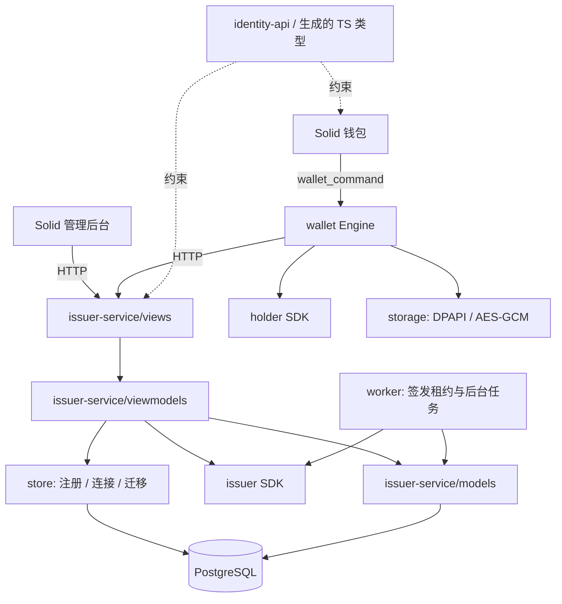

# 身份中心与钱包项目结构、模块及页面

文档状态：当前代码结构说明，按 2026-11-01 的仓库实现核对。目录树只列已存在的主要源码、配置和验证入口，省略依赖、构建缓存及部分图片资源。

更新日期：2026-11-01。业务基线：[身份验证中心与钱包业务流程](identity-center-wallet-business-flow.md)。技术栈固定为 PostgreSQL、Salvo、Toasty、Solid 和 Tauri；密码学部分沿用现有 SDK v0.1 / 协议 v1。

## 1. 总体组织方式

仓库使用根 Cargo workspace 管理 SDK、身份中心后端、钱包 Rust 后端、示例应用和共享库。中心后端按 MVVM 划分，管理后台独立构建；钱包采用 Solid 界面和 Tauri Rust 后端，网络、秘密存储与 SDK 调用由 Rust 处理。

| 单元 | 入口与职责 | 主要依赖 |
|---|---|---|
| `issuer-service` | `src/main.rs` 启动 Salvo API 与签发 worker；`models / viewmodels / views` 划分业务 | issuer SDK、identity-api、telemetry、Toasty、PostgreSQL |
| `issuer-service-webui` | `src/App.tsx` 组装管理路由、布局、会话与 QueryClient | Solid Router、Solid Query、生成的 HTTP 类型 |
| `wallet/src-tauri` | `src/lib.rs` 注册 IPC、启动同步；`engine.rs` 执行钱包用例 | holder SDK、identity-api、telemetry、Tauri、reqwest、DPAPI |
| `wallet/src` | `App.tsx` 组装 HashRouter、锁定门禁与事件订阅 | Solid Router、Solid Query、类型化 IPC bridge |
| `crates/identity-api` | `src/lib.rs` 定义共享 HTTP DTO；example 导出 TypeScript | Serde、ts-rs |
| `crates/telemetry` | `src/lib.rs` 统一初始化 tracing 和 RUST_LOG 过滤 | tracing、tracing-subscriber |
| `packages/identity-api-types` | `src/generated.ts` 提供生成的 HTTP 类型 | identity-api 导出结果 |
| `examples/relying-party` | `src/lib.rs` 验真与消费挑战，`http.rs` 适配 API，`web/src/index.tsx` 提供登录页 | verifier SDK、issuer-service 的存储/会话工具、Toasty、独立 PostgreSQL 数据库 |



SDK 保持角色边界；业务 DTO 不加入 SDK core。中心 View 处理 HTTP、状态码、Cookie 和会话适配，ViewModel 拥有业务事务，Model 定义实体与领域规则。会话存储由 `session_store.rs` 对接 Salvo。钱包 IPC 与存储按其当前模块组织，不套用中心的 MVVM 目录。

## 2. 仓库总体目录

以下为现有目录；`dist`、运行数据和生成缓存不提交版本库。

```text
crypto-sso/
├── Cargo.toml  # 根 Rust workspace
├── Cargo.lock  # Rust 依赖锁
├── Toasty.toml  # 迁移 CLI 产物目录
├── .env.example  # 应用环境变量示例
├── sdk/
│   ├── core/  # 共享协议与密码学基础
│   ├── issuer/  # 签发角色
│   ├── holder/  # 持有角色
│   └── verifier/  # 验真角色
├── crates/
│   ├── identity-api/  # 共享 HTTP 契约
│   └── telemetry/  # 日志初始化
├── packages/
│   └── identity-api-types/  # 生成的 TypeScript HTTP 类型
├── issuer-service/  # 中心后端
├── issuer-service-webui/  # 独立管理 SPA
├── wallet/
│   ├── src/  # 钱包 Solid 界面
│   └── src-tauri/  # 钱包 Rust 后端
├── examples/
│   └── relying-party/
│       ├── src/  # 独立应用 API 与验真
│       ├── web/  # 独立应用登录页
│       └── tests/  # 完整端到端验收
├── utils/  # 签发密钥生成工具
├── dev-utils/  # 开发资料抓取工具
├── deploy/
│   ├── compose.dev.yaml  # 开发数据库及初始化
│   ├── nginx.admin.conf.template  # 管理前端网关模板
│   └── README.md  # 启动、迁移与部署说明
├── scripts/  # 环境初始化、构建与验收入口
└── docs/  # 业务、结构、SDK 与静态 GUI 文档
```

管理后台、钱包与示例应用前端分别维护 Bun 配置及锁文件。共享类型包由本地依赖引用，未建立独立的通用 UI 组件库。

## 3. 共享契约与类型归属

### 3.1 HTTP 业务契约

```text
crates/identity-api/
├── Cargo.toml  # crypto-sso-identity-api
├── src/
│   └── lib.rs  # Claims、设置、申请、审核、错误与分页契约
└── examples/
    └── export_types.rs  # HTTP TypeScript 类型导出
```

```text
packages/identity-api-types/
├── package.json  # 本地类型包入口
├── README.md  # 类型生成说明
└── src/
    └── generated.ts  # 生成并提交；禁止手工修改
```

共享 HTTP 契约目前集中在 `crates/identity-api/src/lib.rs`，未拆成 common、public、admin 等文件。中心专用请求、响应及审核动作类型位于 `issuer-service/src/viewmodels/contracts.rs`；管理前端的 `Enrollment`、`Member`、`Session`、`Overview` 展示接口目前仍在 `issuer-service-webui/src/api.ts` 声明。

`cargo run -p crypto-sso-identity-api --example export_types` 生成 HTTP 类型；`cargo run -p wallet --example export_ipc` 生成钱包 IPC 类型。`scripts/check-contracts.ps1` 重新生成并比较两个文件内容。

SDK 消息保留原始 JSON，最终进入各角色的严格 wire 解析器，避免外层对象解析吞掉内层重复字段。TypeScript 中的 SDK 公共消息保持 `unknown`。

| 数据类型 | 当前定义位置 | 边界 |
|---|---|---|
| SDK 公共交换消息 | `sdk/core`，由各角色重导出 | 不复制另一套消息类型 |
| 共享 HTTP DTO | `crates/identity-api/src/lib.rs` | 同时供中心和钱包使用 |
| 中心专用 ViewModel 契约 | `issuer-service/src/viewmodels/contracts.rs` | 具体请求、响应、列表查询与 ReviewAction |
| ORM 模型与领域规则 | `issuer-service/src/models` | 查询结果转换为展示类型后返回 |
| 管理前端接口与表单状态 | `issuer-service-webui/src/api.ts`、`src/pages` | 表单草稿由页面 signals 保存 |
| 钱包 IPC 展示 DTO | `wallet/src-tauri/src/dto.rs` | 输出到 `wallet/src/bridge/generated.ts` |
| 钱包秘密与持久化记录 | `wallet/src-tauri/src/model.rs`、`storage.rs` | holder、pending 和访问秘密不导出前端 |

### 3.2 后台只读查询

当前查询由 `viewmodels/queries.rs` 实现；以下为页面使用的聚合接口：

| API | 使用页面 | 内容 |
|---|---|---|
| `GET /api/v1/admin/overview` | 概览 | 开关、密钥状态、待审/签发失败数量、近期处理摘要 |
| `GET /api/v1/admin/members` | 成员列表 | 已核验成员的分页检索，不按钱包自报信息自动创建关联 |
| `GET /api/v1/admin/members/{member_ref}` | 成员详情 | 内部成员标识、核验摘要、签发名额及关联申请 |

首期成员页面以查询为主。建立新成员及绑定可信资料发生在批准用例的事务中；无需增加一套独立的成员账号、密码、角色和用户自助登录系统。

## 4. 身份中心后端目录

当前后端按照 MVVM 划分：`models` 保存持久化实体及领域规则，`viewmodels` 编排业务事务并定义展示契约，`views` 适配 Salvo HTTP。新增能力应沿这三个层次放置代码，Model 和 ViewModel 的类型声明均需中文用途注释。

```text
issuer-service/src/
├── models/                           # Model
│   ├── mod.rs                        # 统一导出实体，保持原有导入路径
│   ├── settings.rs                   # 中心身份、服务配置、属性提示版本
│   ├── enrollment.rs                 # 申请聚合、审核历史、成员
│   ├── audit.rs                      # 审计事件、幂等结果存储
│   ├── session.rs                    # 浏览器会话、撤销、挑战、应用会话
│   └── domain.rs                     # 管理员会话、校验、状态迁移、审计规则
├── viewmodels/                       # ViewModel
│   ├── mod.rs                        # Application 共享依赖和初始化
│   ├── contracts.rs                  # 明确的请求、响应、查询与审核动作类型
│   ├── auth.rs                       # 管理员凭据验证
│   ├── enrollment.rs                 # 申请提交、状态、取消与凭证读取
│   ├── settings.rs                   # 配置保存与修订控制
│   ├── review.rs                     # 审批、退回、拒绝及重试事务
│   ├── queries.rs                    # 总览、成员、签发台账和审计查询
│   └── idempotency.rs                # 从历史 JSON 记录恢复指定类型的响应
├── views/                            # View
│   ├── mod.rs                        # 路由、HTTP 提取与健康检查
│   ├── public.rs                     # 钱包公开 API
│   ├── admin.rs                      # 管理 API、Cookie 和会话适配
│   └── middleware.rs                 # 来源、会话、限流与安全响应头
├── application.rs                    # 兼容导出 viewmodels::Application
├── domain.rs                         # 兼容导出 models::domain
├── store.rs                          # 模型注册、数据库连接与启动迁移
├── session_store.rs                  # Salvo PostgreSQL 会话存储适配
├── worker.rs                         # 持久化签发租约和后台调度
├── config.rs                         # 部署配置
├── security.rs                       # 令牌、摘要和时间工具
├── error.rs                          # 稳定错误与 HTTP 错误映射
├── lib.rs                            # 模块与兼容路径导出
├── main.rs                           # 配置、SDK 限制、HTTP 和 worker 启动
└── bin/
    ├── issuer-db.rs                  # Toasty 官方迁移 CLI
    └── hash-password.rs              # 管理员密码哈希工具
```

HTTP handler 统一使用 `<操作对象>_<动作>` 命名，例如 `enrollment_submit`、`enrollment_approve`、`settings_save`、`admin_session_create`。签名返回具体的 `Json<T>`、`Json<Page<T>>` 或明确的中间件结果类型，禁止使用 `Json<Value>` 等动态类型。带 ETag 的属性提示接口返回 `ClaimHintsReply` 枚举，分别渲染 `ClaimHintsResponse` 或无响应体的 304。共享契约仍定义在 `crates/identity-api`；后端专用展示类型定义在 `viewmodels/contracts.rs`。SDK 交换消息保留原始 JSON，由 SDK wire 入口严格解析。

现有 URL、JSON 字段及数据库映射保持兼容。`http` 是 `views` 的兼容导出；旧 Rust 调用方使用审核用例时，需将字符串动作替换为 `ReviewAction`，并读取具体响应类型的字段。中心原先面向钱包的 `Application::wallet_action` 已拆为 `enrollment_status`、`enrollment_cancel` 和 `credential_get`。

以上模块属于同一 crate，按真实业务职责扩展。

### 4.1 模块边界

| 模块 | 负责 | 调用方式 |
|---|---|---|
| `views` | 路由、权限上下文、严格外层解析、状态码与 Cookie | 调用 `viewmodels`；会话持久化由 Salvo 适配器处理 |
| `viewmodels` | 编排完整用例、核对哈希、拥有业务事务、构造明确类型的结果 | 使用 `models` 的领域规则和 Toasty 原生事务 |
| `models/domain` | 状态迁移、审批条件、设置校验及审计事件构造 | 状态规则使用普通函数，审计通过调用方传入的 Executor 创建 |
| `models / store` | 类型化 Toasty 模型、统一注册、连接与启动迁移 | CRUD 由用例直接使用框架生成的 API |
| `sdk/issuer` | 保持固定 issuer、严格 SDK 解析及盲签发 | 使用 issuer crate；不依赖 holder/verifier |
| `worker.rs` | 轮询、申请过期、租约恢复、签发与会话清理 | 直接使用领域规则、SDK 和 Toasty 事务；由 main 启动 |
| `main.rs / viewmodels/mod.rs` | 启动与共享依赖组装 | main 设置 SDK 限制，Application::bootstrap 导入密钥、连接数据库并初始化配置 |

当前实现不为每张表建立通用 CRUD trait 或通用 JSON 存取函数；由 `viewmodels`、`worker.rs` 和会话/应用适配器直接拥有 Toasty 原生事务；`models` 按业务对象定义类型化 ORM 模型，`store.rs` 仅提供模型注册、数据库句柄与启动迁移。所有关联读写传入同一个 `&mut Transaction`，不能在事务中重新取得全局数据库句柄执行关联操作。

## 5. PostgreSQL 模型与事务归属

### 5.1 当前持久化模型

所有模型由 `store::connect_database` 注册，中心和示例应用复用同一模型集与迁移集，在各自独立数据库中运行。

| 模型 / 表名 | 定义文件（相对 `issuer-service/src/models`） | 内容与约束 |
|---|---|---|
| `IssuerMetadata / issuer_metadata` | `settings.rs` | 固定中心 issuer，启动时核对导入密钥 |
| `Settings / service_settings` | `settings.rs` | 单一配置、修订、开关、提示与更新时间 |
| `ClaimHintRevision / claim_hint_revisions` | `settings.rs` | 按 revision 保存历史属性提示 |
| `Enrollment / enrollments` | `enrollment.rs` | request_id 主键；申请、审核、历史、签发代次、租约、响应与失败码聚合 |
| `Member / members` | `enrollment.rs` | member_ref 主键；关联 Enrollment，保留签发名额和核验记录 |
| `Idempotency / operation_dedup` | `audit.rs` | 幂等键主键、内容摘要、历史操作结果 |
| `AuditRecord / audit_events` | `audit.rs` | 操作主体、动作、目标与时间 |
| `WebSession / web_sessions` | `session.rs` | Salvo 服务端会话，按 namespace 区分用途 |
| `RevokedSession / revoked_sessions` | `session.rs` | 已撤销会话标识 |
| `StoredChallenge / login_challenges` | `session.rs` | SDK 挑战原文及消费状态 |
| `ApplicationSession / application_sessions` | `session.rs` | 主体、issuer、origin、披露属性与有效期 |

管理员账号与密码哈希来自部署环境；`AdminSession` 是保存在 Salvo 会话中的身份模型，定义于 `models/domain.rs`，没有独立的管理员用户表或管理员会话表。审核决定、成员名额、签发任务与结果通过 `Enrollment` 和 `Member` 字段表达，没有单独的 decision、job、slot 或 issuance 模型。

`ReviewHistory` 是 `enrollment.rs` 中的结构化历史模型。Claims、属性提示、公开状态、审核决定及历史使用明确的 `Json<T>` 映射 JSONB；主键、关联、开关、修订、租约与时间单独建列。幂等存储兼容多种历史操作结果，恢复时由 `viewmodels/idempotency.rs` 反序列化为指定响应类型。

签发列表按申请存在审核决定筛选；列表搜索、排序和分页当前在内存完成。管理端显式转换为 `AdminEnrollmentView`、`MemberView` 和 `AuditEventView`，排除访问摘要、请求原文及签名响应等内部字段。

CRUD 直接使用 Toasty 生成的 API 和原生关联：

```rust
let enrollment = Enrollment::get_by_request_id(&mut tx, &request_id).await?;
let member = toasty::create!(Member {
    member_ref: member_ref.to_owned(),
    enrollment: &enrollment,
    evidence_source: source.to_owned(),
    verification_note: note.to_owned(),
    verified_at: now(),
    issued: false,
}).exec(&mut tx).await?;

let mut member = Member::get_by_member_ref(&mut tx, &member.member_ref).await?;
let enrollment = member.enrollment().exec(&mut tx).await?;
member.update().issued(true).exec(&mut tx).await?;
```

### 5.2 原子操作划分

| 持久化操作 | 同一事务的内容 |
|---|---|
| 接受申请 | 检查原请求幂等、固定业务元数据、保存建议快照引用、创建待审记录 |
| 批准申请 | 核对状态/版本/时间/开关、创建成员并保留名额、保存审核决定及历史、申请转为 Approved、审计、管理幂等结果 |
| 退回 / 拒绝 / 取消 / 过期 | 状态条件迁移、对应理由；适用时释放未签发名额并废弃旧执行代次 |
| 取得签发执行权 | 核对获准状态及签发开关、分配新代次、写入租约、更新执行状态 |
| 提交签发结果 | 重查代次及开关、保存唯一盲签响应、更新申请及任务状态、占用永久签发名额、写审计 |
| 保存设置 | 核对设置修订、更新完整设置、必要时追加建议修订、写审计及幂等结果 |

按照 [Toasty 0.11 Transactions](https://tokio-rs.github.io/toasty/0.11.0/guide/transactions.html)，写用例使用 `Db::transaction_builder().isolation(IsolationLevel::Serializable).begin()`，把所有查询及 ORM 写入交给同一个 `&mut tx`，最后调用 `tx.commit().await?`。隔离级别枚举来自 `toasty_core::driver::operation::IsolationLevel`，由 `store` 模块重导出。事务遇到 `?` 或提前返回而未提交时，由 Toasty 的 Drop 自动回滚；不自行发送事务 SQL，不实现内存快照、变更比较、补偿回滚或全局锁行。

数据库通过 Serializable 隔离检查并发读写，保证状态/修订检查和成员名额不会发生丢失更新或写偏差。序列化失败整体回滚，并映射为 `409 REVISION_CONFLICT`；调用者刷新后可沿用幂等键重试完整用例。worker 领取租约发生冲突时跳过本轮，下一次 tick 再尝试；签发结果未提交则仍按租约恢复。业务层不在已失败的事务内重试单条 SQL。

管理复合查询使用原生只读 RepeatableRead 事务；单条独立查询及写入直接使用 Db Executor。CRUD 直接使用各模型的 `create!`、`get_by_*`、查询构造器、实例/查询更新器和删除器。详情按主键或关联读取，会话按 namespace 索引筛选；列表排序、业务搜索和分页当前仍在内存完成。

昂贵的 `issue_blind` 和应用证明验真均在数据库事务外执行。租约必须先提交才能签名；结果提交时重新核对执行代次、状态、租约和签发开关，旧任务即使算出签名也不能写回。签发结果事务还使用 `current_settings.update().issuance_enabled(enabled).exec(&mut tx)` 更新已检查的同一设置行；若关闭签发已提交，旧快照的写入会触发序列化失败，确保结果无法在关闭后继续提交。该行只参与设置保存和签发结果提交，不再作为全库事务锁。应用端在验真后开启新的原生写事务，重新检查完整挑战、到期时间和消费状态，然后原子消费挑战并创建应用会话。Salvo SessionStore 也以原生写事务保护撤销检查、会话保存与删除。

### 5.3 Toasty 与迁移

按 [Toasty 0.11 Schema Management](https://tokio-rs.github.io/toasty/0.11.0/guide/schema-management.html)，模型以 Rust `toasty::Model` 定义并统一注册；迁移、映射快照与历史集中在服务自己的 `toasty/` 下。使用官方 `ToastyCli` 生成模型差异迁移，通过 `toasty::embed_migrations!()` 将迁移集编译进程序。根 `Toasty.toml` 配置产物目录，`issuer-db` 提供官方迁移命令入口。

模型按业务对象定义于 `models` 并由 `store.rs` 统一注册；用例直接调用 Toasty 的 CRUD 与事务 API，结构化 JSONB 字段的编解码交给原生 `Json<T>`。对 ORM 之外确需使用的 PostgreSQL DDL，放入受版本管理的迁移；用例及 handler 不散落 SQL，也不再并行引入另一套 ORM。

中心和示例应用在每次启动时调用 Toasty `MigrationSet::apply`，自动应用各自数据库中尚未执行的迁移；框架维护 `__toasty_migrations` 并跳过已应用版本。迁移完成后才启动 HTTP 服务和后台任务，失败则退出。模型变更后生成、审阅并提交迁移产物，再重新构建程序；不在运行时手写建表或重新实现迁移历史管理。迁移验收覆盖新库、旧原型及已有旧迁移历史的数据库，验证所有类型化模型的数据搬迁、原生关联、旧锁表移除和重复启动。`0001_remove_transaction_guard.sql` 由官方 CLI 生成，不修改已应用的初始迁移；升级前停止旧版服务和 worker，避免不同事务实现混合运行。事务验收使用真实 PostgreSQL 验证提交可见性、自动/显式回滚、嵌套保存点及并发写偏差保护，并继续验证业务事务及任务竞争。

`0002_typed_business_models.sql` 的 DDL 与快照由官方 CLI 生成，迁移内补充一次性数据转换语句，旧 `identity_records` 的业务对象转入独立模型表，原始行完整保留为 `identity_records_legacy` 迁移归档。归档不注册为运行时模型，应用不再通过前缀或通用 JSON CRUD 访问业务数据。数据转换仍随 Toasty 迁移原子执行，失败不会留下部分搬迁结果；不在应用启动函数中自行遍历旧记录或维护迁移版本。

### 5.4 日志

中心、独立应用、钱包和迁移工具使用共享 `crypto-sso-telemetry` 初始化 `tracing` subscriber。日志过滤仅从进程环境的 `RUST_LOG` 读取，开发时可由 `.env` 传入；启动前加载环境文件，不在库代码中重复安装全局 subscriber。按业务语义分别使用 `error`、`warn`、`info`、`debug` 和 `trace`，成功提交的日志放在 Toasty `commit()` 之后。

事务冲突作为预期竞争记录在 `debug`，worker 租约竞争留待下一轮；数据库操作失败、任务失败和本地加密写入失败使用 `error`。HTTP 错误只记录公开状态码、错误码与响应中的 `trace_id`。span 使用 `skip_all`，不捕获密钥、连接串、申请/证明/Claims、Cookie 或钱包数据；默认配置提高应用 target 以及 `salvo_extra::logging` 的日志级别，其余第三方 SQL/HTTP 库保持 `warn`。

注册中心通过 `views::service`（兼容导出 `http::service`）、独立应用通过 `http::service` 构建 Salvo `Service`，在路由层之外挂载框架原生 `logging::Logger`。它以 `info` 记录每次访问的方法、路径、状态码、耗时、协议及远端地址，并将请求 span 传播到业务日志。Service 中间件保证权限/来源/CSRF/限流早期返回及 404/405 都会被记录；不自行实现路径分发或访问日志计时器。默认 `RUST_LOG` 显式包含 `salvo_extra::logging=info`，应用 target 为 `info`。

访问日志仅使用 URI 的 path，不包含 query、Authorization、Cookie 或请求体。`issuer-service/tests/access_logs.rs` 通过实际 Service 请求验证正常响应、早期拒绝、路由缺失、方法不匹配和服务错误，检查每条访问记录的 INFO 等级、字段及请求敏感数据隔离；端到端测试使用与生产相同的 Service 入口。

## 6. 中心 Solid 前端目录

```text
issuer-service-webui/
├── package.json  # 依赖、开发和构建命令
├── vite.config.ts  # 管理 base、环境与 API 代理
└── src/
    ├── index.tsx  # 页面挂载
    ├── App.tsx  # Router、QueryClient、Layout 与会话门禁
    ├── api.ts  # HTTP 请求、CSRF、错误及管理展示接口
    ├── ui.tsx  # 共用 UI、状态与格式化
    ├── features/
    │   ├── useWrite.tsx  # 幂等写操作与重试
    │   └── EnrollmentRows.tsx  # 申请和签发台账的共用表格
    ├── pages/
    │   ├── index.ts  # 页面导出
    │   ├── Login.tsx  # 登录
    │   ├── OverviewPage.tsx  # 总览
    │   ├── EnrollmentList.tsx  # 申请列表和签发台账
    │   ├── ReviewPage.tsx  # 申请详情与审核
    │   ├── MembersPage.tsx  # 成员列表
    │   ├── MemberPage.tsx  # 成员详情
    │   ├── SettingsPage.tsx  # 服务设置与属性提示编辑
    │   ├── IssuerPage.tsx  # 签发身份只读信息
    │   ├── AuditPage.tsx  # 审计列表
    │   └── NotFound.tsx  # 未知路由
    ├── design.css  # 设计样式
    ├── interactive.css  # 交互样式
    ├── index.css  # 入口样式
    └── App.css  # 应用样式
```

布局、路由和会话查询集中在 `App.tsx`，页面通过 Solid Query 读取数据，通过 `useWrite` 提交管理写操作；未提交表单使用页面内 signals。当前没有独立的 app、shared 或按领域划分的 feature 子目录。

## 7. 中心页面、路由与交互

### 7.1 页面划分

管理后台统一部署于 `/admin/`。下表的 API 均带 `/api/v1` 前缀。

| 路由 | 当前页面组件（`src/pages`） | 页面内容、动作 | 主要 API |
|---|---|---|---|
| `/admin/login` | `Login.tsx` | 账号密码、登录错误、成功后进入概览 | `POST /admin/sessions` |
| `/admin/overview` | `OverviewPage.tsx` | 注册与签发状态、密钥可用性、待审及失败数量、处理入口 | `GET /admin/overview` |
| `/admin/enrollments` | `EnrollmentList.tsx` | 状态筛选、请求 ID 或属性值搜索、游标分页；默认全部状态 | `GET /admin/enrollments` |
| `/admin/enrollments/:requestId` | `ReviewPage.tsx` | 固定申请、核验、处理、签发状态和历史 | 申请详情、批准/退回/拒绝/重试 |
| `/admin/members` | `MembersPage.tsx` | 可信成员检索、名额状态及关联申请入口 | `GET /admin/members` |
| `/admin/members/:memberRef` | `MemberPage.tsx` | 内部标识、核验摘要、已获准或已签发申请；首期只读 | `GET /admin/members/{member_ref}` |
| `/admin/issuances` | `EnrollmentList.tsx` | 签发时间、状态、失败原因、重试入口；进入原申请查看详情 | `GET /admin/issuances` |
| `/admin/settings/service` | `SettingsPage.tsx` | 展示信息、公开地址、开关、期限、轮询间隔 | `GET/PUT /admin/settings` |
| `/admin/settings/claims` | `SettingsPage.tsx` | 字段编辑、顺序、默认值、预览及修订冲突 | 同一完整设置 API |
| `/admin/settings/issuer` | `IssuerPage.tsx` | 只读公钥、指纹、协议版本及实际 ClaimsLimits | `GET /service-info` |
| `/admin/audit` | `AuditPage.tsx` | 展示操作者、时间、动作与对象，支持刷新及分页 | `GET /admin/audit-events` |

`/admin` 跳转到概览。签发详情复用申请详情中的“签发”区域，不为同一对象维护第二套详情接口。未知页面使用站内 404；API 路径始终返回 API 404，不进入 SPA fallback。

### 7.2 审批工作区

申请详情采用一个工作区，分为三个主要区域：

1. **申请事实**：请求 ID、哈希、提交时版本、原始 Claims、建议差异、申请说明及到期时间。原始 Claims 只读。
2. **身份核验与决定**：录入成员标识、可信资料来源和核验说明，批准时创建成员并保留名额；确认完整核准集合；提供通过、退回或拒绝入口。内部备注与公开理由分别输入。
3. **处理历史**：状态变化、审批人、签发任务、失败码、已签发时间。仅合法状态显示重试或终止操作。

“通过”确认框再次列出完整 Claims、成员和期望状态修订。前端不允许在这里直接改 Claim 值；有改动需求则退回。提交按钮禁用只能改善交互，服务端仍执行版本、幂等、成员名额及权限检查。

### 7.3 设置编辑实现

`SettingsPage.tsx` 同时承载 `/settings/service` 和 `/settings/claims`，依据路由选择展示内容。它读取完整 `ServiceSettings`，用组件内 `draft` signal 保存编辑值，保存时完整提交配置与期望修订。属性提示的增删、顺序调整和预览也在同一文件中实现。

`useWrite` 保存幂等键并处理写入结果；`409` 后可重新加载配置。只读公钥与 issuer 信息由 `IssuerPage.tsx` 展示。当前没有 `SettingsLayout`、`SettingsDraft` 或独立的 `ClaimHintEditor` 模块；组件内草稿不应视为独立的跨页持久化状态。

### 7.4 服务端状态与界面状态

当前列表筛选、搜索、分页游标与表单草稿使用组件内 signals，查询参数随 API 请求发送。申请列表每 10 秒刷新，审核详情每 5 秒刷新；写入成功后由页面重新读取相应查询。

`App.tsx` 的 Layout 读取管理员会话并控制页面门禁，后台身份依赖 HttpOnly Cookie；`api.ts` 处理 CSRF 和 API 错误，`useWrite` 管理提交中状态、错误与重试幂等键。

管理页面所有 Claims、备注和理由作为文本显示；输入的 HTML 不进入 `innerHTML`。审计及通知仅展示需要的信息，不将完整表单写入浏览器日志。

### 7.5 计划新增首次初始化向导

本节为 2026-11-01 的后续设计，以下路由、组件及 API 尚未实现；不属于上表的当前页面。详细业务契约见 [首次启动与 WebUI 初始化设计](identity-center-bootstrap-design.md)，静态稿见 [GUI 图集](gui-design/index.html)。

| 计划路由 | 计划页面 | 内容与状态 | 静态稿 |
| --- | --- | --- | --- |
| `/admin/setup` | `SetupPage.tsx` 的验证/门禁视图 | 迁移后部署权限验证、服务未就绪、会话失效、已初始化重访 | a20、a28、a29、a32 |
| `/admin/setup/admin` | 同一向导的管理员步骤 | 首位管理员账号及密码，字段校验 | a21、a34 |
| `/admin/setup/service` | 同一向导的服务步骤 | 公开服务信息、只读关闭的业务开关、草稿冲突 | a22、a33 |
| `/admin/setup/issuer` | 同一向导的签发身份步骤 | 组织身份、生成中、候选密钥就绪、存储失败及重试 | a23、a24、a30、a35 |
| `/admin/setup/review` | 同一向导的最终确认步骤 | 配置汇总、最终提交中及提交结果未知 | a25、a26、a31 |
| `/admin/setup/complete` | 同一向导的完成视图 | 只读本次提交回执，进入正常管理员登录 | a27 |

拟在 `App.tsx` 中增加位于正常管理员 Layout 之前的中心初始化状态门禁；它与管理员会话查询分开。后端仍按 MVVM 分层，拟新增初始化控制/草稿/管理员模型、初始化 ViewModel 及 setup 路由分组，并将共享 DTO 纳入 `identity-api`。候选密钥由服务端受保护存储管理，不由 Solid 或浏览器生成。

数据库表结构自动迁移与中心业务初始化是两个阶段。后续需让 `Config` 在新中心模式下不再强制要求预置管理员与 issuer 文件，让 `Application` 在完成初始化前可以无签发器运行；当前代码尚不支持此模式。原中心身份不匹配或密钥丢失应走恢复分支，不能落入新中心向导。实现后再同步当前目录树与配置清单。

## 8. 钱包 Rust 后端目录

```text
wallet/src-tauri/
├── Cargo.toml  # wallet / wallet_lib
├── build.rs  # Tauri 构建入口
├── tauri.conf.json  # 桌面应用配置
├── capabilities/
│   └── default.json  # 窗口能力
├── src/
│   ├── main.rs  # 桌面可执行入口
│   ├── lib.rs  # 初始化、wallet_command 注册、同步循环与事件
│   ├── engine.rs  # Engine、网络请求、业务用例、同步和单元测试
│   ├── model.rs  # 加密文档及中心、草稿、申请、凭证、应用和任务记录
│   ├── dto.rs  # 公开 IPC 展示 DTO 与 TS 声明
│   └── storage.rs  # Vault、DPAPI、AES-GCM、单写入者锁、原子写入及测试
└── examples/
    └── export_ipc.rs  # 导出钱包 IPC 展示类型
```

### 8.1 当前模块职责

`lib.rs` 从环境读取 SDK 和网络限制，构造 `Engine`，只注册一个 Tauri 命令 `wallet_command`。它把命令名和参数交给 `Engine::command`，并启动后台申请同步循环。

`engine.rs` 持有 `Mutex<Inner>`、HTTP client 和响应大小限制；`Inner` 保存 Vault、解锁文档、epoch 与最近活动时间。中心探测、信任确认、草稿、申请、领证、受信应用、登录任务和偏好操作均在此文件实现。`Engine::request` 统一执行 HTTP 超时、响应大小、429 重试信息及禁止重定向策略；没有独立的 issuer_client、application 或 jobs 模块。

`model.rs` 定义 `Center`、`Draft`、`LocalEnrollment`、`Credential`、`TrustedApp`、`LoginTask` 和 `Document`。`dto.rs` 定义 `WalletStatus`、`CredentialView`、`LocalEnrollmentView`、`DisclosurePlan`，并导出可公开的中心、草稿、应用和任务类型。带秘密的内部记录不直接导出到前端。

网络和阻塞密码学操作不持有内部状态互斥锁；提交或返回敏感结果时重新检查 epoch 与解锁状态。钱包的正常 SDK 依赖为 holder；测试可以使用 issuer/verifier 验证闭环。

### 8.2 本地数据布局与提交

数据目录由 `WALLET_DATA_DIR` 指定，`storage::Vault` 管理以下文件：

```text
WALLET_DATA_DIR/
├── writer.lock  # 打开钱包期间持有的单写入者锁
├── key.dpapi    # 当前 Windows 用户保护的数据密钥
├── vault.enc    # 已提交的 AES-256-GCM 加密文档
└── profile.json # 最小格式标识，不保存 Claims 或秘密
```

原子提交使用同目录 `tempfile::NamedTempFile`，写入并同步后 persist 到目标路径，不承诺固定的临时文件名称。数据密钥保护由 `storage.rs` 内的 `protect` 函数调用 Windows DPAPI；非 Windows 平台不提供该保护能力。

每个凭证保留关联 request ID。领证响应先保存，`Engine::verify_and_store_response` 完成 SDK 解盲验签和 holder 提交，再清理恢复材料；错误时保留可重试状态。当前文档格式为 v1，未知格式或损坏数据停止读取/写入，没有独立的 storage/migration 模块。

### 8.3 锁定与后台同步

自动锁定在 Engine 的状态检查中处理，锁定增加 epoch 并释放已加载文档和数据密钥。晚到的网络或密码学结果必须通过 epoch 检查。

`lib.rs` 的后台循环读取 `Engine::pending_sync_ids`，按申请轮询间隔及错误退避调用 `Engine::sync`，并发送有限状态事件。用户显式刷新和凭证保存重试也调用同一同步实现；页面不另建中心状态轮询器。

## 9. 钱包 IPC 契约与事件

### 9.1 Command 分组

前端的命令名联合类型集中在 `wallet/src/bridge/index.ts`，经 `invoke("wallet_command", { command, args })` 调用。Rust 由 `wallet/src-tauri/src/lib.rs` 注册单一入口，在 `engine.rs` 的分支中执行下列 32 个业务命令；不是每个名字各注册一个 Tauri command。

| 分组 | 当前命令 | 返回给前端的数据 |
|---|---|---|
| 钱包 | `get_wallet_status`、`initialize_wallet`、`unlock_wallet`、`lock_wallet`、`touch_wallet` | 初始化/锁定状态及 epoch，或操作结果 |
| 中心 | `probe_center`、`confirm_center`、`list_centers`、`get_center`、`refresh_claim_hints` | 中心信息、固定身份和缓存设置 |
| 草稿 | `create_enrollment_draft`、`get_enrollment_draft`、`save_enrollment_draft` | 可编辑属性行、提示版本与说明 |
| 申请与领证 | `submit_enrollment`、`list_enrollments`、`get_enrollment`、`refresh_enrollment`、`retry_credential_save`、`cancel_enrollment` | 不含 Bearer/pending 的本地与中心状态；同步中完成领证 |
| 凭证 | `list_credentials`、`get_credential`、`delete_credential` | 凭证展示信息与 Claims，不返回 holder |
| 受信应用 | `list_trusted_apps`、`save_trusted_app`、`remove_trusted_app` | 独立确认的 origin、issuer、显示名和修订 |
| 登录任务 | `list_login_tasks`、`import_login_challenge`、`get_disclosure_plan`、`create_presentation`、`refuse_disclosure` | 任务、披露计划及本次公开证明 |
| 偏好 | `get_preferences`、`save_preferences` | 自动锁定秒数 |

中心探测与确认分开，秘密请求只发往已确认的中心；没有任意文件读取、秘密导出或带 Bearer 的通用前端网络接口。IPC 展示类型由 `dto.rs` 生成，命令名联合类型目前由 bridge 显式维护。

### 9.2 登录同意计划

`import_login_challenge` 在 Rust 内严格解析并保存挑战，`get_disclosure_plan` 核对独立可信应用、issuer、时效及本地凭证，生成带任务修订的 `DisclosurePlan`。前端显示应用 origin、必需键值、额外可选键以及截止时间。

用户确认时提交任务 ID、期望计划修订和选择键。Rust 再次核对任务、完整挑战、选定凭证、解锁代次及时效，校验必需项均已同意，然后生成证明。不能让前端直接传入任意 holder 字节或把“用户曾经同意过”当作后续新挑战的授权。

首次领证后旧挑战已过期时，登录任务进入“等待新挑战”。用户从原可信应用取得新挑战，生成新的披露计划并再次确认。钱包完成 `present` 后只显示“证明已生成/等待应用处理”，首期手工交换没有可信应用结果回调，因此不显示“应用登录成功”。

重启只恢复任务和申请关联，不恢复可自动重放的披露授权；重新核对挑战后再次确认。修改或删除可信应用配置、删除相关凭证，都使依赖旧版本的同意计划失效。

### 9.3 当前事件

| 事件 | 载荷 | 发送与订阅 |
|---|---|---|
| `wallet://lock-changed` | WalletStatus：initialized、unlocked、epoch、version | Rust `lib.rs` 检测状态改变后发送，前端 `App.tsx` 订阅 |
| `wallet://enrollment-changed` | `{ id }` | Rust 后台同步后发送，前端 `App.tsx` 订阅 |

事件不广播 Claims、访问秘密或证明正文。前端收到事件后使 Query 缓存失效；其他显式命令通过 `actions.ts` 刷新查询。当前没有独立的 credential-changed、login-task-changed 事件或 bridge/events.ts。监听的建立和清理由 `App.tsx` 的 Root 组件管理。

## 10. 钱包 Solid 前端目录

```text
wallet/src/
├── index.tsx  # 入口挂载
├── App.tsx  # HashRouter、Root、门禁、QueryClient 和事件监听
├── actions.ts  # 统一命令执行、错误状态与缓存失效
├── ui.tsx  # 共用 UI、格式化与提示
├── pages/
│   ├── Home.tsx  # Welcome、Unlock、Home、Preferences、NotFound
│   ├── Centers.tsx  # CenterList、AddCenter、CenterDetail
│   ├── Enrollments.tsx  # DraftPage、EnrollmentList、EnrollmentDetail
│   ├── Credentials.tsx  # CredentialList、CredentialDetail
│   └── Login.tsx  # Apps、AppEditor、StartLogin、LoginTaskPage
├── bridge/
│   ├── index.ts  # 命令名联合类型、IPC 调用及错误提示
│   └── generated.ts  # 生成的公开 IPC 类型
├── design.css  # 设计样式
├── interactive.css  # 交互样式
├── App.css  # 应用样式
└── vite-env.d.ts  # Vite 环境类型
```

页面按业务组集中在五个文件中，没有独立的 app、features、shared 或 styles 子目录。Solid Query 的数据源是 IPC；HashRouter 路径是 hash 后的应用内路径。Root 根据 WalletStatus 处理初始化和解锁门禁，并在锁定时移除敏感查询。

## 11. 钱包页面与路由

| 路由 | 页面 | 主要内容与操作 | Engine 命令分组 |
|---|---|---|---|
| `/welcome` | 初始化 | 本地钱包说明、系统密钥保护初始化；不创建中心账号 | vault |
| `/unlock` | 解锁 | 访问系统保护的本地钱包；恢复解锁前的本站路由 | vault |
| `/` | 首页 | 凭证数、待处理申请、未完成登录、中心连接入口 | credentials、enrollments、login |
| `/centers` | 中心列表 | 已信任中心、指纹、当前连接与注册状态 | centers |
| `/centers/add` | 添加中心 | 输入地址 → 探测公开信息 → 独立指纹核对 → 确认 | centers |
| `/centers/:centerId` | 中心详情 | 公开信息、建议修订、刷新建议、发起注册、关联凭证 | centers、credentials |
| `/centers/:centerId/enroll?draft=:draftId` | 注册草稿 | 默认 Claim 行、自定义增删、说明、完整提交预览 | enrollments |
| `/enrollments` | 申请列表 | 本地与中心状态、待处理筛选、进入详情 | enrollments |
| `/enrollments/:enrollmentId` | 申请详情 | 固定 Claims、审批理由、进度、取消、领证恢复 | enrollments |
| `/credentials` | 凭证列表 | issuer、可用状态、关联中心；进入详情或选择登录 | credentials |
| `/credentials/:credentialId` | 凭证详情 | 完整本地 Claims、issuer 指纹、本地领证时间、删除确认 | credentials |
| `/apps` | 受信应用 | 独立已确认的 origin 与 issuer；进入登录 | trusted_apps |
| `/apps/new`、`/apps/:appId/edit` | 应用配置 | 输入并确认规范 origin、可信 issuer 与显示名 | trusted_apps |
| `/login/new?app=:appId` | 开始登录 | 选定已信任应用，导入原应用挑战并校验 | trusted_apps、login |
| `/login/:taskId` | 登录向导 | 无凭证领证、等待新挑战、披露确认、证明结果 | login、enrollments |
| `/settings` | 本地设置 | 自动锁定、界面偏好、数据格式及本地恢复状态 | preferences、vault |

路由只包含本地对象 ID，不包含 Claim 值、Bearer、pending 或证明正文。`centerId` 是本地连接记录 ID；信任判断仍用固定 issuer 指纹。同 issuer 的新地址通过显式迁移确认，避免用重复连接绕过原信任配置。

### 11.1 注册表单

注册编辑直接实现在 `pages/Enrollments.tsx` 的 `DraftPage` 中，以 `Draft.rows` 保存可增删的字符串键值行，以 `claim_hints_revision` 记录建议来源版本。建议更新通过页面对话框显式应用，编辑器没有独立的 ClaimValueEditor 模块。

保留空输入行表示签署空字符串，删除行表示不包含该键。键和值保留用户原始输入，不做 trim 或类型转换；编辑器提供字节数与重复键错误。最终校验仍由 Rust 构造 SDK Claims 执行。

草稿通过 IPC 保存至加密本地存储。提交后建立不可修改的申领记录；需要修改时从原内容创建新草稿，并按原申请状态取消或保留其终态。提交按钮必须使用“提交申请”而非“注册成功”。

### 11.2 申请详情与凭证详情

申请页展示三个独立事实：本地是否已保存恢复材料、中心审批/签发到哪一步、本地是否已完成解盲与保存。网络不可用时保留上次中心状态及同步时间，不能把“查询失败”替换成“申请被拒绝”。

领证成功可跳转凭证详情；若由登录任务创建申请，则返回原登录任务，提示获取新挑战。已签发后本地保存失败，应提供“继续完成领证”，而非“重新注册”。

凭证删除确认说明它只删除本地记录，中心仍保持已签发状态。删除时检查未完成的本地登录任务并使其失效；不会据此释放中心成员名额或改变应用已存在的会话。

### 11.3 登录向导实现

受信应用、挑战导入和任务向导共同位于 `pages/Login.tsx`。`StartLogin` 调用 `import_login_challenge` 建立任务；`LoginTaskPage` 通过 `get_disclosure_plan` 读取状态，按结果显示缺少凭证、等待新挑战、披露选择、生成中或证明结果等区域。

这些区域直接在 `LoginTaskPage` 内组合，并没有单独的 EnrollmentRequired、RefreshChallenge、DisclosureReview 或 PresentationResult 文件。生成证明时使用 `create_presentation`，拒绝时使用 `refuse_disclosure`；新挑战仍需从原应用取得并重新核对。

### 11.4 前端内存和导航

Claims 编辑值与披露值只在解锁期间按需进入前端内存。Query 缓存不持久化到浏览器存储；锁定事件使敏感查询、表单及证明展示立即失效，并阻止旧请求结果重新填充缓存。

全局事件监听由 `App.tsx` 的 Root 建立并在其卸载时清理；申请同步由 Rust `lib.rs` 的后台循环管理。草稿通过页面命令保存至本地。复制公开证明是显式操作，不自动复制凭证备份、完整秘密或未选择披露的属性。

## 12. 前后端协作的关键调用链

| 动作 | 当前调用链 | 提交点 |
|---|---|---|
| 保存设置 | SettingsPage → useWrite/api → views/admin::settings_save → Application::save_settings | Settings、提示修订、审计、幂等结果同事务提交 |
| 提交申请 | DraftPage → bridge → wallet_command → Engine → 本地提交 → HTTP → views/public::enrollment_submit → Application::submit | 本地先保存恢复材料，中心再接受固定请求 |
| 审批签发 | ReviewPage → views/admin::enrollment_approve → Application::review(ReviewAction::Approve) → worker::tick → issuer SDK | 审批与签发结果分别提交，成员名额由 Member 保留 |
| 钱包领证 | 后台循环/刷新命令 → Engine::sync → 查询与领取 → SDK finish → holder 保存 → 恢复材料清理 | 本地 holder 保存成功才可使用 |
| 生成证明 | LoginTaskPage → bridge → Engine 的 create_presentation 分支 → holder present | 重新核对任务修订、挑战、选中凭证、时效与 epoch |
| 应用登录 | 示例 web → relying-party/http.rs → App::verify_and_consume → verifier 与值策略 → Toasty | 消费挑战与创建 ApplicationSession 同事务提交 |

中心的 View 不承载业务事务；Model 经明确的 ViewModel 契约投影后输出。钱包页面只调用 bridge，网络及 SDK 操作留在 Engine。独立应用正常验真不请求中心。

## 13. 最小接入应用结构

```text
examples/relying-party/
├── Cargo.toml  # crypto-sso-relying-party
├── src/
│   ├── main.rs  # 加载环境、SDK 限制、数据库和 HTTP 服务
│   ├── lib.rs  # App、固定 verifier/策略、验真与挑战消费事务
│   └── http.rs  # 挑战、证明、会话、Cookie 与 CSRF
├── tests/
│   └── end_to_end.rs  # 中心、钱包、浏览器及独立应用完整验收
└── web/
    ├── package.json  # 示例前端依赖和命令
    ├── vite.config.ts  # 环境与同源 API 代理
    └── src/
        ├── index.tsx  # 挑战获取、公开证明提交、会话展示
        └── style.css  # 登录页样式
```

示例没有单独的 config、login、persistence 模块或自己的 toasty 目录。`App::from_env` 读取固定 issuer、浏览器 origin 和披露值策略；存储复用 `issuer-service::store::Store`，模型复用中心导出的 `StoredChallenge` 与 `ApplicationSession`，在 `RP_DATABASE_URL` 指定的独立数据库中应用相同迁移。

中心管理会话、申请访问秘密、应用浏览器绑定 Cookie 和应用会话使用不同名称与生命周期。示例的正常密码学依赖为 verifier；它也引用 issuer-service 提供配置、错误、会话与持久化工具，因此并非仅依赖 verifier crate。已有凭证的证明验真不调用中心。

## 14. 开发、部署与配置边界

| 项目 | 开发运行建议 | 生产方式 |
|---|---|---|
| PostgreSQL | `compose.dev.yaml` 提供实例；中心与示例各用独立数据库 | 外部持久化服务与受保护备份 |
| 中心后端 | Salvo loopback 端口，如 8080 | HTTPS 入口后的 Salvo 服务 |
| 中心管理前端 | Vite 如 5173，代理 `/api` 到中心 | 构建后由独立前端托管服务提供 `/admin/`；网关代理 API，配置匹配的 Vite base |
| 钱包 | 沿用现有 Tauri 开发端口 1420 | Tauri 桌面包，Solid 资源随包分发 |
| 示例应用 | 独立后端如 8081、Vite 如 5174 | 独立应用 origin，与中心分开 |

端口为部署建议，实际 origin 必须写入对应可信配置；开发时应用浏览器访问的是 Vite origin，verifier 与钱包都应固定该 origin，而不是 Vite 代理后的后端地址。

| 配置类别 | 存放位置 | 是否由管理网页修改 |
|---|---|---|
| DB 连接、监听、密钥位置、SDK 启动限制、worker 间隔及租约 | 中心部署配置 | 否 |
| 服务展示、地址、业务开关、建议、轮询和期限 | PostgreSQL 服务设置 | 是，带修订控制 |
| 钱包中心信任、受信应用、偏好与本地记录 | 加密钱包文档 | 钱包本地页面操作 |
| 管理 SPA 和钱包静态资源 | 各自构建产物 | 不作为业务数据编辑 |

前后端分离部署；Rust 后端仅提供 API。开发通过 Vite 反向代理，生产由独立前端网关转发 API，保持浏览器同源 Cookie 语义。Tauri 只加载自身界面，能力配置和 CSP 按实际 IPC/静态资源收紧；中心网络请求由 Rust 层执行。

## 15. 当前验证入口

| 范围 | 当前入口 | 验证内容 |
|---|---|---|
| API 访问日志 | `issuer-service/tests/access_logs.rs` | 实际 Service 的正常响应、早期拒绝、404/405、失败与敏感信息隔离 |
| 启动迁移 | `issuer-service/tests/migrations.rs` | 新库、旧记录转换、关联、快照与重复启动 |
| 数据库原子性 | `issuer-service/tests/transactions.rs` | 提交可见性、自动/显式回滚、保存点、并发写偏差 |
| 钱包加密存储 | `wallet/src-tauri/src/storage.rs` 内联测试 | Windows DPAPI、加密重开、篡改检测、单写入者 |
| 钱包恢复 | `wallet/src-tauri/src/engine.rs` 内联测试 | 注册关闭后暂停重试、锁定重开后恢复材料保留 |
| 完整业务闭环 | `examples/relying-party/tests/end_to_end.rs` | 配置、申请、审批、签发、恢复、中心离线登录、挑战原子消费，以及类型化管理查询、ETag 与取消接口 |
| 类型生成 | `scripts/check-contracts.ps1` | HTTP 与 IPC 生成结果一致性 |
| 前端构建与界面 | 各前端 build、`scripts/check-ui.mjs`、`scripts/check-proxy.mjs` | 构建、Playwright 页面与 Vite 代理验证 |
| 集成检查 | `scripts/check-integration.ps1` | fmt、Clippy、上述 Rust 测试、三个前端构建、类型检查和 UI 检查 |

真实 PostgreSQL 测试使用 `TEST_DATABASE_URL` 指向专用 `_test` 数据库，通过 `--ignored` 显式执行。完整钱包闭环及 DPAPI 测试需要 Windows。当前没有 identity-api/tests、钱包 tests/ 目录或分散的 feature 单元测试文件。

## 16. 结构维护约定

本文按当前源码组织维护，不把尚未创建的模块或事件列为已有实现。新增、移动或删除业务模块时，同步修改对应目录树、模块表、页面映射及调用链；HTTP/IPC 类型变化同时检查生成产物。

中心新增能力遵循 Model → ViewModel → View 的职责划分；所有 Model、ViewModel 类型保留中文用途注释，handler 使用明确类型及 `<操作对象>_<动作>` 命名。兼容导出 `application`、`domain` 和 `http` 只用于旧导入路径，新的中心实现放在 `models`、`viewmodels`、`views`。

具体业务规则见 [业务流程文档](identity-center-wallet-business-flow.md)，启动、环境与迁移见 [部署说明](../deploy/README.md)。本次同步只调整文档，不新增业务模块或改变数据库。
