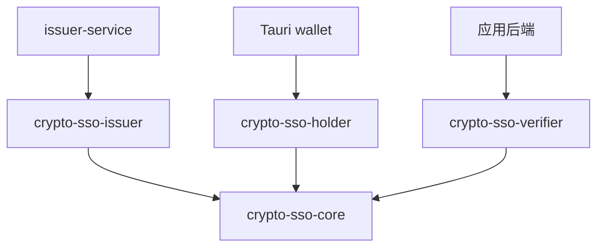

# SDK 按调用方角色拆包与对外 API 设计（SDK v0.1 / 协议 v1）

本文定义拟实现的 Rust 调用接口与契约，当前 `sdk` 尚未实现这些接口。签名示例省略函数体；文中的数据库与 HTTP 调用属于集成方伪代码。

SDK 完成带 key-value 属性的 BBS+ 盲签发、解盲、属性选择披露、应用域化名、组合证明及验真，不读取文件、不访问网络、不维护数据库，也不创建应用会话。所有方法同步执行，时间与安全随机源由调用方显式传入。

密码学实现参考仓库为 `org-anon-auth`，参考提交为 `ebf343609d1ba05c9e5a6043e1ba95ca4efe0188`。本设计在其 BBS+ 盲签发和共享秘密组合证明上加入属性签名，定义本项目首次实现的协议 v1，使用 `crypto-sso/v1/` 域分离标签、本文规定的参数、消息布局和 JSON 线格式；沿用参考实现的 origin、挑战时效和客户端绑定规则。SDK 版本与协议版本分别管理，SDK v0.1 实现本文的协议 v1。

## 1. 按角色划分四个 crate

`sdk/` 改为 SDK 家族的目录，使用仓库根目录现有的 Cargo workspace 管理。目录下包含三个面向调用方的角色 crate，以及一个共享基础 crate；不另建嵌套 workspace，也不保留同时导出三个角色的总入口 crate。

```text
sdk/
├── README.md
├── core/                         # crypto-sso-core
│   ├── Cargo.toml
│   └── src/
│       ├── lib.rs                # 共享值类型、协议常量、Core Error
│       ├── wire.rs               # 交换消息、严格 JSON 编解码
│       ├── limits.rs             # ClaimsLimits、共享静态配置与初始化接口
│       ├── origin.rs             # origin 规范化
│       ├── secret.rs             # SecretBytes
│       └── internal/             # 固定参数、转录、群元素、公共数学函数
├── issuer/                       # crypto-sso-issuer
│   ├── Cargo.toml
│   └── src/                      # Issuer、签发私密备份、签发错误
├── holder/                       # crypto-sso-holder
│   ├── Cargo.toml
│   └── src/                      # Holder、PendingEnrollment、本地秘密备份
└── verifier/                     # crypto-sso-verifier
    ├── Cargo.toml
    ├── src/                      # Verifier、ClientBindingSecret、VerifiedProof
    └── tests/
        ├── offline_flow.rs       # dev-dependencies 引入另两个角色
        └── fixtures/v1/          # 版本控制内的属性签发与披露 JSON
```

| 调用方 | 直接依赖的包 | 主要能力 |
|---|---|---|
| `issuer-service` | `crypto-sso-issuer` | 初始化组织密钥、核对核准属性后盲签发、私钥导入导出 |
| `wallet/src-tauri` | `crypto-sso-holder` | 携带属性申领、保存申领状态、解盲、选择属性生成证明、凭证恢复 |
| 应用程序后端 | `crypto-sso-verifier` | 创建带必需属性的挑战、检查客户端绑定、验证证明、返回应用内身份及已验证属性 |
| 三个 SDK 角色包 | `crypto-sso-core` | 共用消息、值类型、编码、协议参数和基础数学函数 |

正常依赖关系如下，箭头表示“依赖”：



三个角色包之间不建立正常依赖。holder 直接调用共享数学函数验证自己的凭证，不依赖 verifier；verifier 不依赖 holder 或 issuer。签发、解盲、证明生成和完整验真流程分别留在对应角色包，不能全部下沉进 core 再由角色包包装转发。

core 包含密码学依赖，因为组织指纹、点解码和公共参数属于共享协议。首版不再额外拆分 protocol/crypto 两个基础包。业务方依赖 verifier 时，不会引入 SDK 的签发和钱包角色实现，但仍会引入验证所需的底层密码学库。

## 2. 各角色的导出入口与类型归属

每个角色包重导出本角色调用所需的共享类型和 `wire`，因此业务方通常只需声明一个 SDK 依赖。Rust import 中将包名的连字符写成下划线。

```rust
// 签发服务
use crypto_sso_issuer::{
    Issuer, IssuerPublic, EnrollmentRequest, BlindCredential,
    Claims, IssuerId, RequestId, RequestHash, SecretBytes, Error, Result, wire,
    ClaimsLimits, DEFAULT_CLAIMS_LIMITS, claims_limits, set_claims_limits,
};

// 钱包 Rust 后端
use crypto_sso_holder::{
    Holder, PendingEnrollment, IssuerPublic, EnrollmentRequest, BlindCredential,
    LoginChallenge, Presentation, Origin, IssuerId, RequestId, RequestHash, Nonce,
    Claims, ClaimKeys, DisclosedClaim, SecretBytes, Error, Result, wire,
    ClaimsLimits, DEFAULT_CLAIMS_LIMITS, claims_limits, set_claims_limits,
};

// 应用后端
use crypto_sso_verifier::{
    Verifier, IssuerPublic, LoginChallenge, Presentation,
    VerifiedProof, Claims, ClaimKeys, DisclosedClaim,
    ClientBindingSecret, Origin, IssuerId, Nonce, Subject,
    Error, Result, wire,
    ClaimsLimits, DEFAULT_CLAIMS_LIMITS, claims_limits, set_claims_limits,
};
```

以上三段是不同调用方的独立示例。所有随机源使用 `rand 0.8` 的 `RngCore + CryptoRng`，生产调用可使用 `rand::rngs::OsRng`。

| 定义所在包 | 定义的类型 |
|---|---|
| `crypto-sso-core` | `IssuerPublic`、`EnrollmentRequest`、`BlindCredential`、`LoginChallenge`、`Presentation` 及其内嵌 DTO `DisclosedClaim`；`Claims`、`ClaimKeys`、`Origin`、`IssuerId`、`RequestId`、`RequestHash`、`Nonce`、`Subject`；`ClaimsLimits` 及共享配置接口、`SecretBytes`、协议常量、公共编解码及基础错误 |
| `crypto-sso-issuer` | `Issuer`、签发私密备份的内部结构、签发角色的 `Error/Result` |
| `crypto-sso-holder` | `Holder`、`PendingEnrollment`、钱包私密备份的内部结构、持有角色的 `Error/Result` |
| `crypto-sso-verifier` | `Verifier`、`ClientBindingSecret`、`VerifiedProof`、验证角色的 `Error/Result` |

各角色重导出的消息是同一 core 类型，不定义 `IssuerEnrollmentRequest`、`HolderEnrollmentRequest` 等镜像结构，不需要转换，也不重复维护 JSON 格式。

各角色同时重导出 `CoreError`、`CoreResult<T>`，供调用方处理 `wire` 和值类型的公共错误。`wire` 的返回类型始终是 `CoreResult<T>`，在返回角色 `Result<T>` 的函数中可以通过 `?` 转换为本角色错误。

| 类型 | 用途 | 能否在协议参与方间传递 |
|---|---|---|
| `Issuer` | 持有签发私钥的运行时对象 | 否 |
| `IssuerPublic` | 组织标识、公钥和派生指纹 | 可向钱包和应用分发，来源必须可信 |
| `PendingEnrollment` | 用户秘密、盲因子和申领上下文 | 否，留在钱包本地 |
| `EnrollmentRequest` | 隐藏秘密的承诺、知识证明及申请签署的明文属性 | 钱包 → 签发中心 |
| `BlindCredential` | 与具体申领请求及属性绑定的盲签响应 | 签发中心 → 钱包 |
| `Holder` | 用户秘密、完整属性与已验证凭证的运行时对象 | 否，留在钱包本地 |
| `LoginChallenge` | 应用创建的公开挑战及必需披露的属性键 | 应用 → 钱包 |
| `ClientBindingSecret` | 独立的预登录客户端秘密 | 应用与当前浏览器通过 Cookie 交换 |
| `Presentation` | 凭证持有证明、应用域化名及所选属性的披露项 | 钱包 → 应用 |
| `VerifiedProof` | 验真后的身份、已披露属性与挑战上下文 | 应用内部使用 |
| `SecretBytes` | 显式导出的本地秘密备份 | 仅交给本地安全存储或加密层 |

角色运行时对象、秘密类型和值类型字段私有，使用构造方法和只读访问器。五种公共交换消息及内嵌的 `DisclosedClaim` 作为不可信 DTO，提供 `pub` 字段以便不同 crate 构造；其中 ID、nonce、origin、属性集合等字段使用对应值类型，密码学编码使用小写 hex 字符串。

这替代了先前“所有消息字段私有”的设计：Rust 的 `pub(crate)` 不能跨 crate 使用。角色方法必须重新校验传入消息，不能假设消息一定由 `wire::from_json` 创建，或在解析后从未被修改。消息解析成功不代替签发请求证明、凭证或登录证明的验真。

`Issuer`、`Holder` 和 `Verifier` 在构造或恢复时建立自己的已验证上下文并缓存组织指纹，不从可变 DTO 缓存信任判断。`VerifiedProof` 定义在 verifier 内，字段和构造入口保持私有，其他角色不能直接构造它。

`IssuerPublic`、`EnrollmentRequest`、`BlindCredential`、`LoginChallenge`、`Presentation` 支持公共消息编解码，可实现 `Clone`、`Debug`、`Eq`。`Debug` 应隐藏属性值和体积较大的密码学字段，避免意外写入日志；消息可以在参与方间交换不代表其中属性适合公开记录。

`Issuer`、`Holder`、`PendingEnrollment`、`ClientBindingSecret`、`SecretBytes` 不实现 `Debug`、`Clone` 或通用 Serde 序列化。秘密通过专用接口导入导出，释放时尽可能清理内存；不承诺消除进程、第三方库或操作系统中的全部副本。

core 的内部数学函数需要由不同 crate 调用，因此通过带 `#[doc(hidden)]` 的 `__private` 模块公开，文件组织在 `src/internal/` 下。Rust 不提供“仅允许某几个兄弟 crate 访问”的 `pub(crate)` 机制；这里是实现接口，不是权限边界。底层类型不出现在三个角色包的业务方法签名中。角色包精确依赖同版本 core，并共同发布升级，不对 `__private` 提供独立稳定承诺。

## 3. 基础值类型

本节类型定义在 core，签名中的 `Result` 为 core 的 `Result`。

```rust
impl Origin {
    pub fn parse(value: &str) -> Result<Self>;
    pub fn as_str(&self) -> &str;
}

// 以下值类型均提供同名方法，并实现 Eq、Hash、Clone。
impl IssuerId {
    pub fn parse(value: &str) -> Result<Self>;
    pub fn as_str(&self) -> &str;
}
// RequestId、RequestHash、Nonce、Subject 同上。
```

| 类型 | v1 编码与语义 |
|---|---|
| `IssuerId` | 32 字节的小写 hex；绑定版本、组织、公钥与固定参数 |
| `RequestId` | 32 字节随机值的小写 hex；仅用于申领 |
| `RequestHash` | 完整规范化申领请求的域分离哈希，小写 hex |
| `Nonce` | 32 字节随机值的小写 hex；作为挑战查询标识 |
| `Subject` | 非零、有效 G1 点的压缩编码，小写 hex；身份按 issuer 和 origin 解释 |

`Subject::parse` 只检查编码与群元素有效性，不赋予身份可信性。业务账号只能使用 `VerifiedProof` 返回的 subject；不能直接相信请求中声明的化名。

`Origin::parse` 沿用参考规范：

- 接受裸 HTTPS origin，以及仅供本地开发的 HTTP loopback origin。
- 规范化 scheme、host、默认端口，并使用 URL 库输出 ASCII origin。
- 拒绝用户名、密码、非根路径、查询和 fragment。
- 同一 origin 的不同业务路径共享身份，非默认端口属于不同身份域。

例如 `HTTPS://FORUM.EXAMPLE.ORG:443/` 规范化为 `https://forum.example.org`。

`IssuerId::parse` 不验证某个公钥是否属于该组织。应用和钱包仍需通过可信渠道固定 `IssuerPublic` 或其指纹。

### 3.1. key-value 属性与披露选择

v1 的属性类型固定为字符串到字符串的映射；暂不接受数字、布尔值、数组、对象或 `null`，避免跨语言类型和序列化歧义。需要这些业务类型时，调用方应约定字符串语义；SDK 只证明 issuer 签署了该键与该字符串值，不自动解释角色、日期或权限。

```rust
// 两者内部字段私有，可实现 Clone、Eq；不提供原地修改接口。
pub struct Claims { /* private: 按键排序的字符串映射 */ }
pub struct ClaimKeys { /* private: 按键排序的键集合 */ }

impl Claims {
    pub fn new<I, K, V>(entries: I) -> Result<Self>
    where
        I: IntoIterator<Item = (K, V)>,
        K: Into<String>,
        V: Into<String>;

    pub fn empty() -> Self;
    pub fn len(&self) -> usize;
    pub fn is_empty(&self) -> bool;
    pub fn get(&self, key: &str) -> Option<&str>;
    pub fn keys(&self) -> ClaimKeys;
    pub fn iter(&self) -> impl ExactSizeIterator<Item = (&str, &str)>;
}

impl ClaimKeys {
    pub fn new<I, K>(keys: I) -> Result<Self>
    where
        I: IntoIterator<Item = K>,
        K: Into<String>;

    pub fn empty() -> Self;
    pub fn len(&self) -> usize;
    pub fn is_empty(&self) -> bool;
    pub fn contains(&self, key: &str) -> bool;
    pub fn iter(&self) -> impl ExactSizeIterator<Item = &str>;
}

// Presentation 内嵌的不可信 DTO；index 为属性槽位，不是 BBS+ 消息索引。
#[derive(Clone, Eq, PartialEq)]
pub struct DisclosedClaim {
    pub index: u64,
    pub key: String,
    pub value: String,
}
```

构造和解析必须遵守以下规则，角色方法也要校验可变 DTO 的当前内容：

- SDK 不设固定的 Claims 字段数量上限。`Claims` 和 `ClaimKeys` 的最大键数量由调用方通过第 7.2 节的共享静态配置设置，默认每个集合最多 128 个键；这不是进程内所有集合的累计配额。
- 键匹配 ASCII 正则 `[a-z][a-z0-9_.-]*`，键名长度另按配置的 `max_key_bytes` 检查，默认 64 字节。不同键名不做大小写折叠或别名替换。
- 值为有效 UTF-8 字符串，长度按配置的 `max_value_bytes` 检查，默认 1024 字节，允许空字符串；字符串不做 trim、Unicode 归一化或隐式类型转换。键名和值的长度分别配置，均按 UTF-8 字节数计算。
- 不另设固定的属性总字节数上限；属性总量由配置的键数量、单键及单值长度共同约束。所有计数、长度累加、消息数量和平台类型转换均检查溢出，不能通过截断或整数回绕绕过校验。
- `Claims::new` 和 JSON 解析均在收集成映射前拒绝重复键，不能静默保留首项或末项。`ClaimKeys::new` 同样拒绝重复键。两者均按键的 ASCII 字节序排序。
- 空集合表示没有属性或没有选择披露。省略的键与值为空字符串的键不同；`ClaimKeys` 不支持通配符。
- `Claims` 在验真前只代表数据格式有效。只有 `Holder::claims()` 和 `VerifiedProof::disclosed_claims()` 分别代表本地已验证凭证的属性和本次证明中已验证的披露属性。

### 3.2. 属性签名与选择披露的密码学契约

令 `n = claims.len()`，按键排序后的属性依次为 `(k_i, v_i)`，`0 <= i < n`。每张凭证签署下列有序消息向量：

```text
消息索引 0：钱包秘密 x，始终隐藏
消息索引 1：组织消息 m_org，始终公开
消息索引 2：属性数量 Fr(n)，始终公开
消息索引 3 + i：m_i = H_scalar(
    LP("crypto-sso/v1/claim") || LP("utf8-string") || LP(k_i) || LP(v_i)
)
```

`LP` 为 `u64` 小端字节长度前缀加原始 UTF-8 字节；`H_scalar` 为 SHA-512 输出按小端整数约减到 BLS12-381 标量域。键和值作为一条消息共同哈希，且使用独立类型与用途标签，不能仅签值、仅签属性总哈希，或只把属性加入登录挑战。空属性集合仍签署前三条消息。

参数使用 `crypto-sso/v1/bbsplus/fixed-parameters` 标签公开、确定性地按需派生，不预先限定消息基点数量。固定用途基点使用各自用途标签；第 `j` 个消息基点以 `LP("crypto-sso/v1/bbsplus/fixed-parameters") || LP("message") || u64_le(j)` 为输入进行 hash-to-curve。每张凭证使用前 `3 + n` 个消息基点，已存在索引的基点不随本次请求数量或本地配置变化，其余公共基点也保持相同。实现应按实际所需数量派生或扩展缓存，不能按配置上限预分配整组参数。

组织指纹绑定 v1、组织、公钥和固定参数派生规则的标识；标识固定曲线与散列套件、派生标签及索引编码规则，不枚举一个有限的“完整消息基点组”，也不绑定本地 `ClaimsLimits`、本次属性数量或披露选择。禁止 issuer 或钱包提供个性化参数或生成规则。组织消息由该指纹在 `crypto-sso/v1/organization-message` 域中派生。

签发时，钱包只对索引 0 的秘密 `x` 和盲因子作承诺并证明知道开口；issuer 能看到完整属性，核准后将索引 1、2 和所有属性消息作为已知消息加入同一个 BBS+ 盲签名。承诺知识证明的 Fiat–Shamir 转录使用 `crypto-sso/v1/enrollment-proof` 域，并绑定版本、组织指纹、请求 ID、本次参数、承诺、证明承诺及完整规范属性集合。属性也必须进入 `request_hash`。传输保密和业务身份核验由集成方负责。

出示时，钱包为选中的每个键发送 `DisclosedClaim { index: i, key, value }`，公开它对应的 BBS+ 消息 `3 + i`；所有未选属性的消息保持隐藏，`x` 始终隐藏。应用根据键值重新计算消息，验证它们与签名、公开的属性数量及应用化名属于同一张凭证。不能用独立属性签名与独立登录证明拼接，也不能向应用发送原始凭证签名。

`Presentation` 携带公开的 `claim_count = n`。`claim_count` 和披露 `index` 使用 `u64`；验真要求 `n` 不超过当前本地 `max_keys`、每项 `index < n`，索引和键分别唯一，披露项按索引严格递增，且可见键遵守相同的升序关系；消息数量严格为 `3 + n`。所有 `u64`、`usize` 转换及 `3 + n` 等运算必须检查溢出和可表示性，不另设置固定字段数阈值。公开消息集合恰为索引 1、2 及全部披露槽位，隐藏消息集合为其余位置。证明结构、隐藏消息响应数量和资源约束必须按当前配置和实际数量计算，不能假定只有一个隐藏消息，也不能接受部分响应证明。

登录证明在 `crypto-sso/v1/login-proof` 域中绑定完整挑战（含 `required_claims`）、`claim_count`、每个披露项的索引、键和值、公钥、化名上下文和 BBS+ 的完整挑战贡献。化名基点继续使用对组织指纹和规范 origin 的 hash-to-curve，在 v1 独立域中派生；化名 `N = x·B` 的证明必须复用同一 BBS+ 证明中索引 0 的秘密响应。增加多个隐藏属性后，仍须从正确消息索引提取该响应。

该设计支持按键选择披露、全部披露及完全不披露。应用可见属性总数及已披露属性的槽位；未披露键名、值和可供字典枚举的属性哈希不得单独输出，完整键清单、请求 ID、`request_hash` 或整份属性摘要也不得进入出示消息。公开的属性数量、槽位及属性本身仍可能提供关联线索，披露唯一姓名或成员编号会影响跨应用不可关联性。选择披露只证明已披露的值，不证明某个未披露键不存在，也不自动提供范围证明。

### 3.3. v1 交换字段

五种顶层消息仍是封闭结构；扩展点是显式的 `claims` 字段，不能在消息顶层任意添加属性。沿用参考消息的字段名称及顺序，并按下表追加 v1 字段：

| 消息 | v1 字段及 JSON 形式 | 信任含义 |
|---|---|---|
| `EnrollmentRequest` | `claims: Claims`，JSON 对象，例如 `{"department":"engineering","role":"member"}` | 钱包申请签署的数据，尚未经 issuer 核准 |
| `BlindCredential` | `claims: Claims`，与请求完全相同的 JSON 对象 | 解盲并验证签名后才可信 |
| `LoginChallenge` | `required_claims: ClaimKeys`，JSON 字符串数组 | 应用要求本次必须披露的键，钱包仍需取得用户同意 |
| `Presentation` | `claim_count: u64`；`disclosed_claims: Vec<DisclosedClaim>`，数组项 `index` 为 `u64`，字段顺序为 `index`、`key`、`value` | 验真前均是不可信输入 |
| `IssuerPublic` | 无新增业务字段；`version` 固定为 1，按本文参数解释 | 仍需可信分发 |

Rust DTO 的新增字段与上表同名，均为 `pub`。所有集合字段必须显式出现，空值编码为 `{}` 或 `[]`，不使用省略或 `null`。`Claims` 编码为按键排序的 JSON 对象，`ClaimKeys` 编码为按键排序的 JSON 数组；`disclosed_claims` 按槽位排序。字段中 JSON 转义与未转义字符解析为同一字符串后，按相同规范重编码。

## 4. 签发方接口：crypto-sso-issuer

```rust
impl Issuer {
    pub fn generate<R: RngCore + CryptoRng>(
        organization: &str,
        rng: &mut R,
    ) -> Result<Self>;

    pub fn public(&self) -> &IssuerPublic;
    pub fn issuer_id(&self) -> &IssuerId;

    pub fn export_secret(&self) -> Result<SecretBytes>;

    pub fn import_secret(
        bytes: &[u8],
        expected_issuer: &IssuerPublic,
    ) -> Result<Self>;

    pub fn issue_blind<R: RngCore + CryptoRng>(
        &self,
        request: &EnrollmentRequest,
        approved_claims: &Claims,
        rng: &mut R,
    ) -> Result<BlindCredential>;
}

impl IssuerPublic {
    pub fn version(&self) -> u8;
    pub fn organization(&self) -> &str;
    pub fn public_key_hex(&self) -> &str;
    pub fn issuer_id(&self) -> crypto_sso_core::Result<IssuerId>;
}

impl EnrollmentRequest {
    pub fn issuer_id(&self) -> &IssuerId;
    pub fn request_id(&self) -> &RequestId;
    pub fn request_hash(&self) -> crypto_sso_core::Result<RequestHash>;
    pub fn claims(&self) -> &Claims;
}

impl BlindCredential {
    pub fn issuer_id(&self) -> &IssuerId;
    pub fn request_id(&self) -> &RequestId;
    pub fn request_hash(&self) -> &RequestHash;
    pub fn claims(&self) -> &Claims;
}
```

契约：

- 本节 `Issuer` 方法中的 `Result` 属于 `crypto-sso-issuer`；共享 DTO 的可失败方法显式使用 core 的 `Result`。
- 共享 DTO 可以被修改，`IssuerPublic::issuer_id` 和 `EnrollmentRequest::request_hash` 每次重新计算并返回拥有所有权的值；角色对象的 `issuer_id()` 返回自身缓存的可信指纹。
- `generate` 生成非零私钥，并验证组织名。沿用参考规则：组织名非空、最多 128 字节、无首尾空白和控制字符。
- `import_secret` 校验秘密备份版本、公私钥一致性，以及与 `expected_issuer` 的完整信任源一致性。导入不能悄悄切换组织或公钥。
- `issue_blind` 始终先检查请求版本、组织绑定、属性格式与数量、群元素、覆盖属性的承诺开口知识证明，再执行盲签。首版不公开跳过检查的签发入口。
- `approved_claims` 必须由 issuer 服务层根据可信资料及业务策略核准，不能不经核验地复制钱包请求。SDK 要求它与请求中的完整 `claims` 相等，否则返回 `ClaimsMismatch`，不生成签名，也不自动删改属性。需要改值、增加或删除属性时，由钱包确认新集合并重新申领。
- `issue_blind` 把核准属性作为同一张凭证的已知签名消息，不接受独立成员编号参数，也不核验自然人身份。成员编号只有作为显式属性提交并核准时才进入签名；调用此方法应发生在服务层完成身份与属性授权以后。
- 同一请求多次调用 `issue_blind` 可以产生不同的有效盲签响应；SDK 不保证签发幂等。
- `request_hash` 使用固定的 v1 结构重序列化后，在 `crypto-sso/v1/enrollment-request` 域中计算；覆盖完整请求，包括排序后的 `claims`。JSON 文本的空白或输入字段顺序不改变结果；不直接哈希原始 HTTP body。它用于申领匹配与幂等，不代替属性签名。

签发服务的台账应在事务中同时约束成员与请求的唯一性。对同一已授权成员、同一请求及同一核准属性集合的重试，返回保存的同一份响应；同一成员换请求、同一请求换成员或同一请求 ID 携带不同属性必须拒绝。只比较 `request_id` 不足以识别完整请求；属性修改应使 `request_hash` 改变。

## 5. 钱包持有方接口：crypto-sso-holder

```rust
impl Holder {
    pub fn begin_enrollment<R: RngCore + CryptoRng>(
        trusted_issuer: &IssuerPublic,
        claims: &Claims,
        rng: &mut R,
    ) -> Result<(PendingEnrollment, EnrollmentRequest)>;

    pub fn issuer(&self) -> &IssuerPublic;
    pub fn issuer_id(&self) -> &IssuerId;
    pub fn claims(&self) -> &Claims;

    pub fn present<R: RngCore + CryptoRng>(
        &self,
        challenge: &LoginChallenge,
        trusted_origin: &Origin,
        disclose_keys: &ClaimKeys,
        now: u64,
        rng: &mut R,
    ) -> Result<Presentation>;

    pub fn export_secret(&self) -> Result<SecretBytes>;

    pub fn import_secret(
        bytes: &[u8],
        expected_issuer: &IssuerPublic,
    ) -> Result<Self>;
}

impl PendingEnrollment {
    pub fn issuer_id(&self) -> &IssuerId;
    pub fn request_id(&self) -> &RequestId;
    pub fn request_hash(&self) -> &RequestHash;
    pub fn claims(&self) -> &Claims;

    pub fn finish(&self, response: &BlindCredential) -> Result<Holder>;

    pub fn export_secret(&self) -> Result<SecretBytes>;

    pub fn import_secret(
        bytes: &[u8],
        expected_issuer: &IssuerPublic,
    ) -> Result<Self>;
}
```

契约：

- 首版一个 `Holder` 对应一个签发组织及其凭证，内部持有随机秘密 `x`、完整 `claims` 和覆盖它们的已验证签名，不提供读取 `x` 的独立方法。`claims()` 返回只读的已验证属性，没有修改已签属性的入口。
- `begin_enrollment` 接受钱包希望 issuer 签署的完整属性集合，复制到 pending 与请求，并在生成证明前校验限制；这些属性对 issuer 可见，只有秘密 `x` 被盲化。`Claims::empty()` 可用于仅申请成员资格。
- 每次 `begin_enrollment` 都生成新的秘密、盲因子和请求标识。重新申领（包括更新属性）会改变应用身份；恢复身份应导入既有 `Holder` 备份。更新属性且保留原身份的续签接口不在首版范围内。
- 钱包应先安全保存 pending 状态和对应请求，再发送请求。pending 包含解盲必需数据，不能发送给签发中心。
- `finish` 检查 issuer、request ID、request hash 和完整属性集合与 pending 一致，完成解盲并验证覆盖 `[x, m_org, Fr(n), m_0, ...]` 的最终签名。收到别人的响应、属性被替换或签名不成立时返回错误；字段相等或哈希匹配不能代替验签。
- `finish` 借用 pending，不在错误时销毁它，也不隐式删除本地备份。钱包先持久化新 `Holder`，成功后再清理 pending；这样可以恢复网络重试和保存失败。
- v1 pending 备份包含完整 `EnrollmentRequest`、秘密和盲因子。导入时重新计算请求哈希、检查属性与请求证明、检查承诺与秘密及盲因子相符，并校验预期信任源；仍由 `finish` 的最终验签确认 issuer 的签发。
- `Holder::import_secret` 校验组织绑定、非零秘密、完整属性和覆盖它们的凭证签名，失败时不创建可用的 `Holder`。导出格式必须保留所有属性，不能只备份已披露子集。
- `present` 校验组织、可信 origin、挑战时效和披露选择，将完整挑战与所选披露项绑定进同一个组合证明。`disclose_keys` 必须是本凭证键集合的子集，且包含挑战的全部 `required_claims`；未知键返回 `InvalidDisclosure`，缺少必需键返回 `MissingRequiredClaims`。
- 披露集合必须由钱包交互取得用户同意并显式传入。SDK 不会根据应用请求自动增加披露项，也没有默认“全部披露”；传入 `ClaimKeys::empty()` 时，只有挑战也不要求属性才能成功。钱包可拒绝挑战或让用户调整选择后重试。
- `present` 只把 `disclose_keys` 对应的键值写入 `disclosed_claims`，其余属性作为隐藏消息参与证明；不会修改 `Holder`。相同挑战下重复调用仍生成新的随机化证明，使用不同披露子集也不改变应用化名。
- `trusted_origin` 来自钱包的可信交互或浏览器集成，不得直接从挑战复制。SDK 能检查两者相等，不能替钱包确认浏览器正在访问哪个站点。

`Holder`、pending 和签发私钥的导入导出使用带 `version: 1` 的 v1 私密 JSON 格式。它们只通过秘密接口操作，不属于公共消息编解码集合。

## 6. 应用验证方接口：crypto-sso-verifier

```rust
impl Verifier {
    pub fn new(
        trusted_issuer: IssuerPublic,
        origin: Origin,
    ) -> Result<Self>;

    pub fn issuer_id(&self) -> &IssuerId;
    pub fn origin(&self) -> &Origin;

    pub fn create_challenge<R: RngCore + CryptoRng>(
        &self,
        required_claims: &ClaimKeys,
        now: u64,
        rng: &mut R,
    ) -> Result<(LoginChallenge, ClientBindingSecret)>;

    pub fn verify_proof(
        &self,
        presentation: &Presentation,
        stored_challenge: &LoginChallenge,
        client_binding: &ClientBindingSecret,
        now: u64,
    ) -> Result<VerifiedProof>;
}

impl LoginChallenge {
    pub fn version(&self) -> u8;
    pub fn issuer_id(&self) -> &IssuerId;
    pub fn origin(&self) -> &Origin;
    pub fn nonce(&self) -> &Nonce;
    pub fn issued_at(&self) -> u64;
    pub fn expires_at(&self) -> u64;
    pub fn required_claims(&self) -> &ClaimKeys;
}

impl Presentation {
    pub fn challenge(&self) -> &LoginChallenge;
    pub fn claim_count(&self) -> u64;
    pub fn disclosed_claims(&self) -> &[DisclosedClaim];
}

impl ClientBindingSecret {
    pub fn from_cookie_value(value: &str) -> Result<Self>;
    pub fn expose_cookie_value(&self) -> &str;
}

#[must_use]
pub struct VerifiedProof { /* private */ }

impl VerifiedProof {
    pub fn subject(&self) -> &Subject;
    pub fn challenge(&self) -> &LoginChallenge;
    pub fn disclosed_claims(&self) -> &Claims;
}
```

`Verifier` 在构造时固定信任源和应用 origin，后续验真不从请求中选择它们。建议缓存可安全复用的参数、已校验公钥与该 origin 的化名基点。

`create_challenge`：

1. 生成独立的 256 位 nonce 和 256 位客户端秘密。
2. 创建 120 秒有效的挑战，并绑定客户端秘密的域分离哈希和显式传入的 `required_claims`；不要求属性时传 `ClaimKeys::empty()`。
3. 返回挑战和客户端秘密，不自动保存任何状态。

应用保存完整挑战；只向钱包传递挑战。客户端秘密通过应用自己的 HttpOnly 预登录 Cookie 下发，生产环境同时设置 Secure，默认使用 SameSite=Strict。钱包不需要读取该秘密。

`verify_proof` 按以下顺序执行：

1. 检查 presentation 中完整挑战与 `stored_challenge` 完全一致。
2. 检查版本、预配置 issuer 和 origin。
3. 检查时间关系与 nonce、客户端绑定格式；客户端秘密必须匹配挑战中的哈希。
4. 检查属性数量、披露项格式、索引及键的唯一性、排序和界限，并要求披露键包含 `stored_challenge.required_claims()`；缺少必需键返回 `MissingRequiredClaims`。
5. 检查点编码、子群、非零化名、与本次隐藏消息数量匹配的完整证明结构和大小限制。
6. 由已披露键值重新计算签名消息，验证 BBS+ 持有证明及复用索引 0 秘密响应的化名关系；属性篡改、错位或跨凭证拼接必须失败。
7. 返回仅由 SDK 创建的 `VerifiedProof`，其中仅包含本次已披露且已验证的属性。

公共 JSON 中 `audience` 等原有字段名保持参考命名；Rust 的 `origin()` 访问器不改变字段名。新增字段遵守第 3.3 节的 v1 线格式。

`Presentation::disclosed_claims()` 只提供请求内容，不提供可信性。应用应使用 `VerifiedProof::disclosed_claims()` 读取属性，并另行执行值和权限策略，例如要求 `role == "member"`。`required_claims` 只要求键出现，不约束值；未披露的键不能被当作空字符串、否定值或“不存在”。选择性隐藏不会允许缺少必需属性的登录通过。

`stored_challenge` 必须来自应用自己的待处理挑战存储，不能直接使用请求中的挑战副本。客户端 Cookie 也必须来自本次 HTTP 请求的独立 Cookie，而不是 presentation 的字段。

`verify_proof` 不查询挑战是否存在或已消费。同一份有效证明可以多次通过无状态验真；应用必须在其后通过数据库条件更新或删除，让同一挑战只有一个成功者。SDK 不提供名为 `login` 或 `authenticate` 的无状态便捷方法。

## 7. 时间与资源约束

### 7.1. 登录挑战时间

```rust
pub const PROTOCOL_VERSION: u8 = 1;
pub const MAX_CHALLENGE_TTL_SECS: u64 = 120;
pub const MAX_FUTURE_SKEW_SECS: u64 = 30;
```

`now`、`issued_at`、`expires_at` 均为 Unix 秒，使用 `u64`。所有加减法检查溢出。

- 创建挑战固定使用 120 秒 TTL；首版不开放任意有效期配置。
- 验证时要求 `0 < expires_at - issued_at <= 120`。
- `now >= expires_at` 立即失效；允许签发时间最多领先当前时间 30 秒。
- 钱包使用设备当前时间；应用使用服务器当前时间。只有测试使用固定时钟。
- HTTP 和异步框架应在阻塞任务池中调用证明生成、验真方法，并在入口限制请求大小与并发量。

验真结束后到原子消费之间，应用应重新读取当前时间，并在消费条件中再次检查有效期。不要仅凭进入验真前的时间创建会话。

### 7.2. 调用方配置 Claims 限制

以下类型、默认值和函数定义在 core，并由三个角色包重导出。三个角色在同一进程中共享同一个 core 静态变量，不分别保存限制。此处 `Result` 为 core 的 `Result`。

```rust
#[derive(Clone, Copy, Debug, Eq, PartialEq)]
pub struct ClaimsLimits {
    pub max_keys: usize,
    pub max_key_bytes: usize,
    pub max_value_bytes: usize,
}

pub const DEFAULT_CLAIMS_LIMITS: ClaimsLimits = ClaimsLimits {
    max_keys: 128,
    max_key_bytes: 64,
    max_value_bytes: 1024,
};

// core 内部私有，不允许调用方直接访问或取得引用。
static mut CLAIMS_LIMITS: ClaimsLimits = DEFAULT_CLAIMS_LIMITS;

// 按值返回当前配置快照。
pub fn claims_limits() -> ClaimsLimits;

/// # Safety
/// 只能在进程初始化、其他 SDK 调用开始之前设置。
/// 调用方须保证没有任何并发 SDK 读取或配置写入，
/// 并在 SDK 开始使用后保持配置不变。
pub unsafe fn set_claims_limits(limits: ClaimsLimits) -> Result<()>;
```

配置契约：

- `max_keys` 限制单个完整属性集合、选择键集合和挑战必需键集合的键数量；也用于校验 `Presentation::claim_count` 及披露项数量。`max_key_bytes` 和 `max_value_bytes` 分别限制解码后单个键名和属性值的 UTF-8 字节数。
- 默认 128 个键、64 字节键名和 1024 字节值仅为可调整的部署策略，不是协议硬上限。SDK 不再导出固定的 `MAX_CLAIMS`、`MAX_CLAIM_KEY_BYTES`、`MAX_CLAIM_VALUE_BYTES`、`MAX_CLAIMS_BYTES` 或 `MAX_MESSAGE_BYTES`。调用方可以把 `max_keys` 设置为 `usize::MAX`，表示不施加额外的本地字段数策略；编码可表示性及实际内存需求仍由具体操作检查。
- `max_key_bytes` 必须至少为 1，否则 `set_claims_limits` 返回 `InvalidClaimsLimits` 并保留原配置。`max_keys=0` 合法，表示仅允许空集合；`max_value_bytes=0` 合法，表示属性值只能为空字符串。设置函数不按容量创建参数组、缓冲区或其他预分配。
- `unsafe` 入口用于承担共享可变静态变量的初始化与并发约束；它不跳过属性校验。配置校验失败保持原状态。实现必须按值读取静态变量，避免暴露 `static mut` 引用，并在函数体中显式使用必要的 `unsafe` 块。
- SDK 操作使用当前配置的值副本，向内部校验传递同一快照。属性构造、wire 输入输出、签发、解盲、出示、验真及私密备份导入导出均执行对应限制，不能只在 `Claims::new` 时检查。
- 该配置只影响本进程的接收和生成策略，不写入交换消息、秘密备份、请求哈希、issuer 指纹、签名消息或证明转录。不同进程可使用不同配置；接收端按自身配置拒绝超限输入，配置变化本身不改变合法凭证的 subject 或协议编码。
- 没有额外固定的属性总字节数或整体消息字节数上限。SDK 按实际结构和上述配置限制字段及容器，所有容量计算检查溢出，不能按不可信长度或极大的配置值直接分配。HTTP body、文件和本地备份的读取总量由调用方在入口限制。

配置必须在其他 SDK 访问前完成，不得用热更新配置改变已经运行的 SDK。并行测试不得在同一进程中反复修改静态变量；不同配置使用独立测试进程，详见 [SDK 测试文档](sdk-test.md)。

## 8. 公共消息编解码与秘密备份

以下入口定义在 `crypto-sso-core`，并由三个角色包重导出。此处 `Result` 为 core 的 `Result`。

```rust
pub mod wire {
    // 封闭 trait，仅 SDK 定义的五种公共交换消息可以实现。
    pub trait WireMessage: private::Sealed {}

    pub fn to_json<T: WireMessage>(value: &T) -> Result<Vec<u8>>;
    pub fn from_json<T: WireMessage>(bytes: &[u8]) -> Result<T>;
}

impl SecretBytes {
    pub fn from_vec(bytes: Vec<u8>) -> Self;
    pub fn expose_secret(&self) -> &[u8];
}
```

公共消息集合为 `IssuerPublic`、`EnrollmentRequest`、`BlindCredential`、`LoginChallenge`、`Presentation`。`Claims`、`ClaimKeys` 和 `DisclosedClaim` 只作为内嵌字段编码，不是额外的顶层 `WireMessage`。`to_json` 按固定顶层字段顺序输出紧凑的 v1 JSON，`from_json` 取得当前 `ClaimsLimits` 快照，再按封闭结构解析并逐项校验数量和长度；输入总量由调用方先行限制。

解析必须拒绝未知或重复字段、非支持版本、非规范 hex、无效群元素、尾随字节、超长字段及非法证明结构。`claims` 内的业务键属于允许的扩展数据，须按第 3.1 节校验；顶层及 `DisclosedClaim` 的结构字段仍拒绝未知字段。解析映射前必须检测重复业务键，不能让 JSON 库先覆盖；披露项还需检测重复索引和重复键。对证明内嵌的可变长度容器，也必须按属性数量和披露数量限制其长度和分配量，不能只限制外层字符串长度。

输入 JSON 对象的字段顺序可以不同，规范输出和 `request_hash` 均使用固定顺序；`ClaimKeys` 数组及 `disclosed_claims` 数组则必须已经按协议排序，不静默修正重复或错序输入。键名和值的长度按解码后的 UTF-8 字节计算，不按 JSON 转义后的文本长度计算。`to_json` 与秘密备份导入导出同样执行当前配置的字段数量和长度限制；SDK 不施加额外固定的集合或消息总字节数上限。

JSON 中的 origin 必须已经是规范形式，解析时与规范化结果比较，不静默改写输入；只有业务配置调用 `Origin::parse` 时接受并规范化大小写、默认端口等形式，以保持参考协议的 origin 校验行为。

首版不为公共消息提供绕过这些检查的通用 `Deserialize` 入口。HTTP 框架先读取有上限的 body，再调用 `wire::from_json`；文件读取也由调用方先限制大小。内部 Serde DTO 不导出。

`export_secret` 返回的 `SecretBytes` 是未加密的秘密 JSON，调用方应直接交给本地加密或安全存储层。`import_secret` 按当前配置检查字段与结构，调用方负责先限制读取总量。SDK 不替调用方清理传入切片对应的内存。

`SecretBytes::from_vec` 转移字节缓冲区的所有权，方便各角色包构造擦除容器；它不校验凭证或秘密格式，也不等于导入秘密。三个角色的私密备份格式、校验和导入导出逻辑各自保留在所属角色包，core 不定义含 issuer 私钥或 holder 主秘密的备份 DTO。

Cookie 使用独立的 `ClientBindingSecret` 导入导出接口。该秘密是固定 32 字节的小写 hex，不能混用为应用登录后的会话令牌。

## 9. 分包错误接口

每个角色包有自己的 `Error` 和 `Result<T>`，只暴露该角色实际可能产生的错误。它们可以包装 core 的公共错误，并通过 `source()` 保留错误链；三个角色的错误类型不合并成总枚举。

```rust
// crypto-sso-core::Error
#[non_exhaustive]
pub enum Error {
    UnsupportedVersion { found: u8 },
    InputTooLarge { limit: usize },
    InvalidEncoding { field: &'static str },
    InvalidIssuer,
    InvalidOrigin,
    InvalidClaims,
    InvalidClaimsLimits,
    Serialization,
    Crypto,
}

// crypto-sso-issuer::Error
#[non_exhaustive]
pub enum Error {
    Core(crypto_sso_core::Error),
    IssuerMismatch,
    InvalidEnrollmentProof,
    ClaimsMismatch,
}

// crypto-sso-holder::Error
#[non_exhaustive]
pub enum Error {
    Core(crypto_sso_core::Error),
    IssuerMismatch,
    OriginMismatch,
    EnrollmentMismatch,
    InvalidCredential,
    InvalidDisclosure,
    MissingRequiredClaims,
    InvalidChallengeTime,
    ChallengeExpired,
    ProofGeneration,
}

// crypto-sso-verifier::Error
#[non_exhaustive]
pub enum Error {
    Core(crypto_sso_core::Error),
    IssuerMismatch,
    OriginMismatch,
    ChallengeMismatch,
    InvalidChallengeTime,
    ChallengeExpired,
    ClientBindingMismatch,
    InvalidPresentation,
    MissingRequiredClaims,
}

// 每个包分别定义。
pub type Result<T> = std::result::Result<T, Error>;
```

以上代码块分别属于不同 crate。各 `Error` 实现 `std::error::Error` 与 `Display`，并实现从 core 错误的转换；不包含原始秘密、原始输入或敏感密码学中间值。core 的 `Crypto` 表示基础数学运算失败，不暴露底层秘密中间值。

- core 的 `InvalidClaims` 表示属性或键集合不满足类型、键语法、重复检查、顺序或当前配置的字节数与数量限制；资源超限也可使用带当前上限的 `InputTooLarge`。`InvalidClaimsLimits` 表示传入设置函数的配置不合法，不表示某份属性内容超限。
- issuer 的 `ClaimsMismatch` 表示钱包申请的完整属性集合与服务层核准集合不同，必须在签名前拒绝。
- `EnrollmentMismatch` 表示盲签响应与本地 pending 的请求上下文或完整属性集合不一致。
- `InvalidCredential` 表示签名与持有秘密、组织绑定或完整属性不成立。
- holder 的 `InvalidDisclosure` 表示所选键不属于当前凭证；holder/verifier 的 `MissingRequiredClaims` 表示选择或实际披露中缺少挑战要求的键。
- `ChallengeMismatch` 表示请求携带的完整挑战与应用保存的挑战不同。
- `InvalidChallengeTime` 包括错误时间顺序、过长 TTL、未来时间和时间溢出。
- `InvalidPresentation` 包括无效 BBS+ 证明、属性数量或披露索引不合法、披露键值与签名不符，以及共享秘密关系不成立。错误中不包含原始属性值或秘密。

不存在 `Database`、`Io`、`AlreadyIssued`、`Replay` 或 `Session` 等 SDK 错误：它们由对应服务层定义。SDK 不能判断挑战是否已经消费，也不能判断某自然人是否已经申领。

## 10. 三方调用示例

以下展示依赖关系和调用顺序，省略应用错误转换、事务实现、Cookie 设置与加密存储实现。`directory`、`member_id` 和时钟等由服务层提供，目录读取也是集成伪代码。

```rust
// 跨角色流程用于 SDK 集成测试；业务方通常只导入自己的角色包。
use crypto_sso_issuer::{Issuer, EnrollmentRequest};
use crypto_sso_holder::{Holder, PendingEnrollment, BlindCredential, Claims, ClaimKeys};
use crypto_sso_verifier::{
    Verifier, ClientBindingSecret, Origin, LoginChallenge, Presentation, wire,
    ClaimsLimits, set_claims_limits,
};
use rand::rngs::OsRng;

// 进程启动时、其他 SDK 调用及工作线程启动之前设置一次。
// 此处三方处于同一示例进程，共享 core 静态配置；实际部署各进程分别配置。
unsafe {
    set_claims_limits(ClaimsLimits {
        max_keys: 256,
        max_key_bytes: 128,
        max_value_bytes: 2048,
    })?;
}

// 初始化并可信分发组织公钥。
let mut rng = OsRng;
let issuer = Issuer::generate("example-org", &mut rng)?;
let public = issuer.public().clone();
let public_json = wire::to_json(&public)?;
let issuer_backup = issuer.export_secret()?;
// 管理员安全保存 issuer_backup，将 public_json 通过可信渠道分发。

// 钱包携带完整 key-value 集合发起申领，先持久化 pending 与对应 request。
let requested_claims = Claims::new([
    ("department", "engineering"),
    ("display_name", "Alice"),
    ("role", "member"),
])?;
let (pending, request) = Holder::begin_enrollment(
    &public, &requested_claims, &mut rng,
)?;
let pending_backup = pending.export_secret()?;
let request_json = wire::to_json(&request)?;
// 安全保存 pending_backup 和 request_json，然后发送 request_json。

// 签发服务完成身份核验与授权，并在台账事务中执行。
let request: EnrollmentRequest = wire::from_json(&request_json)?;
let request_hash = request.request_hash()?;
// 从可信成员目录及策略取得核准集合；本例核准上面三对属性。
// 不得直接把 request.claims().clone() 当作核准结果。
let approved_claims: Claims = directory.load_approved_claims(member_id)?;
// 先按成员、request_hash 和核准集合检查唯一性及已保存的幂等响应。
let blind = issuer.issue_blind(&request, &approved_claims, &mut rng)?;
let response_json = wire::to_json(&blind)?;
// 将 response_json 与签发记录一起持久化提交，再返回响应。

// 钱包恢复 pending、接收响应并完成申领。
let pending = PendingEnrollment::import_secret(
    pending_backup.expose_secret(), &public,
)?;
let blind: BlindCredential = wire::from_json(&response_json)?;
let holder = pending.finish(&blind)?;
let holder_backup = holder.export_secret()?;
// 安全保存 holder_backup，成功后清理 pending 及其本地备份。

// 应用只持有公钥，创建要求披露 role 的挑战。
let app_origin = Origin::parse("https://forum.example.org")?;
let verifier = Verifier::new(public.clone(), app_origin)?;
let required_claims = ClaimKeys::new(["role"])?;
let (challenge, client_binding) = verifier.create_challenge(
    &required_claims, now, &mut rng,
)?;
let challenge_json = wire::to_json(&challenge)?;
// 先按 challenge.nonce() 保存完整 challenge_json 和有效期。
// 通过 HttpOnly Cookie 设置 client_binding.expose_cookie_value()。
// HTTP body 只返回 challenge_json。

// 钱包从独立可信来源确定 origin，并展示应用要求，取得用户披露同意。
let trusted_origin = Origin::parse("https://forum.example.org")?;
let challenge: LoginChallenge = wire::from_json(&challenge_json)?;
// 用户选择披露 role 和 department，display_name 保持隐藏。
let disclose_keys = ClaimKeys::new(["role", "department"])?;
let presentation = holder.present(
    &challenge, &trusted_origin, &disclose_keys, now, &mut rng,
)?;
let presentation_json = wire::to_json(&presentation)?;
// 浏览器向应用提交 presentation_json，同时自动携带自己的 Cookie。
```

应用接收证明后的完整步骤必须包括状态消费：

```rust
// 这里的 request_body、cookie_value、store 与 sessions 来自应用层。
let presentation: Presentation = wire::from_json(request_body)?;
let stored_json = store.load_pending(presentation.challenge().nonce())?;
let stored_challenge: LoginChallenge = wire::from_json(&stored_json)?;
let binding = ClientBindingSecret::from_cookie_value(cookie_value)?;

let verified = verifier.verify_proof(
    &presentation, &stored_challenge, &binding, current_unix_seconds(),
)?;

// 只读取验真结果中的属性，并在创建会话前执行应用自己的值与权限策略。
if verified.disclosed_claims().get("role") != Some("member") {
    return Err(AppError::Forbidden);
}
let department = verified.disclosed_claims().get("department");
// display_name 未披露时 get 返回 None，不代表凭证中不存在该键。

// 以下为数据库伪代码。昂贵验真发生在事务锁之外。
let tx = store.begin_transaction()?;
let commit_now = current_unix_seconds();
let consumed = tx.consume_if_pending_and_unexpired(
    verified.challenge(), commit_now,
)?;
if !consumed {
    return Err(AppError::ChallengeUnavailable);
}
// 消费必须匹配同一 nonce 的完整挑战记录，并检查 expires_at > commit_now。
// 会话创建与挑战消费一起提交；竞争同一挑战的请求只能有一个成功。
let session = sessions.create_in_transaction(
    &tx, verified.subject(), commit_now,
)?;
tx.commit()?;
// 提交成功后，才给浏览器设置应用会话 Cookie。
```

真实签发中心和应用可运行于不同机器；示例中共享变量只用于说明交换内容。完成领证后，钱包生成证明与应用验真均不需要签发中心或其私钥。

## 11. Workspace 与调用方依赖配置

当前 `sdk` 模板 crate 在实际实施时移除或迁移到上述四个目录，`sdk/` 本身只作为目录，不再有 `[package]` 或第二个 `[workspace]`。本次方案修订只更新设计文档，尚未修改实际 manifest。

仓库根目录的目标配置：

```toml
[workspace]
resolver = "3"
members = [
    "sdk/core",
    "sdk/issuer",
    "sdk/holder",
    "sdk/verifier",
    "issuer-service",
    "wallet/src-tauri",
    "dev-utils",
]
```

调用方分别配置依赖：

```toml
# issuer-service/Cargo.toml
[dependencies]
crypto-sso-issuer = { version = "0.1.0", path = "../sdk/issuer" }

# wallet/src-tauri/Cargo.toml
[dependencies]
crypto-sso-holder = { version = "0.1.0", path = "../../sdk/holder" }

# 外部应用后端：正式发布后从 registry 获取。
[dependencies]
crypto-sso-verifier = "0.1.0"
```

SDK 内部三个角色的正常依赖都指向 core；例如 verifier：

```toml
# sdk/verifier/Cargo.toml
[dependencies]
crypto-sso-core = { version = "=0.1.0", path = "../core" }

[dev-dependencies]
crypto-sso-issuer = { version = "=0.1.0", path = "../issuer" }
crypto-sso-holder = { version = "=0.1.0", path = "../holder" }
```

dev-dependencies 只为 verifier 的三方集成测试服务，不进入应用后端的正常依赖图。core 不反向依赖任何角色包，其他角色也不通过 dev-dependencies 反向引入 verifier，保持测试依赖清晰。

SDK 内部版本同步发布，先发布 core，再发布三个角色包。生产依赖保留 `version` 和 `path`，以便本地 workspace 开发与后续 registry 发布。不能把 role crate 的正常依赖 core 标为 `publish = false` 后又直接发布 role crate。

将完整三方测试和参考 JSON 放在 `sdk/verifier/tests/` 内，使测试数据进入该包的发布产物；不依赖 workspace 外层文件，也不另外增加一个只为首版示例服务的聚合 crate。每个角色另外维护自己的单元测试和边界测试。

## 12. 实现顺序、验收与边界

实施顺序：

1. 建立四个 crate、统一依赖版本与根 workspace 成员，删除原始 sdk 模板。
2. 实现 core 的 v1 消息、`Claims`/`ClaimKeys`、共享静态 `ClaimsLimits` 及初始化接口、严格编解码、规范哈希、按需参数派生和 SecretBytes。
3. 实现 issuer 与 holder，完成属性核准匹配、带属性的盲签发、完整 pending 保存恢复和本地解盲验签。
4. 实现 verifier 与 holder 的证明生成，完成显式选择披露、必需属性检查、应用挑战、客户端绑定和组合证明验真。
5. 在 verifier 的 dev-dependencies 集成测试中以 0、1、3 对属性跑通三方流程，生成并重验 v1 签发与多种披露子集的 JSON 测试样本，不进行大规模 Claims 压力测试。
6. 通过 `cargo tree -p <角色包> -e normal` 检查正常依赖；三个角色之间不能出现依赖边。

各 SDK 包分别执行测试与静态检查，例如 `cargo test -p crypto-sso-core -p crypto-sso-issuer -p crypto-sso-holder -p crypto-sso-verifier`。不以整个 Tauri workspace 的构建代替 SDK 自身检查。

- 三方接口以 0、1、3 对属性完成盲签发、解盲和离线证明验真；多个隐藏属性、不同披露槽位及随机化均在小规模样本中验证，不要求测试默认容量上限、压力或性能。
- 配置接口和当前限制的校验通过单元测试完成；使用独立进程和较小自定义阈值覆盖默认值、设置成功、非法配置不生效及数量和长度边界，不能并行修改同一个静态变量。
- 钱包提交的集合与 issuer 核准集合不一致（含越权 `role=admin`、缺失或额外属性）时签发失败；同一请求 ID 修改任意键值会改变请求哈希并被台账拒绝。
- 属性插入顺序和 JSON 对象输入顺序不影响规范请求哈希；键名、值、空字符串和缺失键能被明确区分，Unicode 值按规定字节处理。
- 非法键、重复业务键、重复选择键、重复披露索引或键、越界索引、错序数组、错误类型、超过当前本地配置的数量和长度均被拒绝，证明内嵌长度也按实际属性数量校验。
- 全部披露、部分披露、完全不披露及同一凭证的不同披露子集均可验真；请求未知键或缺少必需披露键会失败，应用只从 `VerifiedProof` 取得已验证的键值。
- 修改披露键或值、删除必需项、调换索引、篡改 `claim_count`、增补未签署属性、复用证明后增删披露项、跨凭证拼接均被拒绝。
- 未披露键名、值、属性哈希、完整键清单、整份属性摘要、请求标识和原始签名不出现在出示消息中；属性数量与公开槽位属于明确的可见信息。
- 秘密对象的导出、恢复、错误响应重试和凭证导入验证有测试；包含隐藏属性的备份可完整恢复，修改备份属性不能通过验签。
- 相同应用 subject 稳定且不随披露选择变化，不同应用与不同用户 subject 不同；重复证明随机化。属性数量不改变 v1 组织指纹。
- 错误 issuer、origin、客户端绑定、挑战字段和时间均被拒绝。
- BBS+ 证明有效但化名使用另一个秘密的对抗样例被拒绝，覆盖多个隐藏属性时对索引 0 响应的正确提取。
- 从 SDK 自带 `fixtures/v1/` 重验规范 JSON、请求哈希、签名消息编码及不同披露组合；测试不依赖被 Git 忽略的 references 目录。
- SDK 测试证明无状态验真可能重复成功；服务层测试另行证明并发消费只有一个成功者。

首版没有撤销、凭证有效期、组织密钥轮换迁移、保留身份的属性续签或主秘密恢复授权。应用会话与挑战的过期不等于撤销凭证；即使业务属性名为 `expires_at`，SDK 也不会自动执行其有效期策略。签名保护的是 issuer 签发时确认的属性值，不保证它们目前仍然有效。SDK 不证明自然人唯一性，也不能阻止用户主动复制秘密。

参考源码提取时保留 Apache-2.0 许可和归属信息，并标注修改。
