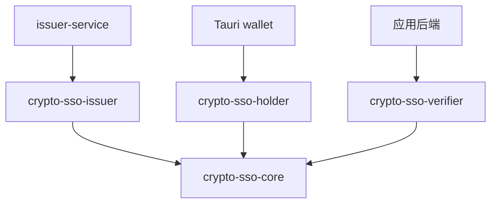

# SDK 按调用方角色拆包与对外 API 设计（v0.1）

本文定义拟实现的 Rust 调用接口与契约，当前 `sdk` 尚未实现这些接口。签名示例省略函数体；文中的数据库与 HTTP 调用属于集成方伪代码。

SDK 完成 BBS+ 盲签发、解盲、应用域化名、组合证明及验真，不读取文件、不访问网络、不维护数据库，也不创建应用会话。所有方法同步执行，时间与安全随机源由调用方显式传入。

协议基线为参考仓库 `org-anon-auth` 的提交 `ebf343609d1ba05c9e5a6043e1ba95ca4efe0188`。首版保留其 v1 域分离标签、固定参数、消息顺序、挑战规则和 JSON 线格式。SDK 版本与协议版本分别管理；Rust API 重构不自动改变协议。

## 1. 按角色划分四个 crate

`sdk/` 改为 SDK 家族的目录，使用仓库根目录现有的 Cargo workspace 管理。目录下包含三个面向调用方的角色 crate，以及一个共享基础 crate；不另建嵌套 workspace，也不保留同时导出三个角色的总入口 crate。

```text
sdk/
├── README.md
├── core/                         # crypto-sso-core
│   ├── Cargo.toml
│   └── src/
│       ├── lib.rs                # 共享值类型、协议常量、Core Error
│       ├── wire.rs               # 交换消息、严格 JSON 编解码
│       ├── origin.rs             # origin 规范化
│       ├── secret.rs             # SecretBytes
│       └── internal/             # 固定参数、转录、群元素、公共数学函数
├── issuer/                       # crypto-sso-issuer
│   ├── Cargo.toml
│   └── src/                      # Issuer、签发私密备份、签发错误
├── holder/                       # crypto-sso-holder
│   ├── Cargo.toml
│   └── src/                      # Holder、PendingEnrollment、本地秘密备份
└── verifier/                     # crypto-sso-verifier
    ├── Cargo.toml
    ├── src/                      # Verifier、ClientBindingSecret、VerifiedProof
    └── tests/
        ├── offline_flow.rs       # dev-dependencies 引入另两个角色
        └── fixtures/v1/          # 版本控制内的参考 JSON
```

| 调用方 | 直接依赖的包 | 主要能力 |
|---|---|---|
| `issuer-service` | `crypto-sso-issuer` | 初始化组织密钥、盲签发、私钥导入导出 |
| `wallet/src-tauri` | `crypto-sso-holder` | 发起申领、保存申领状态、解盲、生成证明、凭证恢复 |
| 应用程序后端 | `crypto-sso-verifier` | 创建挑战、检查客户端绑定、验证证明、返回应用内身份 |
| 三个 SDK 角色包 | `crypto-sso-core` | 共用消息、值类型、编码、协议参数和基础数学函数 |

正常依赖关系如下，箭头表示“依赖”：



三个角色包之间不建立正常依赖。holder 直接调用共享数学函数验证自己的凭证，不依赖 verifier；verifier 不依赖 holder 或 issuer。签发、解盲、证明生成和完整验真流程分别留在对应角色包，不能全部下沉进 core 再由角色包包装转发。

core 包含密码学依赖，因为组织指纹、点解码和公共参数属于共享协议。首版不再额外拆分 protocol/crypto 两个基础包。业务方依赖 verifier 时，不会引入 SDK 的签发和钱包角色实现，但仍会引入验证所需的底层密码学库。

## 2. 各角色的导出入口与类型归属

每个角色包重导出本角色调用所需的共享类型和 `wire`，因此业务方通常只需声明一个 SDK 依赖。Rust import 中将包名的连字符写成下划线。

```rust
// 签发服务
use crypto_sso_issuer::{
    Issuer, IssuerPublic, EnrollmentRequest, BlindCredential,
    IssuerId, RequestId, RequestHash, SecretBytes, Error, Result, wire,
};

// 钱包 Rust 后端
use crypto_sso_holder::{
    Holder, PendingEnrollment, IssuerPublic, EnrollmentRequest, BlindCredential,
    LoginChallenge, Presentation, Origin, IssuerId, RequestId, RequestHash, Nonce,
    SecretBytes, Error, Result, wire,
};

// 应用后端
use crypto_sso_verifier::{
    Verifier, IssuerPublic, LoginChallenge, Presentation,
    VerifiedProof, ClientBindingSecret, Origin, IssuerId, Nonce, Subject,
    Error, Result, wire,
};
```

以上三段是不同调用方的独立示例。所有随机源使用 `rand 0.8` 的 `RngCore + CryptoRng`，生产调用可使用 `rand::rngs::OsRng`。

| 定义所在包 | 定义的类型 |
|---|---|
| `crypto-sso-core` | `IssuerPublic`、`EnrollmentRequest`、`BlindCredential`、`LoginChallenge`、`Presentation`；`Origin`、`IssuerId`、`RequestId`、`RequestHash`、`Nonce`、`Subject`；`SecretBytes`、协议常量、公共编解码及基础错误 |
| `crypto-sso-issuer` | `Issuer`、签发私密备份的内部结构、签发角色的 `Error/Result` |
| `crypto-sso-holder` | `Holder`、`PendingEnrollment`、钱包私密备份的内部结构、持有角色的 `Error/Result` |
| `crypto-sso-verifier` | `Verifier`、`ClientBindingSecret`、`VerifiedProof`、验证角色的 `Error/Result` |

各角色重导出的消息是同一 core 类型，不定义 `IssuerEnrollmentRequest`、`HolderEnrollmentRequest` 等镜像结构，不需要转换，也不重复维护 JSON 格式。

各角色同时重导出 `CoreError`、`CoreResult<T>`，供调用方处理 `wire` 和值类型的公共错误。`wire` 的返回类型始终是 `CoreResult<T>`，在返回角色 `Result<T>` 的函数中可以通过 `?` 转换为本角色错误。

| 类型 | 用途 | 能否在协议参与方间传递 |
|---|---|---|
| `Issuer` | 持有签发私钥的运行时对象 | 否 |
| `IssuerPublic` | 组织标识、公钥和派生指纹 | 可向钱包和应用分发，来源必须可信 |
| `PendingEnrollment` | 用户秘密、盲因子和申领上下文 | 否，留在钱包本地 |
| `EnrollmentRequest` | 隐藏承诺及其知识证明 | 钱包 → 签发中心 |
| `BlindCredential` | 与具体申领请求绑定的盲签响应 | 签发中心 → 钱包 |
| `Holder` | 用户秘密与已验证凭证的运行时对象 | 否，留在钱包本地 |
| `LoginChallenge` | 应用创建的公开挑战 | 应用 → 钱包 |
| `ClientBindingSecret` | 独立的预登录客户端秘密 | 应用与当前浏览器通过 Cookie 交换 |
| `Presentation` | 凭证持有证明及应用域化名 | 钱包 → 应用 |
| `VerifiedProof` | 验真后的身份与挑战上下文 | 应用内部使用 |
| `SecretBytes` | 显式导出的本地秘密备份 | 仅交给本地安全存储或加密层 |

角色运行时对象、秘密类型和值类型字段私有，使用构造方法和只读访问器。五种公共交换消息作为不可信 DTO，提供 `pub` 字段以便不同 crate 构造；其中 ID、nonce、origin 等字段使用对应值类型，密码学编码保留字符串形式以匹配 v1 JSON。

这替代了先前“所有消息字段私有”的设计：Rust 的 `pub(crate)` 不能跨 crate 使用。角色方法必须重新校验传入消息，不能假设消息一定由 `wire::from_json` 创建，或在解析后从未被修改。消息解析成功不代替签发请求证明、凭证或登录证明的验真。

`Issuer`、`Holder` 和 `Verifier` 在构造或恢复时建立自己的已验证上下文并缓存组织指纹，不从可变 DTO 缓存信任判断。`VerifiedProof` 定义在 verifier 内，字段和构造入口保持私有，其他角色不能直接构造它。

`IssuerPublic`、`EnrollmentRequest`、`BlindCredential`、`LoginChallenge`、`Presentation` 支持公共消息编解码，可实现 `Clone`、`Debug`、`Eq`。`Debug` 的具体形式可以省略体积较大的密码学字段。

`Issuer`、`Holder`、`PendingEnrollment`、`ClientBindingSecret`、`SecretBytes` 不实现 `Debug`、`Clone` 或通用 Serde 序列化。秘密通过专用接口导入导出，释放时尽可能清理内存；不承诺消除进程、第三方库或操作系统中的全部副本。

core 的内部数学函数需要由不同 crate 调用，因此通过带 `#[doc(hidden)]` 的 `__private` 模块公开，文件组织在 `src/internal/` 下。Rust 不提供“仅允许某几个兄弟 crate 访问”的 `pub(crate)` 机制；这里是实现接口，不是权限边界。底层类型不出现在三个角色包的业务方法签名中。角色包精确依赖同版本 core，并共同发布升级，不对 `__private` 提供独立稳定承诺。

## 3. 基础值类型

本节类型定义在 core，签名中的 `Result` 为 core 的 `Result`。

```rust
impl Origin {
    pub fn parse(value: &str) -> Result<Self>;
    pub fn as_str(&self) -> &str;
}

// 以下值类型均提供同名方法，并实现 Eq、Hash、Clone。
impl IssuerId {
    pub fn parse(value: &str) -> Result<Self>;
    pub fn as_str(&self) -> &str;
}
// RequestId、RequestHash、Nonce、Subject 同上。
```

| 类型 | v1 编码与语义 |
|---|---|
| `IssuerId` | 32 字节的小写 hex；绑定版本、组织、公钥与固定参数 |
| `RequestId` | 32 字节随机值的小写 hex；仅用于申领 |
| `RequestHash` | 完整规范化申领请求的域分离哈希，小写 hex |
| `Nonce` | 32 字节随机值的小写 hex；作为挑战查询标识 |
| `Subject` | 非零、有效 G1 点的压缩编码，小写 hex；身份按 issuer 和 origin 解释 |

`Subject::parse` 只检查编码与群元素有效性，不赋予身份可信性。业务账号只能使用 `VerifiedProof` 返回的 subject；不能直接相信请求中声明的化名。

`Origin::parse` 沿用参考规范：

- 接受裸 HTTPS origin，以及仅供本地开发的 HTTP loopback origin。
- 规范化 scheme、host、默认端口，并使用 URL 库输出 ASCII origin。
- 拒绝用户名、密码、非根路径、查询和 fragment。
- 同一 origin 的不同业务路径共享身份，非默认端口属于不同身份域。

例如 `HTTPS://FORUM.EXAMPLE.ORG:443/` 规范化为 `https://forum.example.org`。

`IssuerId::parse` 不验证某个公钥是否属于该组织。应用和钱包仍需通过可信渠道固定 `IssuerPublic` 或其指纹。

## 4. 签发方接口：crypto-sso-issuer

```rust
impl Issuer {
    pub fn generate<R: RngCore + CryptoRng>(
        organization: &str,
        rng: &mut R,
    ) -> Result<Self>;

    pub fn public(&self) -> &IssuerPublic;
    pub fn issuer_id(&self) -> &IssuerId;

    pub fn export_secret(&self) -> Result<SecretBytes>;

    pub fn import_secret(
        bytes: &[u8],
        expected_issuer: &IssuerPublic,
    ) -> Result<Self>;

    pub fn issue_blind<R: RngCore + CryptoRng>(
        &self,
        request: &EnrollmentRequest,
        rng: &mut R,
    ) -> Result<BlindCredential>;
}

impl IssuerPublic {
    pub fn version(&self) -> u8;
    pub fn organization(&self) -> &str;
    pub fn public_key_hex(&self) -> &str;
    pub fn issuer_id(&self) -> crypto_sso_core::Result<IssuerId>;
}

impl EnrollmentRequest {
    pub fn issuer_id(&self) -> &IssuerId;
    pub fn request_id(&self) -> &RequestId;
    pub fn request_hash(&self) -> crypto_sso_core::Result<RequestHash>;
}

impl BlindCredential {
    pub fn issuer_id(&self) -> &IssuerId;
    pub fn request_id(&self) -> &RequestId;
    pub fn request_hash(&self) -> &RequestHash;
}
```

契约：

- 本节 `Issuer` 方法中的 `Result` 属于 `crypto-sso-issuer`；共享 DTO 的可失败方法显式使用 core 的 `Result`。
- 共享 DTO 可以被修改，`IssuerPublic::issuer_id` 和 `EnrollmentRequest::request_hash` 每次重新计算并返回拥有所有权的值；角色对象的 `issuer_id()` 返回自身缓存的可信指纹。
- `generate` 生成非零私钥，并验证组织名。沿用参考规则：组织名非空、最多 128 字节、无首尾空白和控制字符。
- `import_secret` 校验秘密备份版本、公私钥一致性，以及与 `expected_issuer` 的完整信任源一致性。导入不能悄悄切换组织或公钥。
- `issue_blind` 始终先检查请求版本、组织绑定、群元素、承诺开口知识证明，再执行盲签。首版不公开跳过检查的签发入口。
- `issue_blind` 不接受成员编号，也不核验自然人身份。调用它应发生在服务层完成授权以后。
- 同一请求多次调用 `issue_blind` 可以产生不同的有效盲签响应；SDK 不保证签发幂等。
- `request_hash` 使用固定的 v1 结构重序列化后计算，保持参考协议的字段顺序与编码。JSON 文本的空白或输入字段顺序不改变结果；不直接哈希原始 HTTP body。它是访问器，不能向参考 JSON 额外添加字段。

签发服务的台账应在事务中同时约束成员与请求的唯一性。对同一已授权成员、同一请求的重试，返回保存的同一份响应；同一成员换请求、同一请求换成员必须拒绝。只比较 `request_id` 不足以识别完整请求。

## 5. 钱包持有方接口：crypto-sso-holder

```rust
impl Holder {
    pub fn begin_enrollment<R: RngCore + CryptoRng>(
        trusted_issuer: &IssuerPublic,
        rng: &mut R,
    ) -> Result<(PendingEnrollment, EnrollmentRequest)>;

    pub fn issuer(&self) -> &IssuerPublic;
    pub fn issuer_id(&self) -> &IssuerId;

    pub fn present<R: RngCore + CryptoRng>(
        &self,
        challenge: &LoginChallenge,
        trusted_origin: &Origin,
        now: u64,
        rng: &mut R,
    ) -> Result<Presentation>;

    pub fn export_secret(&self) -> Result<SecretBytes>;

    pub fn import_secret(
        bytes: &[u8],
        expected_issuer: &IssuerPublic,
    ) -> Result<Self>;
}

impl PendingEnrollment {
    pub fn issuer_id(&self) -> &IssuerId;
    pub fn request_id(&self) -> &RequestId;
    pub fn request_hash(&self) -> &RequestHash;

    pub fn finish(&self, response: &BlindCredential) -> Result<Holder>;

    pub fn export_secret(&self) -> Result<SecretBytes>;

    pub fn import_secret(
        bytes: &[u8],
        expected_issuer: &IssuerPublic,
    ) -> Result<Self>;
}
```

契约：

- 首版一个 `Holder` 对应一个签发组织及其凭证，内部持有随机秘密 `x` 和已验证签名，不提供读取 `x` 的独立方法。
- 每次 `begin_enrollment` 都生成新的秘密、盲因子和请求标识。重新申领会改变应用身份；恢复身份应导入既有 `Holder` 备份。
- 钱包应先安全保存 pending 状态和对应请求，再发送请求。pending 包含解盲必需数据，不能发送给签发中心。
- `finish` 检查 issuer、request ID、request hash，完成解盲并验证最终签名。收到别人的响应、元数据被篡改或签名不成立时返回错误。
- `finish` 借用 pending，不在错误时销毁它，也不隐式删除本地备份。钱包先持久化新 `Holder`，成功后再清理 pending；这样可以恢复网络重试和保存失败。
- pending 秘密导入时校验字段、非零秘密与预期信任源；它不包含完整请求，不能单独证明请求哈希正确，最终由 `finish` 的绑定检查和签名验证确认。
- `Holder::import_secret` 校验组织绑定、非零秘密和凭证签名，失败时不创建可用的 `Holder`。
- `present` 校验组织、可信 origin 和挑战时效，并将完整挑战绑定进证明。相同挑战下重复调用仍生成新的随机化证明，但应用化名相同。
- `trusted_origin` 来自钱包的可信交互或浏览器集成，不得直接从挑战复制。SDK 能检查两者相等，不能替钱包确认浏览器正在访问哪个站点。

`Holder`、pending 和签发私钥的导入导出使用与参考类型对应的 v1 私密 JSON 格式。它们只通过秘密接口操作，不属于公共消息编解码集合。

## 6. 应用验证方接口：crypto-sso-verifier

```rust
impl Verifier {
    pub fn new(
        trusted_issuer: IssuerPublic,
        origin: Origin,
    ) -> Result<Self>;

    pub fn issuer_id(&self) -> &IssuerId;
    pub fn origin(&self) -> &Origin;

    pub fn create_challenge<R: RngCore + CryptoRng>(
        &self,
        now: u64,
        rng: &mut R,
    ) -> Result<(LoginChallenge, ClientBindingSecret)>;

    pub fn verify_proof(
        &self,
        presentation: &Presentation,
        stored_challenge: &LoginChallenge,
        client_binding: &ClientBindingSecret,
        now: u64,
    ) -> Result<VerifiedProof>;
}

impl LoginChallenge {
    pub fn version(&self) -> u8;
    pub fn issuer_id(&self) -> &IssuerId;
    pub fn origin(&self) -> &Origin;
    pub fn nonce(&self) -> &Nonce;
    pub fn issued_at(&self) -> u64;
    pub fn expires_at(&self) -> u64;
}

impl Presentation {
    pub fn challenge(&self) -> &LoginChallenge;
}

impl ClientBindingSecret {
    pub fn from_cookie_value(value: &str) -> Result<Self>;
    pub fn expose_cookie_value(&self) -> &str;
}

#[must_use]
pub struct VerifiedProof { /* private */ }

impl VerifiedProof {
    pub fn subject(&self) -> &Subject;
    pub fn challenge(&self) -> &LoginChallenge;
}
```

`Verifier` 在构造时固定信任源和应用 origin，后续验真不从请求中选择它们。建议缓存可安全复用的参数、已校验公钥与该 origin 的化名基点。

`create_challenge`：

1. 生成独立的 256 位 nonce 和 256 位客户端秘密。
2. 创建 120 秒有效的挑战，并绑定客户端秘密的域分离哈希。
3. 返回挑战和客户端秘密，不自动保存任何状态。

应用保存完整挑战；只向钱包传递挑战。客户端秘密通过应用自己的 HttpOnly 预登录 Cookie 下发，生产环境同时设置 Secure，默认使用 SameSite=Strict。钱包不需要读取该秘密。

`verify_proof` 按以下顺序执行：

1. 检查 presentation 中完整挑战与 `stored_challenge` 完全一致。
2. 检查版本、预配置 issuer 和 origin。
3. 检查时间关系与 nonce、客户端绑定格式；客户端秘密必须匹配挑战中的哈希。
4. 检查点编码、子群、非零化名、证明结构和大小限制。
5. 验证 BBS+ 持有证明，以及复用同一秘密响应的化名关系。
6. 返回仅由 SDK 创建的 `VerifiedProof`。

公共 JSON 中 `audience` 等字段名仍保持参考格式；Rust 的 `origin()` 访问器不改变线格式。

`stored_challenge` 必须来自应用自己的待处理挑战存储，不能直接使用请求中的挑战副本。客户端 Cookie 也必须来自本次 HTTP 请求的独立 Cookie，而不是 presentation 的字段。

`verify_proof` 不查询挑战是否存在或已消费。同一份有效证明可以多次通过无状态验真；应用必须在其后通过数据库条件更新或删除，让同一挑战只有一个成功者。SDK 不提供名为 `login` 或 `authenticate` 的无状态便捷方法。

## 7. 时间与资源约束

```rust
pub const PROTOCOL_VERSION: u8 = 1;
pub const MAX_CHALLENGE_TTL_SECS: u64 = 120;
pub const MAX_FUTURE_SKEW_SECS: u64 = 30;
pub const MAX_MESSAGE_BYTES: usize = 16 * 1024;
```

`now`、`issued_at`、`expires_at` 均为 Unix 秒，使用 `u64`。所有加减法检查溢出。

- 创建挑战固定使用 120 秒 TTL；首版不开放任意有效期配置。
- 验证时要求 `0 < expires_at - issued_at <= 120`。
- `now >= expires_at` 立即失效；允许签发时间最多领先当前时间 30 秒。
- 钱包使用设备当前时间；应用使用服务器当前时间。只有测试使用固定时钟。
- HTTP 和异步框架应在阻塞任务池中调用证明生成、验真方法，并在入口限制请求大小与并发量。

验真结束后到原子消费之间，应用应重新读取当前时间，并在消费条件中再次检查有效期。不要仅凭进入验真前的时间创建会话。

## 8. 公共消息编解码与秘密备份

以下入口定义在 `crypto-sso-core`，并由三个角色包重导出。此处 `Result` 为 core 的 `Result`。

```rust
pub mod wire {
    // 封闭 trait，仅 SDK 定义的五种公共交换消息可以实现。
    pub trait WireMessage: private::Sealed {}

    pub fn to_json<T: WireMessage>(value: &T) -> Result<Vec<u8>>;
    pub fn from_json<T: WireMessage>(bytes: &[u8]) -> Result<T>;
}

impl SecretBytes {
    pub fn from_vec(bytes: Vec<u8>) -> Self;
    pub fn expose_secret(&self) -> &[u8];
}
```

公共消息集合为 `IssuerPublic`、`EnrollmentRequest`、`BlindCredential`、`LoginChallenge`、`Presentation`。`to_json` 输出紧凑的 v1 JSON，`from_json` 先检查总字节数，再按封闭结构解析与校验。

解析必须拒绝未知或重复字段、非支持版本、非规范 hex、无效群元素、尾随字节、超长字段及非法证明结构。对证明内嵌的可变长度容器，也必须限制其长度和分配量，不能只限制外层字符串长度。

JSON 中的 origin 必须已经是规范形式，解析时与规范化结果比较，不静默改写输入；只有业务配置调用 `Origin::parse` 时接受并规范化大小写、默认端口等形式，以保持参考 v1 挑战校验行为。

首版不为公共消息提供绕过这些检查的通用 `Deserialize` 入口。HTTP 框架先读取有上限的 body，再调用 `wire::from_json`；文件读取也由调用方先限制大小。内部 Serde DTO 不导出。

`export_secret` 返回的 `SecretBytes` 是未加密的秘密 JSON，调用方应直接交给本地加密或安全存储层。`import_secret` 同样先限制大小再检查数据。SDK 不替调用方清理传入切片对应的内存。

`SecretBytes::from_vec` 转移字节缓冲区的所有权，方便各角色包构造擦除容器；它不校验凭证或秘密格式，也不等于导入秘密。三个角色的私密备份格式、校验和导入导出逻辑各自保留在所属角色包，core 不定义含 issuer 私钥或 holder 主秘密的备份 DTO。

Cookie 使用独立的 `ClientBindingSecret` 导入导出接口。该秘密是固定 32 字节的小写 hex，不能混用为应用登录后的会话令牌。

## 9. 分包错误接口

每个角色包有自己的 `Error` 和 `Result<T>`，只暴露该角色实际可能产生的错误。它们可以包装 core 的公共错误，并通过 `source()` 保留错误链；三个角色的错误类型不合并成总枚举。

```rust
// crypto-sso-core::Error
#[non_exhaustive]
pub enum Error {
    UnsupportedVersion { found: u8 },
    InputTooLarge { limit: usize },
    InvalidEncoding { field: &'static str },
    InvalidIssuer,
    InvalidOrigin,
    Serialization,
    Crypto,
}

// crypto-sso-issuer::Error
#[non_exhaustive]
pub enum Error {
    Core(crypto_sso_core::Error),
    IssuerMismatch,
    InvalidEnrollmentProof,
}

// crypto-sso-holder::Error
#[non_exhaustive]
pub enum Error {
    Core(crypto_sso_core::Error),
    IssuerMismatch,
    OriginMismatch,
    EnrollmentMismatch,
    InvalidCredential,
    InvalidChallengeTime,
    ChallengeExpired,
    ProofGeneration,
}

// crypto-sso-verifier::Error
#[non_exhaustive]
pub enum Error {
    Core(crypto_sso_core::Error),
    IssuerMismatch,
    OriginMismatch,
    ChallengeMismatch,
    InvalidChallengeTime,
    ChallengeExpired,
    ClientBindingMismatch,
    InvalidPresentation,
}

// 每个包分别定义。
pub type Result<T> = std::result::Result<T, Error>;
```

以上代码块分别属于不同 crate。各 `Error` 实现 `std::error::Error` 与 `Display`，并实现从 core 错误的转换；不包含原始秘密、原始输入或敏感密码学中间值。core 的 `Crypto` 表示基础数学运算失败，不暴露底层秘密中间值。

- `EnrollmentMismatch` 表示盲签响应与本地 pending 的请求上下文不一致。
- `InvalidCredential` 表示签名与持有秘密、组织绑定不成立。
- `ChallengeMismatch` 表示请求携带的完整挑战与应用保存的挑战不同。
- `InvalidChallengeTime` 包括错误时间顺序、过长 TTL、未来时间和时间溢出。
- `InvalidPresentation` 包括无效 BBS+ 证明与共享秘密关系不成立。

不存在 `Database`、`Io`、`AlreadyIssued`、`Replay` 或 `Session` 等 SDK 错误：它们由对应服务层定义。SDK 不能判断挑战是否已经消费，也不能判断某自然人是否已经申领。

## 10. 三方调用示例

以下展示依赖关系和调用顺序，省略应用错误转换、事务实现、Cookie 设置与加密存储实现。

```rust
// 跨角色流程用于 SDK 集成测试；业务方通常只导入自己的角色包。
use crypto_sso_issuer::{Issuer, EnrollmentRequest};
use crypto_sso_holder::{Holder, PendingEnrollment, BlindCredential};
use crypto_sso_verifier::{
    Verifier, ClientBindingSecret, Origin, LoginChallenge, Presentation, wire,
};
use rand::rngs::OsRng;

// 初始化并可信分发组织公钥。
let mut rng = OsRng;
let issuer = Issuer::generate("example-org", &mut rng)?;
let public = issuer.public().clone();
let public_json = wire::to_json(&public)?;
let issuer_backup = issuer.export_secret()?;
// 管理员安全保存 issuer_backup，将 public_json 通过可信渠道分发。

// 钱包发起申领，先持久化 pending 与对应 request。
let (pending, request) = Holder::begin_enrollment(&public, &mut rng)?;
let pending_backup = pending.export_secret()?;
let request_json = wire::to_json(&request)?;
// 安全保存 pending_backup 和 request_json，然后发送 request_json。

// 签发服务完成身份核验与授权，并在台账事务中执行。
let request: EnrollmentRequest = wire::from_json(&request_json)?;
let request_hash = request.request_hash()?;
// 先按成员和 request_hash 检查唯一性及已保存的幂等响应。
let blind = issuer.issue_blind(&request, &mut rng)?;
let response_json = wire::to_json(&blind)?;
// 将 response_json 与签发记录一起持久化提交，再返回响应。

// 钱包恢复 pending、接收响应并完成申领。
let pending = PendingEnrollment::import_secret(
    pending_backup.expose_secret(), &public,
)?;
let blind: BlindCredential = wire::from_json(&response_json)?;
let holder = pending.finish(&blind)?;
let holder_backup = holder.export_secret()?;
// 安全保存 holder_backup，成功后清理 pending 及其本地备份。

// 应用只持有公钥，创建挑战。
let app_origin = Origin::parse("https://forum.example.org")?;
let verifier = Verifier::new(public.clone(), app_origin)?;
let (challenge, client_binding) = verifier.create_challenge(now, &mut rng)?;
let challenge_json = wire::to_json(&challenge)?;
// 先按 challenge.nonce() 保存完整 challenge_json 和有效期。
// 通过 HttpOnly Cookie 设置 client_binding.expose_cookie_value()。
// HTTP body 只返回 challenge_json。

// 钱包从独立可信来源确定 origin，并生成证明。
let trusted_origin = Origin::parse("https://forum.example.org")?;
let challenge: LoginChallenge = wire::from_json(&challenge_json)?;
let presentation = holder.present(&challenge, &trusted_origin, now, &mut rng)?;
let presentation_json = wire::to_json(&presentation)?;
// 浏览器向应用提交 presentation_json，同时自动携带自己的 Cookie。
```

应用接收证明后的完整步骤必须包括状态消费：

```rust
// 这里的 request_body、cookie_value、store 与 sessions 来自应用层。
let presentation: Presentation = wire::from_json(request_body)?;
let stored_json = store.load_pending(presentation.challenge().nonce())?;
let stored_challenge: LoginChallenge = wire::from_json(&stored_json)?;
let binding = ClientBindingSecret::from_cookie_value(cookie_value)?;

let verified = verifier.verify_proof(
    &presentation, &stored_challenge, &binding, current_unix_seconds(),
)?;

// 以下为数据库伪代码。昂贵验真发生在事务锁之外。
let tx = store.begin_transaction()?;
let commit_now = current_unix_seconds();
let consumed = tx.consume_if_pending_and_unexpired(
    verified.challenge(), commit_now,
)?;
if !consumed {
    return Err(AppError::ChallengeUnavailable);
}
// 消费必须匹配同一 nonce 的完整挑战记录，并检查 expires_at > commit_now。
// 会话创建与挑战消费一起提交；竞争同一挑战的请求只能有一个成功。
let session = sessions.create_in_transaction(
    &tx, verified.subject(), commit_now,
)?;
tx.commit()?;
// 提交成功后，才给浏览器设置应用会话 Cookie。
```

真实签发中心和应用可运行于不同机器；示例中共享变量只用于说明交换内容。完成领证后，钱包生成证明与应用验真均不需要签发中心或其私钥。

## 11. Workspace 与调用方依赖配置

当前 `sdk` 模板 crate 在实际实施时移除或迁移到上述四个目录，`sdk/` 本身只作为目录，不再有 `[package]` 或第二个 `[workspace]`。本次方案修订只更新设计文档，尚未修改实际 manifest。

仓库根目录的目标配置：

```toml
[workspace]
resolver = "3"
members = [
    "sdk/core",
    "sdk/issuer",
    "sdk/holder",
    "sdk/verifier",
    "issuer-service",
    "wallet/src-tauri",
    "dev-utils",
]
```

调用方分别配置依赖：

```toml
# issuer-service/Cargo.toml
[dependencies]
crypto-sso-issuer = { version = "0.1.0", path = "../sdk/issuer" }

# wallet/src-tauri/Cargo.toml
[dependencies]
crypto-sso-holder = { version = "0.1.0", path = "../../sdk/holder" }

# 外部应用后端：正式发布后从 registry 获取。
[dependencies]
crypto-sso-verifier = "0.1.0"
```

SDK 内部三个角色的正常依赖都指向 core；例如 verifier：

```toml
# sdk/verifier/Cargo.toml
[dependencies]
crypto-sso-core = { version = "=0.1.0", path = "../core" }

[dev-dependencies]
crypto-sso-issuer = { version = "=0.1.0", path = "../issuer" }
crypto-sso-holder = { version = "=0.1.0", path = "../holder" }
```

dev-dependencies 只为 verifier 的三方集成测试服务，不进入应用后端的正常依赖图。core 不反向依赖任何角色包，其他角色也不通过 dev-dependencies 反向引入 verifier，保持测试依赖清晰。

SDK 内部版本同步发布，先发布 core，再发布三个角色包。生产依赖保留 `version` 和 `path`，以便本地 workspace 开发与后续 registry 发布。不能把 role crate 的正常依赖 core 标为 `publish = false` 后又直接发布 role crate。

将完整三方测试和参考 JSON 放在 `sdk/verifier/tests/` 内，使测试数据进入该包的发布产物；不依赖 workspace 外层文件，也不另外增加一个只为首版示例服务的聚合 crate。每个角色另外维护自己的单元测试和边界测试。

## 12. 实现顺序、验收与边界

实施顺序：

1. 建立四个 crate、统一依赖版本与根 workspace 成员，删除原始 sdk 模板。
2. 实现 core 的 v1 消息、值类型、严格编解码、公共数学函数和 SecretBytes。
3. 实现 issuer 与 holder，完成盲签发、pending 保存恢复和本地解盲。
4. 实现 verifier 与 holder 的证明生成，完成应用挑战、客户端绑定和组合证明验真。
5. 在 verifier 的 dev-dependencies 集成测试中跑通三方流程，重验参考 JSON。
6. 通过 `cargo tree -p <角色包> -e normal` 检查正常依赖；三个角色之间不能出现依赖边。

各 SDK 包分别执行测试与静态检查，例如 `cargo test -p crypto-sso-core -p crypto-sso-issuer -p crypto-sso-holder -p crypto-sso-verifier`。不以整个 Tauri workspace 的构建代替 SDK 自身检查。

- 三方接口完成盲签发、解盲和离线证明验真。
- 秘密对象的导出、恢复、错误响应重试和凭证导入验证有测试。
- 相同应用 subject 稳定，不同应用与不同用户 subject 不同；重复证明随机化。
- 错误 issuer、origin、客户端绑定、挑战字段和时间均被拒绝。
- BBS+ 证明有效但化名使用另一个秘密的对抗样例被拒绝。
- 从 SDK 自带 testdata 重验参考 v1 JSON；测试不依赖被 Git 忽略的 references 目录。
- SDK 测试证明无状态验真可能重复成功；服务层测试另行证明并发消费只有一个成功者。

首版没有撤销、凭证有效期、组织密钥轮换迁移或主秘密恢复授权。应用会话与挑战的过期不等于撤销凭证。SDK 不证明自然人唯一性，也不能阻止用户主动复制秘密。

参考源码提取时保留 Apache-2.0 许可和归属信息，并标注修改。
